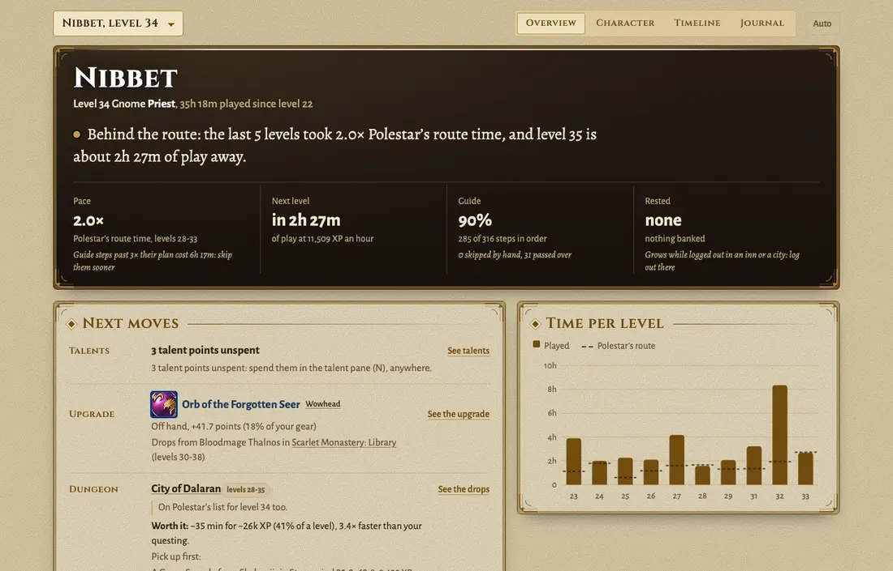

# wow-stats

A levelling log for World of Warcraft: Forever, with an MCP server so your own AI assistant
can read it.

A small program on the computer you play on reads what the game and your addons already save.
A server you run turns it into your climb: time per level against Polestar's route, where the
hours went, the next upgrade per slot and where it drops, the dungeons worth running, deaths,
one journal entry per play session, a plan for your next two hours. Claude, ChatGPT or any
MCP client can ask about it, and the server re-runs the SQL behind every number your assistant
wants to keep.

It runs on your computer or a small box at home. Nothing goes anywhere else unless you set it
up that way.



**[Live demo](https://sam-dumont.github.io/wow-mcp/demo/)**: Nibbet-Gearholt, an invented Gnome
priest, no install (online once the repository is public).

## Three ways in

1. **[Try the demo](docs/self-host/demo.md)**: Docker and five made-up characters on your
   computer, about 10 minutes, no game needed.
2. **[Track my character](docs/install.md)**: run the server, add the addons and the small
   program on the computer you play on.
3. **[Join a friend's server](docs/players/getting-started.md)**: someone runs it for you and
   sent you a link. Nothing from this repository needed.

Then, for your AI: **[Connect your AI](docs/ai/connect.md)**. Everything else is in
**[the manual](docs/README.md)**, also on the [docs site](https://sam-dumont.github.io/wow-mcp/).

## The demo in two commands

With [Docker](https://docs.docker.com/get-docker/) running, from the top of a copy of this
repository (Mac, Linux, or Git Bash on Windows):

```sh
cd deploy/compose && export INGEST_PASSWORD=demo-password-only
docker compose up -d --build ui && docker compose exec -T ui python - --vl http://victorialogs:9428 < ../../dev/seed.py
```

The first run builds the image, a minute or two. It ends with
`1831 events into http://victorialogs:9428`. Open <http://127.0.0.1:8080/>: five made-up
characters, each with a DEMO DATA banner. `docker compose down -v` removes it all.
PowerShell, a port already taken, or the sites for friends: [Try the demo](docs/self-host/demo.md).

## How it fits together

```
 the PC you play on                      your server (docker compose)
 the shipper  ---POST over HTTPS--->  ui :8080  ---> VictoriaLogs (your events, kept)
   every 5 min, reads WTF/ and Logs/     |  your page (the full view, behind your login)
                                         |  /mcp for your AI assistant
                                         +-- publish + site :8081: static copies for friends
                                         +-- optional: exporter ---> VictoriaMetrics
                                             (Battle.net data, 23 days)
```

- **Your data stays yours.** Your page shows everything, behind your login. Friends get a
  sealed copy with a key in the link; anyone gets a public copy cut to an allow list. Neither
  ever shows other players, what killed you, or where you are now.
  [Privacy tiers](docs/explanation/privacy.md).
- **No model on the server.** Your assistant does the thinking, in your own account; the
  server hands it data and checks its numbers. [Ask about your character](docs/ai/asking.md).
- **Known addons only.** It reads [Polestar](https://github.com/fitzforge/polestar) and other
  well-known addons; it never asks you to install one of its own. [Addons](docs/reference/addons.md).
- **Small.** One player fits in 2 vCPU and 2 GiB of RAM; a year of events takes a few MiB.
  [Sizing](docs/self-host/sizing.md).

## The manual

| You are | Start here |
|---|---|
| A player a friend invited | [Join a friend's server](docs/players/getting-started.md), then [your page, tab by tab](docs/players/your-page.md) and [something's wrong](docs/players/troubleshooting.md) |
| Running your own server | [Try the demo](docs/self-host/demo.md), [install it](docs/install.md), then [run it on a server](docs/self-host/production.md) |
| Using an AI assistant | [Connect your AI](docs/ai/connect.md), [ask about your character](docs/ai/asking.md), [every tool](docs/reference/mcp-tools.md) |
| Contributing | [Development](docs/development.md), [architecture](docs/architecture.md), [CONTRIBUTING.md](CONTRIBUTING.md), [SECURITY.md](SECURITY.md), [CODE_OF_CONDUCT.md](CODE_OF_CONDUCT.md) |

What changed in each version: [CHANGELOG.md](CHANGELOG.md).

## License

GPL-3.0-only ([LICENSE](LICENSE)). The kit ships route times and gear data
made from [Polestar](https://github.com/fitzforge/polestar) (GPL-3.0-only) and
its quest database forever-db (GPL-3.0), so it is GPL too. Thanks to
fitzforge and Polestar's contributors: the route clock and the gear scoring
are theirs. The gear data carries parts under MIT, from ForeverLevelingBiS
v0.12.0-beta by Thunder and from wowsims: their notices are in
[THIRD_PARTY.md](THIRD_PARTY.md).

The images (`/app/LICENSE`) and the shipper's installers (`LICENSE` next to
the installed script) carry the license and name the source they were built
from: this repository at the matching tag, `<SOURCE_URL>/tree/v<version>`,
where `SOURCE_URL` is `wowstats.SOURCE_URL` (pyproject's `[project.urls]`
`Source`).

The page's fonts (Cinzel, Alegreya, Alegreya Sans) are under the SIL Open
Font License, their licence files in `web/fonts/`.

World of Warcraft is a trademark of Blizzard Entertainment. Item names,
icons and models the server fetches stay Blizzard's: this kit doesn't
bundle them.
