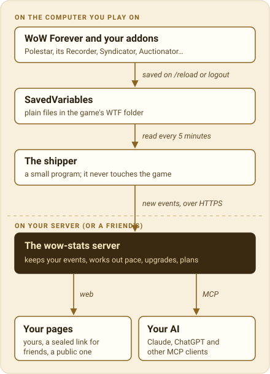

# How it works

**For:** anyone deciding whether wow-stats is for them. **At the end:** you know what runs
where, what leaves your computer, and which page to read next.

wow-stats never talks to the game. WoW Forever and a few well-known addons already write down
what you do: levels, quests, loot, deaths, gear, auction prices. wow-stats reads those files
after the game saves them, and turns them into pages you can act on.

## The four pieces

**The addons.** [Polestar](https://github.com/fitzforge/polestar) and its Recorder do most of
the work: route steps, levels, sessions, zones, deaths. The optional ones each add one part
(bags, auction scans, older quests, talent history). wow-stats ships no addon of its own.
The full list, with what each one adds: [Addons it reads](../reference/addons.md).

**SavedVariables.** That's where addons keep their data: plain text files in the game's `WTF`
folder. WoW writes them only when you `/reload`, log out or switch character. A crash or
Alt+F4 loses what happened since the last save, for every addon. So the one habit worth
having: `/reload` after a dungeon, an auction house scan, or before a break.

**The shipper.** A small program on the computer you play on. Every 5 minutes it reads what
changed in `WTF` (and the combat log, if you turned it on), turns it into events and sends them
to your server with your own upload password. It keeps a copy of everything it sent in a
`WoWArchive` folder in your home folder. Other players you met leave your computer as a name,
when, where and how you met them, nothing more. It never reads your WoW or Battle.net password, and
nothing outside the WoW folder. [What it sends](../players/privacy.md#what-leaves-your-computer).

**The server.** One `docker compose up` on a small box: 2 vCPU and 2 GiB of RAM run it for
one player, and a year of one player's events takes a few MiB. It keeps the events
and works out everything else from them each time new ones arrive: pace, upgrades,
dungeons, plans. Someone you know can run it for you, and then you skip this part.

## What you get out of it

**Your page.** Behind your login, with everything: your pace against Polestar's route, the
next upgrade per slot and where it drops, the dungeon worth running, your climb, one journal
entry per play session. A tour: [Your page at a glance](../players/your-page.md).

**Pages for others, if you want them.** A sealed copy for the friends you pick (encrypted, with
the key in the link, which your browser never sends to the web server) and a public one cut down to an allow list. Neither
ever shows other players, what killed you, or where your character is right now.
[What's shared](../players/privacy.md).

**Your AI.** The server speaks MCP, the protocol Claude, ChatGPT and a dozen other assistants
use to call outside tools. The tools work out each answer in code from your data, the same
numbers as your page: where you stand, time per level, your sessions, the dungeon worth a run,
your next upgrade, a plan for the next hours. Your assistant picks them and writes the reply in
your own account; wow-stats never sees the conversation. [Connect your AI](../ai/connect.md).

On top of that, optional: the play analysis. Your assistant asks its own questions of your
data, and the server keeps a finding only once its query re-runs to the same numbers, writes
the measured ones into the text itself, and checks it again each night. You can ask to see
that query. A host can also have the server run the analysis itself, with an AI provider they
pay for, once a character has {{analysis_hours}} hours of play since its last refresh (the host can pick
another number). Your AI never starts one of those runs:
[Server-side analysis](../self-host/server-analysis.md).

**Battle.net data, optional.** With your own Battle.net API client, the server also fetches,
every 2 hours, your character's look, talents and worn gear (the 3D view and your character's picture use
the look; the rest fills what the addons didn't send) and the WoW Token price; never
the auction house, whose prices come from your own Auctionator scans. Blizzard's terms cap that data at 30 days, so it lives in its own store with a 23-day
retention. [Battle.net data](../self-host/battlenet.md).

## Where to go next

- A friend sent you a link: [Join a friend's server](../players/getting-started.md).
- You want to see it first: [the live demo](../../site/pages/demo.md), a made-up priest.
- You want to run it: the [quick start](../quickstart.md), 10 minutes with Docker.
- The parts in detail, for the curious: [Architecture](../architecture.md).
