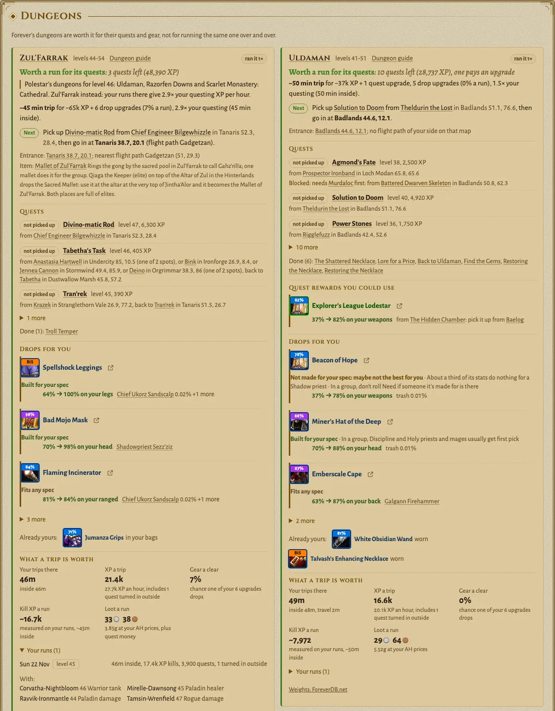

# Dungeons

**For:** players with a wow-stats page. **At the end:** you know which dungeon to run at your
level, what to do before you go, and what to expect from one run.

The Dungeons section is in the Character tab: a card for every dungeon around your level. The
one worth running now is also the Overview's Dungeon move.

## What to do with it

1. Start with the dungeon of the Overview's Dungeon move. Comparing two cards: take the one
   with more upgrades and the higher "× your questing".
2. Do its **Next** line first: the quests picked up before you go add their XP and rewards
   to the same run.
3. Back from a run, `/reload`: the run, its loot and its time land on the card within
   5 minutes.

A card, top to bottom

**The header**: the dungeon, its level range, a link to its dungeon guide, and how many
times you ran it ("ran it 1×").

**The verdict**: the short answer, like "2 quests left (18,800 XP), and 12 missing upgrades at
98% a clear", then the trip in one line: "~2h15 trip for ~58k XP + 4 quest upgrades, at least one of 9 drop upgrades drops: 88% a
run, 1.8× your questing (20 min pickups · 1h15 inside · 15 min hand-ins · 20 min to find a group (assumed))". The last part is a guess: 20 minutes to find a group, counted in every trip because nothing records it. Quest upgrades come
for sure with the quests; drop upgrades are the ones that can drop, with the chance one does. Above 1×, the run levels you faster than questing.
The trip starts where you were last seen: the quests to pick up on the way (Polestar's pick-up
rules, the same ones its "Pick up the quests" guide follows), the walk or flight to the door, the
run, and the hand-ins after, at your pace: your past trips took longer than Polestar's
straight run (you stop, wander, come back for a forgotten hand-in), so these parts are
stretched by how much longer, measured on your own trips. Your own runs there replace each part they
saw with what they measured. A part they didn't see (you logged in at the door, or handed a quest in
hours later) comes from the rules instead, never as 0 minutes. When nothing can time a part, the
line gives the quests' XP without a trip time or a "×". For a
dungeon you haven't run, the time inside and the kill XP are estimates ([Dungeon kill
XP](../dungeon-xp.md)) and count in the "×".

**Wings**: Scarlet Monastery, Dire Maul, Blackrock Spire, Stratholme and Maraudon are run in
parts, so each part gets its own card ("Scarlet Monastery: Library"), with its own level range,
quests, drops, key and trip. A quest that needs two wings (Into The Scarlet Monastery wants
bosses in three) shows on each of them. Your runs count for the wing where your kills were.

**Next**: the one thing to do before going in, like "Pick up A Green Sample from Shylamiir,
then go in at Alterac Mountains 14.7, 63".

**Quests**: every quest for that dungeon and what to do about it: who gives it, hand it in, or
what it needs first. **Done** lists the ones you already finished, worked out from everything
your addons ever saved and the gear you wear.

**Quest rewards you could use** and **Drops for you**: each item with the same badge as your
gear and what it does to its slot ("70% → 91% on your chest"), plus the quest, or the boss and
its drop chance. Forever's newest dungeons list each boss's drops without a badge until the
item data has them.

**Already yours**: drops you have, worn or looted ("looted" may mean sold since, without
Syndicator).

**What a trip is worth** and **Your runs**: from your own runs there, the time and the loot's
value, plus "Gear a clear": the chance a clear drops at least one of your upgrades ("17%: at least
one of 3 drop upgrades drops"). A rate counted over fewer than 5 kills is not a rate: that drop
counts as unknown, never as a sure thing.

**Who was with you**: under each of your runs, the players in your party, with their level,
class and role. The names come from the combat log when it was on, or from ForeverDB_Helper
(ForeverDB.net's addon) if you use it; without either the game saves no names. "2 of 4 names
known" means the party had more players than were named. Only you see them: friends' links and
the public page leave the party out.

**XP a trip** counts the dungeon's quests with the run they came from, even when you hand them in
outside: City of Dalaran's at the Silverpine grate, the Stockade's in Stormwind. It says how many
("includes 2 quests turned in outside"). A quest handed in more than a day after the run, or
picked up after it, stays with the zone you handed it in
([how](../dungeon-xp.md#quests-handed-in-outside)).

## Next

- [Gear and upgrades](gear.md): the same drops, next to the quests and the auction house.
- [Plan your next hours](plan.md): with or without the dungeon.
