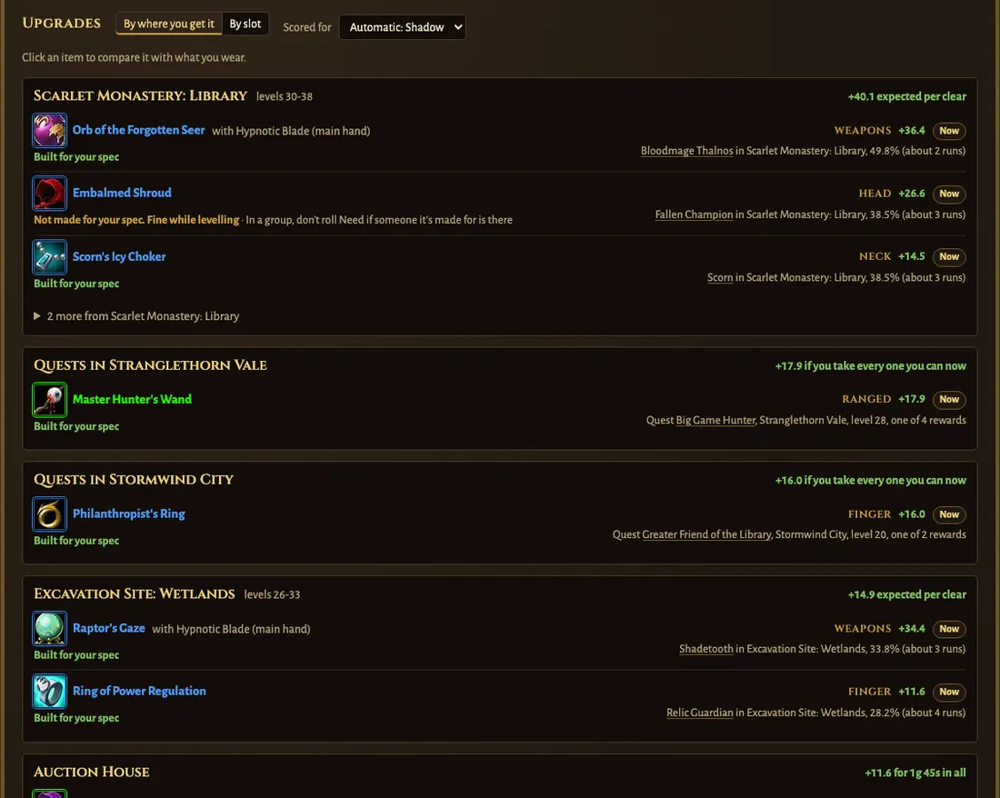

# Gear and upgrades

**For:** players with a wow-stats page. **At the end:** you know which item to chase next,
where it comes from, and whether to buy it instead.

Everything here is in the Character tab: your gear at the top, the upgrades under it.

## Your gear

Every slot shows what you wear and its item level. Under it, in green:

- **"+14% at hand"**: there's an upgrade you can get now, 14% closer to that slot's best.
  Click the item to compare the two.
- **"something to wear"**: the slot is empty and anything would help.

On the icon (and beside it on a wide screen), where the item stands against the best you can
wear at your level for that slot: **BiS** (it's the best), **2nd** (one item beats it), or
**62%** (its share of the best one's points). Nothing when there's nothing to compare it with.
Rings and trinkets count the best two.

Hover or tap an item for its card. Under the slots: your average item level and your
professions. Items Forever added that no item data covers yet get their card (item level,
stats) from your own game's files, sent by the program on your computer; they aren't counted
in points until the item data has them.

## Points

Upgrades are counted in Polestar's points, one score per item for your class and talents, so
a ring and a helmet compare. The page says them against the slot's best: every item, here, on
the Overview and in the Dungeons panel, has the badge from the paperdoll on its icon (its share
of BiS, same colours) and "+18% on your head", how much closer to BiS it takes that slot. A
3% step is a nice-to-have, an 18% one is worth a trip. An item with nothing to measure it
against keeps its points. **Scored for**, at the top, picks the spec
("Automatic" follows your talents); pick another to see the upgrades for a respec.

## The upgrades list

Two ways to read it, switched at the top:

Each upgrade also says what it does in BiS terms: "62% → 100% of BiS" takes that slot from
62% of the best to the best itself. The order follows it: the slot furthest from its best
first, and within a slot the item that closes most of the gap.

**By where you get it** (the default) groups the upgrades by trip: one dungeon, the quests of
one zone, a profession, the auction house, the best trip on top. A dungeon says "+39.0
expected per clear" (its bosses' drop chances counted), quests "+15.8 if you take every one
you can now". Each item says the slot, the points, the boss and its drop chance.

**By slot** lists the best item per slot, the slot furthest from BiS first: the best you can
wear now, and the next one within 3 levels when it beats it. The pills: **Now** (you can wear it), **Level 35** (not yet),
**cheap** (on the auction house for at most what you earn in a level).

## The auction house

Scan the auction house with Auctionator, then `/reload`: within 5 minutes, upgrades on sale
show in an **Auction House** group with the price and its share of your gold ("1g 45s (7% of
your gold)"), from today's or yesterday's scan. An item that also drops in a dungeon says
both: a few runs at a 30% drop chance, or 1g now.

## What to do with it

1. Take the top group in "By where you get it": the trip worth the most points.
2. Before a dungeon, read its card in [Dungeons](dungeons.md): the quests to pick up first make
   the run worth more.
3. "In your bags: equip it" means you already carry it. That needs Syndicator; without it
   your gear comes from Battle.net's copy and the page can't see your bags.

List missing, or bags never counted: [A part of my page is empty](troubleshooting.md#a-part-of-my-page-is-empty)
says which addon fills each part.
