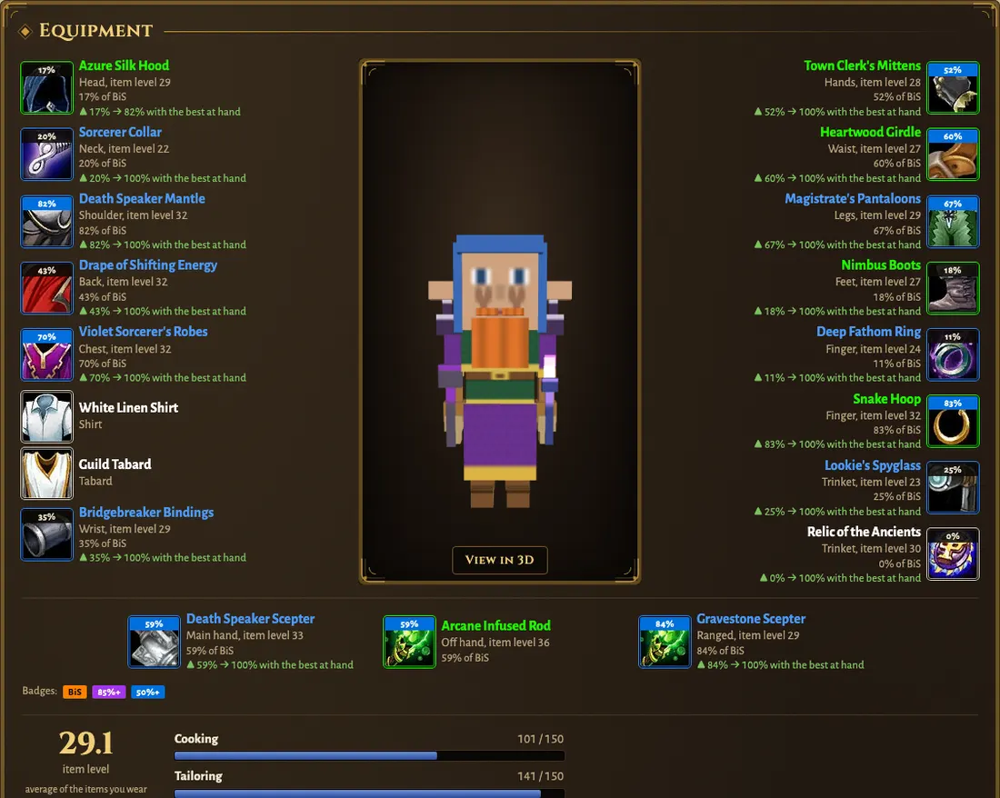
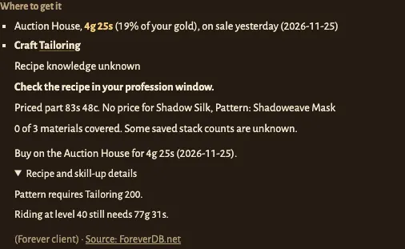

# Gear and upgrades

**For:** players with a wow-stats page. **At the end:** you know which item to chase next,
where it comes from, and whether to buy it instead.

Everything here is in the Character tab: your gear at the top, the upgrades under it.

## Your gear

The badge on each item's icon says how close it is to the best you can wear at your level for
that slot: **BiS** (orange) is the best, then **2nd** or a share like **84%** (purple from 85%,
blue from 50%, dark below). Rings and trinkets count the best two: a new one replaces the
weaker, so its line starts from the weaker one's %. Both weapons count as one setup. No badge:
nothing to measure against.

"▲ 62% → 85% with the best at hand", in green under a slot, means the best upgrade you can get
now takes that slot from 62% to 85%. Click the item to compare. "empty → 85%": nothing is worn
there yet. For rings and trinkets the weaker one gets the best item, the stronger one the next:
both read 100% only when two different items that good are in reach.

The picture in the middle is your character in that gear. "Picture on its way": it isn't drawn
yet, and **View in 3D** shows the model meanwhile.

Open **View in 3D** and drag to turn your character. Leave the model alone for a bit
and it may swing, fire its equipped ranged weapon or cast a class spell. Between
actions it returns to idle. With reduced motion turned on, it stays at rest.

A hunter’s last recorded pet or a warlock’s last summoned demon stands beside the character.
The shipper reads your combat log and the creature appearance saved by your WoW client.
If the skin is uncertain, you’ll see just your character. Past-level views show the gear
recorded for that level.

Characters with a recorded mount can switch between **On foot** and **On mount**.
The rider stays in the saddle while the mount idles, walks or runs.

## The upgrades list

Every item has the same badge and says what it does to its slot: "70% → 91% on your chest"
("empty → 91%" for an empty slot).

- **By where you get it** (the default) groups them by trip: a dungeon, the quests of a zone, a
  profession, the auction house. Each group says what the trip holds: "31% chance one of your 3
  upgrades drops" for a dungeon, "2 upgrades you can take now" for quests or crafts, "2
  upgrades for 4g 10s in all" at the auction house. Auction listings put the most gain per
  gold first.
- **By slot** starts with the slot furthest from its best and shows your pick for each slot:
  **Now** (you can wear it), **Level 35** (not yet),
  **cheap** (on the auction house for at most what you earn in a level). Under it, the slot's
  **BiS**: see below.

## Crafts

Read the bold next step first. For Filigreed Shadow Circlet at Tailoring 121, it can tell you
to make about seven Stylish Red Shirts to reach 125. If the pattern is already in your bank
and you have the skill, it tells you to take it out and learn it.

The card counts the materials in your bags and bank. **Estimated cost** covers the whole
craft. **Priced part** gives the subtotal the page can work out. A price or bag count can be
missing, or the skill-up route can stop short of the required rank. A finished item on the
auction house gets its own price and scan date. An older scan says **Last auction price**. The
circlet binds on pickup. You can buy its pattern and make it yourself.

Open **Recipe and skill-up details** for the crafts along the way and the gold you still need
for riding. Check the trainer and pattern ranks separately. For Black Slippers, a recorded
trainer offer requires Tailoring 150. The pattern requires 140.

What we can't price is named, with the one thing that fixes it: scan the auction house with
Auctionator, open the profession window once (Altoholic saves the recipe list), or update the
shipper (it sends the bag counts). Your AI gets the whole thing from `professions`: "how much to
get Tailoring from 121 to 190" is answered from Polestar's route and your own bags, no web guide.

## BiS, and your pick

Each slot has two answers. The **BiS** is the item that scores most at your level, whatever it
takes: a 0.03% drop, an 84g auction, a rank you don't hold. **Your pick** is what the list
actually sends you after: while you level, an easy item beats a slightly better hard one.

When they're the same item you see it once: **BiS, and within reach** (or **BiS, and your
pick** when it's a long shot or costs more gold than you have). When they differ, the BiS line
says what it takes and the pick says why it wins, with the numbers: "Your pick is 14% behind
BiS: easy where BiS is a long shot (about 3,333 runs)."

A BiS on the auction house shows its price against your gold and your next riding training,
plus the one thing to do: "84g on the auction house: you have 16g 72s; riding at 40 needs 100g.
Save 67g 28s more, then buy it at the auction house." An auction you can't pay for yet counts
as **some effort**, not easy, so a cheaper easy item can still be your pick.

At 60 the score decides, so the pick is usually the BiS, odds and all. Gear nobody says where to
get is never the BiS (there's nothing to tell you to do), and neither is content Forever hasn't
opened. Your AI's `gear` answers carry the same `bis` and `pick` for each slot. The Overview
names the BiS next to an upgrade when the upgrade is the pick and the BiS is something else.

Some slots don't really count yet. ForeverDB's formula scores on-use effects and procs as zero,
so most levelling trinkets are worth 0 to 1 point, and the best of almost nothing used to read
"BiS" and "empty → 100%". When a slot's best item is worth under 1% of your worn gear's score,
the page drops the badge, the percents and the BiS line for that slot and says it plainly:
"No trinket matters much at your level: +0.7 points at best." Your AI's `gear` answer marks the
slot `negligible` with that line. Wear one trinket that does count and the other slot says
"No other trinket matters much" instead. The badges come back once trinkets with real stats
are in reach.

**Scored for**, at the top, picks the spec ("Automatic" follows your talents): pick another to
see the upgrades for a respec.

**Weights** picks what the scores value: **Leveling** (the default: Stamina, armour and a
caster's wand count for more), **PvP** or **PvE** (raids and dungeons at 60). The weights are
[ForeverDB.net](https://foreverdb.net)'s, and every score links there so you can check it.
Your pick is kept on the server for that character, so your AI's `gear` answers use it too.
Next moves and the plan always score on Leveling.

**PvP rewards**, next to it, says whether honor rank gear and battleground reputation gear
(Talisman of Arathor, the Silverwing Sentinels' rings...) count as a way to an item. Off by
default: if you never queue, a 72s trinket you can only buy after a few Arathi Basin games is
no upgrade. Tick it and they come back, everywhere: this page, next moves, the plan and your
AI. In the PvP weights they always count, and they're **easy** (you get them by playing PvP,
which is the point of that mode).

Reputation gear is your side's only. Theramore's seals (Volunteer's Lucky Seal, Enriched
Seal) are Alliance gear from Darkspear Islands, so they show up for an Alliance character with
**PvP rewards** ticked and never for the Horde, who get the Darkspear Raiders' versions.
Ratchet and Booty Bay are neutral: their gear is for everyone, PvP or not.

Endgame Forever hasn't opened is never proposed, and "nobody said it's closed" isn't open. A
raid, a world boss, the Dungeon Set 2 quests (Lord Valthalak's chain, the Heroism and Virtuous
pieces) and world events like the Gurubashi Arena's chest count only once a source says
they're open: Blizzard's news, the weekly news pass, or a player who saw it drop in Forever.
Today that means no raid loot at all. Onyxia's Lair, Barrow Deeps and Hyjal Summit open on
9 Dec 2026 and their loot shows up that day by itself; Molten Core, Zul'Gurub, Ahn'Qiraj and
Naxxramas wait for Blizzard to give a day.

The level-60 five-mans (Stratholme, Scholomance, Blackrock Spire and Depths, Dire Maul,
Shaper's Terrace, Blackmaw Hold) are open, so their drops count. So do every levelling dungeon
and quest, including drops nobody logged in Forever yet.

Every upgrade says how hard it is to get, from its easiest source, next to where it comes from
(your AI sees the same `effort`):

| | From |
|---|---|
| **easy** | your bags or bank, an auction house listing you have the gold for, a quest, a vendor, a craft you can make (or whose recipe you know or hold, with the gold for the skill-ups), a reputation you hold, a drop of 25% or more |
| **some effort** | an auction house listing that costs more than your gold, a drop of 8-25%, a craft whose recipe you can buy or train, or that needs a trainer rank or more gold than you have, a reputation up to Honored you don't hold yet, a PvP rank you hold |
| **hard** | a drop of 1-8%, a drop seen in Forever with no rate, a world drop, a raid drop, a craft whose recipe we can't say where to get, a reputation above Honored you don't hold |
| **long shot** | a drop under 1%, a rate known only from Classic, a PvP rank you don't hold (or that nothing recorded) |

In the PvP weights, rank and battleground reputation gear is easy.

A rate known only from Classic counts one step harder; an auction house listing makes any item
easy, with its price, as long as you have the gold. While you level, a harder item wins a slot only when it scores 5.3% more
(some effort) or 17.6% more (hard), and the % lines measure against what you can get. At 60
the score alone decides.

Drops say their chance and how many runs that means ("43.75% over 16 kills"; a 3% boss drop
adds "about 33 runs"). Reputation gear says where you stand ("you're Friendly: 16,500 rep to
go"), PvP rank gear too ("rank 3 needed, you're rank 1"); a rank nothing recorded yet counts as
a long shot. While you level, a 0.03% drop never becomes the pick, however good it is. At 60,
where every point counts, it can, with its odds next to it.

In **By where you get it**, **Best possible, out of plain reach** lists, apart, the slots whose
best item is a long shot or has no known source: with its odds, never as an upgrade to chase
while you level. By slot says it on each slot instead.

## The same weights in the game

At the bottom of the Upgrades list, **Copy for Forever Leveling BiS** and **Copy as Pawn
scale** copy the weights shown (the spec and mode picked above) as text, for the Forever
Leveling BiS addon. The text also shows in a box under the buttons, in case the browser
refuses the clipboard. To use it in the game: type `/bis`, click **Stat weights** at the top
right of the window, then **Import**, paste, check the spec and weapon setup, and click
**Import**. The addon picks the new profile ("ForeverDB Leveling", "ForeverDB PvP" or
"ForeverDB PvE") for that spec and setup.

It's weights only. The addon already sticks to your level, faction, race and professions, but
it ranks on score alone: drop chances and effort mean nothing to it, and it scores each
random-suffix green with its best suffix, the one roll you'd have to find or buy. So its "Best in
slot" can be a 1% drop, an epic off the Auction House and a row of "of Shadow Wrath" greens
where this page picks quest rewards and crafts. The string can't change that (its format carries
weights, nothing else). For picks closer to this page, untick **BoE** under **Sources** in the
addon's Settings, Filters. It also keeps its own item list, which can lag the game's hotfixes,
and adds what it knows on top (item effects, racial weapon bonuses, set bonuses at 60), so a few
items still rank differently there. Take the Forever Leveling BiS string when you can: it is exact. The Pawn
scale has no ranged-only hit (hunters' "+% hit with ranged weapons" items score lower), and the
addon rescales a Pawn scale on import (same order, other numbers). Your AI gets the same text
from `gear` with `export: flb` or `export: pawn`. Data from
[ForeverDB.net](https://foreverdb.net).

## What to do with it

1. Take the top group in "By where you get it".
2. Going to a dungeon: read its card in [Dungeons](dungeons.md) first.
3. "In your bags: equip it" means you already carry it (seeing your bags needs Syndicator).
   PvP rank gear checks your rank, which Syndicator and Altoholic record once you hold PvP
   renown (ForeverDB does too, if you run it). Until then it says "your PvP rank isn't
   recorded yet".
4. To see what's for sale: scan the auction house with Auctionator, `/reload`, and an
   **Auction House** group shows within 5 minutes, with prices. On a server you share with
   friends, the newest scan with a matching Auctionator ruleset and faction label counts,
   whoever scanned it. A realm-only scan stays in its owner's private history.

List missing: [A part of my page is empty](troubleshooting.md#a-part-of-my-page-is-empty).
How the scoring works: [Gear reference](../gear-reference.md).
