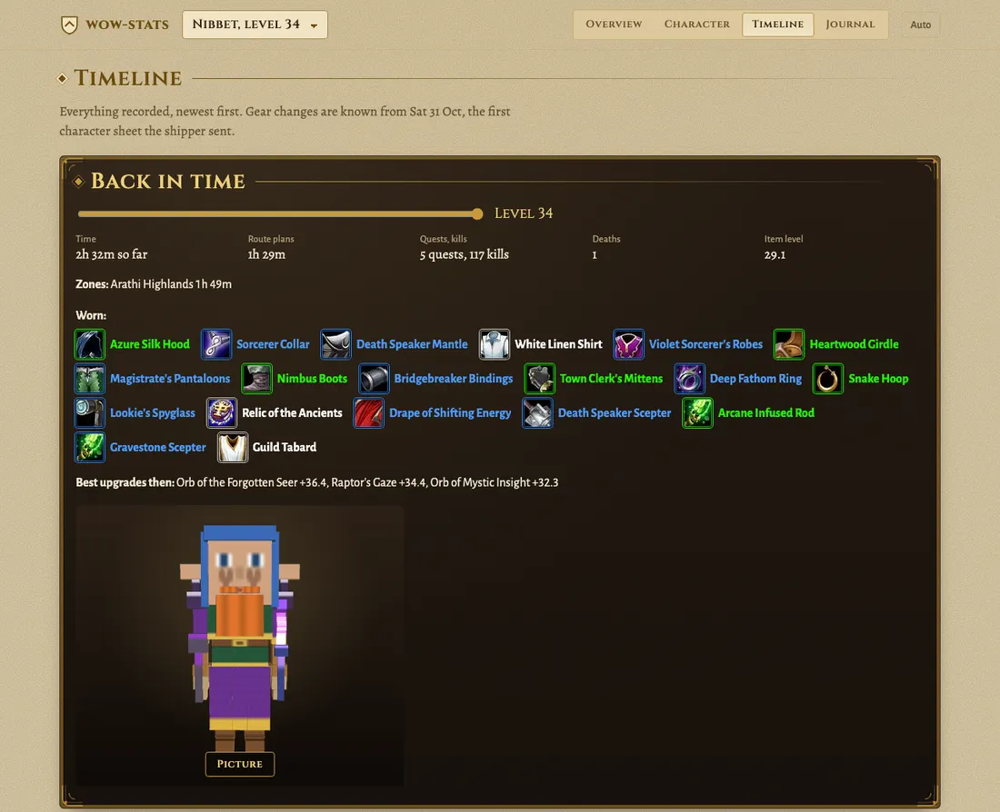
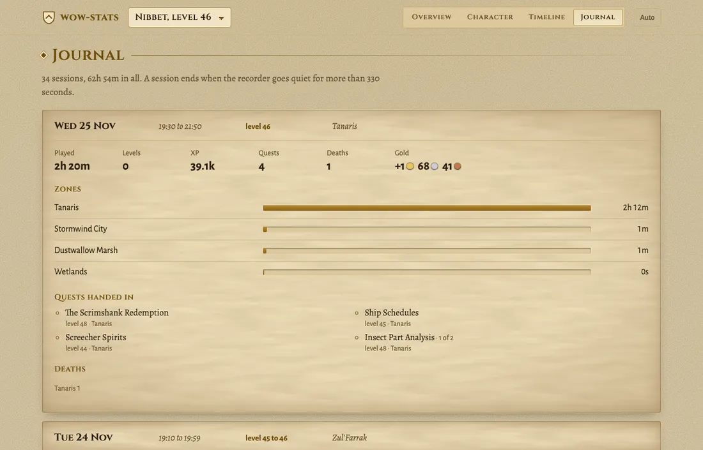

# Climb, timeline, journal

**For:** players with a wow-stats page. **At the end:** you can find any evening, any level and
any death in your history, and see your character as they looked back then.

Three places hold your history: the climb (Character tab), the Timeline and the Journal (their
own tabs).

## The climb

Your level against played time (a week offline takes no room; **Show dates** switches to the
calendar), then one bar per level with its kills, quests, date and time played. A **striped
bar** is a level the tracking only caught part of: it doesn't count in your pace.

Find the long bars, then open those days in the Journal. A slow level is usually one zone or
one guide step: the Character tab's **Where the time went** and **Guide steps** list both.

## Timeline

Everything recorded, newest first: levels, deaths, dungeon runs, sessions.

**Back in time**, at the top, is a slider through your levels. Pick one to see that level as it
was: the time it took against the route plan, quests, kills, deaths, item level, the zones, the
gear you wore and the best upgrades you had at the time.

## Your look at every level

Each level has a picture of your character in that level's gear ("Picture on its way" for a
few minutes after a new level). **View in 3D** shows the model, drawn from your own game files
and dressed in your gear: drag to turn it. The program on your computer sends those files
after your first sessions; until then the page keeps the picture and says why. Without
Battle.net data yet, the face and hair are your race's default look.

## Journal

One entry per play session (a /reload or a quick relog stays in the same one): when, the
levels, where, played time, XP, quests, deaths, gold, the time per zone and the quests you
handed in. Older entries are folded: click one to open it. Without Polestar Recorder, it's one
entry per logout, with the time estimated.

Before a session, read the last entry to remember where you stopped. After a slow level, look
at its zones: 40 minutes in a zone the route crosses in 10 is the detour to cut next time.

## Next

- [Overview and next moves](overview.md): what to do with all of this tonight.
- [What's shared](privacy.md): which of these your zogzog link and your public page show.
