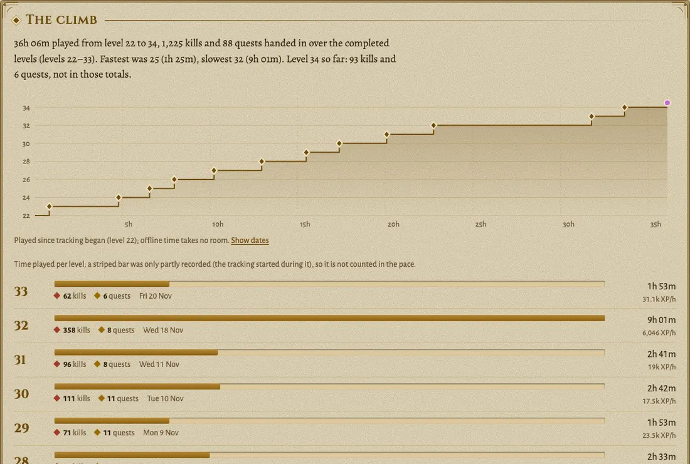
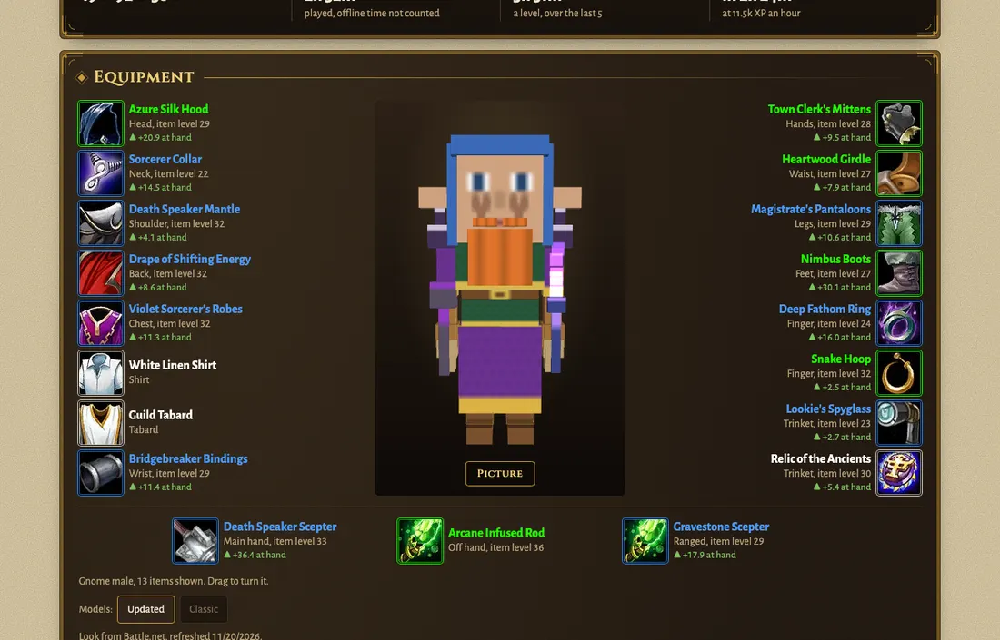

# Climb, timeline, journal

**For:** players with a wow-stats page. **At the end:** you can find any evening, any level and
any death in your history, and see your character as they looked back then.

Three places hold your history: the climb (Character tab), the Timeline and the Journal (their
own tabs).

## The climb

The solid line follows your played time. The dashed line follows Polestar's route from the
same starting level. **Show dates** switches to the calendar. Below the chart, each level
has a played-time bar and, when Polestar has a time for it, a thin route bar underneath.
A striped bar means recording started partway through that level. It doesn't count in your pace.

Nibbet handed in 155 quests across levels 22–45 and another five at level 46. The chart
counts finished levels together and shows the current level separately. Ask your assistant
for `character_summary` to see both counts and their total.

Find the long bars, then open those days in the Journal. The Character tab's **Where the time
went** and **Guide steps** say which zone or step ate the time.

## Timeline

Everything recorded, newest first: levels, deaths, dungeon runs, sessions.

**Back in time**, at the top, is a slider through your levels. Pick one to see that level as it
was: its time against the route plan, quests, kills, deaths, item level, zones, the gear you
wore and the best upgrades you had then.

## Your look at every level

Each level has a picture of your character in that level's gear. "Picture on its way" means it
isn't drawn yet. **View in 3D** shows the model dressed in your gear: drag to turn it. It needs
your game's model files, which the program on your computer sends after your first sessions.

## Journal

One entry per play session: when, the levels, where, played time, XP, quests, deaths, gold, the
time per zone and the quests you handed in. Click an older entry to open it.

Before a session, read the last entry to remember where you stopped. After a slow level, look
at its zones: 40 minutes in a zone the route crosses in 10 is the detour to cut next time.

## Next

- [Overview and next moves](overview.md): what to do with all of this tonight.
- [What's shared](privacy.md): which of these your zogzog link and your public page show.
