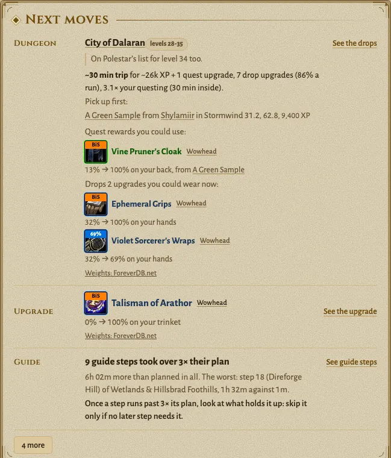

# Overview and next moves

**For:** players with a wow-stats page. **At the end:** you can read the four numbers at the
top of your page and you know which move to do first.

The Overview is the first tab: open it before you log in. The line at the top says whether
you're ahead of Polestar's route, on it or behind, and how much play the next level takes.

*Nibbet, the made-up priest of the [live demo](../../site/pages/demo.md).*

## The four numbers

- **Pace**: your played time per level against Polestar's route, over your last 5 levels.
  1.0× is the route's pace, 2.0× twice as long. Above 1.5×, the line under it says where the
  time went.
- **Next level**: hours of play to the next level at your XP per hour. Hold it against the
  time you have tonight.
- **Guide**: the Polestar guide steps you did in order. Many "passed over" means you left the
  route, and the advice is built on it.
- **Rested**: your banked rested XP. "none": log out in an inn or a city.

## Next moves

Up to 3 things to do now, the most useful first, each with what, where and what blocks it:

- **Talents**: points you haven't spent.
- **Upgrade**: the best item for one slot, its points, and the boss or quest it comes from.
  "In your bags: equip it" means you already carry it.
- **Dungeon**: the run worth doing at your level, the quests to pick up first and the drops
  you'd wear.
- **Training**: a profession rank or riding, with the trainer and the price.

When your level or your gold stands in the way, the move says how far you are. Do the first
one. "See the upgrade" or "See the drops" jumps to the details in the Character tab.

Time per level

The bars are your played time per level, the dashes Polestar's route time for the same level.
A bar way above its dash is a level that went wrong: the [climb](history.md) and the journal
say where that time went.

## Next

- [Gear and upgrades](gear.md): the full list behind the Upgrade move.
- [Dungeons](dungeons.md): every dungeon for your level, not only the best one.
- [Plan your next hours](plan.md): the next 1 to 6 hours, step by step.
