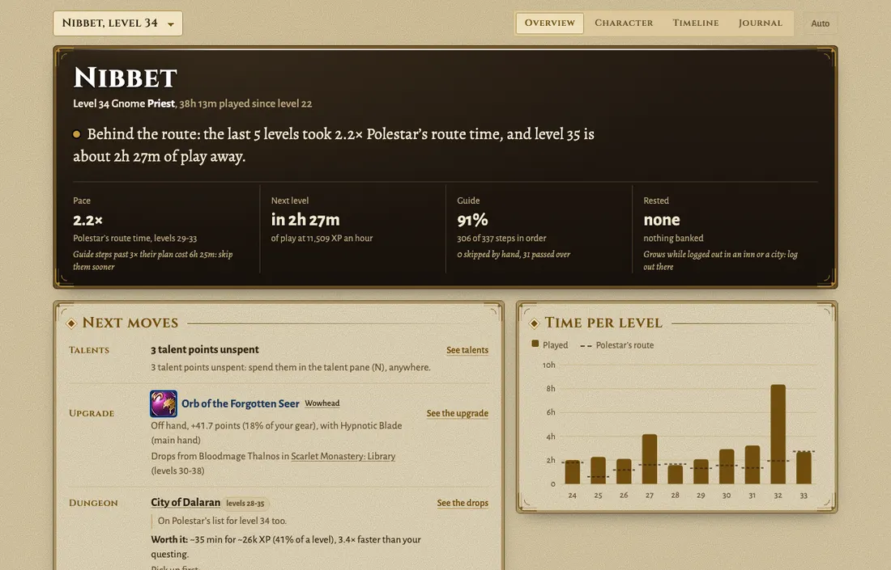

# Overview and next moves

**For:** players with a wow-stats page. **At the end:** you can read the four numbers at the
top of your page and you know which move to do first.

The Overview is the first tab: open it before you log in. The line at the top says whether
you're on Polestar's route (up to 1.5× its time), behind it, or well behind it, and how much play the next level takes.

*Nibbet, the made-up priest of the [live demo](../../site/pages/demo.md).*

## The four numbers

- **Pace**: your played time per level against Polestar's route, over your last 5 levels.
  1.0× is the route's pace, 2.0× twice as long. Above 1.5×, the line under it says where the
  time went.
- **Next level**: hours of play to the next level at your XP per hour.
- **Guide**: the Polestar guide steps you did in order. Many "passed over" means you left the
  route the advice is built on.
- **Rested**: your banked rested XP. "none": log out in an inn or a city.

When a source missed something, the number it feeds says so in a grey line under it: "The
Recorder missed about 2h 10m of play (level 31): deaths from then aren't counted." or
"Equipment last read 5 hours ago: what you wear now may differ." The first goes away once the
Recorder is on (`/psrec on`, then `/reload`); the second at Battle.net's next read, within 2
hours. Your public page only says "Equipment may be out of date."

At the bottom of any dashboard, open **Data sources** to check the wow-stats version,
the Polestar release and the client build used for items and recipes. A shared page
shows the versions used when it was published.

## Next moves

Up to 3 things to do now, the most useful first, each with what, where and what blocks it. The
usual ones:

- **Upgrade**: the best item for one slot, what it does to that slot ("70% → 91% on your
  chest": the slot's share of its best item, now and with this one) and the boss or quest it
  comes from. "In your bags: equip it" means you already carry it. A rare world drop can
  still appear in the gear list. Next moves needs an easy or medium way to get it, such
  as an auction listing with a price and scan date.
- **Dungeon**: the run worth doing at your level, the quests to pick up first and the drops
  you'd wear.
- **Talents**: points you haven't spent.
- **Profession** or **Riding**: the rank to train, the trainer and the price. When your
  addons didn't see the training, the riding move says "if not trained yet" and shows what was last
  seen and when: already trained, skip it. [Why](../faq.md#why-does-a-move-say-if-not-done-yet).

Do the first one. "See the upgrade" or "See the drops" jumps to the details in the Character
tab.

Time per level

The bars are your played time per level, the dashes Polestar's route time for the same level.
A bar way above its dash is a level that went wrong: the [climb](history.md) and the journal
say where that time went.

## Next

- [Gear and upgrades](gear.md): the full list behind the Upgrade move, and what the badges mean.
- [Dungeons](dungeons.md): every dungeon for your level, not only the best one.
- [Plan your next hours](plan.md): the next 1 to 6 hours, step by step.
