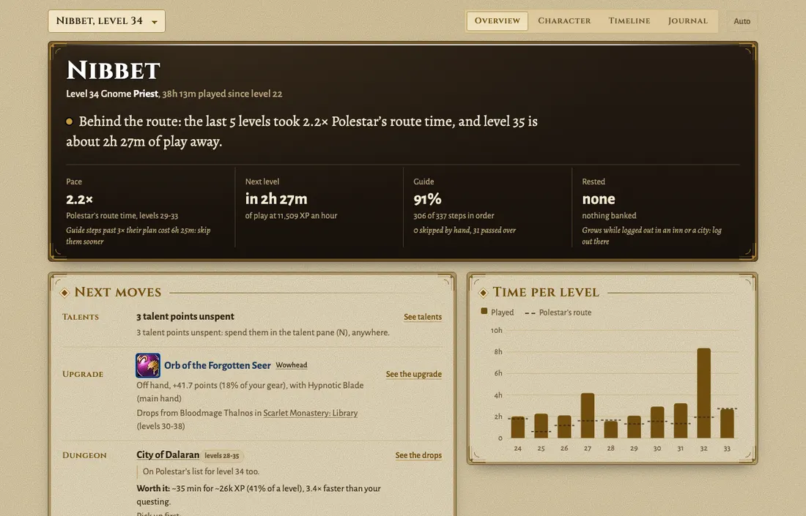

# Your page, tab by tab

**For:** players with data on a wow-stats page (their own server or a friend's). **At the
end:** you know what each tab shows and what to do with it.

<!-- generated:player-page -->
<!-- From docs/videos/steps.json: edit it there, then run tools/manual/generate.py. -->

Your next upgrade and where it drops, the dungeon worth running, your pace per level. Set it up once, then just play: the page fills in by itself.

The tabs at a glance:

- **Overview**: your pace, hours to the next level, your next 3 moves.
- **Character**: your gear, the best upgrade per slot and where it drops, dungeons worth running, a session plan.
- **Timeline and Journal**: every level, death and session, and how you looked at each level.
- **Settings**: top right: hide a character, share your zogzog link, turn on your public page.

## Overview

*Open it before you log in.*

[Watch: overview](../videos/media/tour-light.mp4)

The first tab. The line at the top says where you stand against Polestar's route and how much play the next level needs. Below it, the four numbers and your next moves.

Do the first next move. When something blocks it (your level, your gold), the move says what, and how far you are.

- **Pace**: your time per level against Polestar's route, over the last 5 levels. 1.0x is the route's pace, 2.0x twice as long.
- **Next level**: hours of play to the next level, at your XP per hour.
- **Guide**: how many guide steps you did in order, and how many you passed over.
- **Rested**: the rested XP you have banked. Log out in an inn or a city and it grows.
- **Next moves**: up to 3 things to do now: an upgrade and where it drops, a dungeon and the drops you'd wear, a profession rank or riding with its trainer and price. "1 more" opens the rest.
- **Time per level**: bars are your played time per level, dashes the route's.

## Character

*Your gear, your climb, everything recorded.*

The second tab. At the top, the character sheet: gear and item level, professions, talents and how they changed (every change with WoWSims Exporter, else the last 3 weeks). Hover or tap an item for its card; the Wowhead link opens its page.

Under the sheet, a bar of sections. Each one jumps to its part of the page.

- **Upgrades**: per slot, the best item you can wear now and within 3 levels, the points it adds and where it drops. One you already carry says "In your bags: equip it".
- **The climb**: time per level, yours against the route.
- **Where the time went**: hours per zone.
- **Guide steps**: the steps that took longest against the route.
- **Loot, Deaths, People, Flights**: what dropped, where you died and at what level, the players you keep running into, where you flew.

## Dungeons

*Which dungeon is worth it, and what it drops for you.*

In the Character tab. Each dungeon for your level shows its level range, the drops that are upgrades for you (slot and points) and your runs: when, at what level, how long. A drop you already have says so, and whether to equip it.

Pick the one with the most upgrades you'd wear. The Overview's next moves already do: the dungeon there is that one.

## Plan your next hours

*Pick the hours, get the plan.*

In the Character tab, under the sheet: pick 1 to 6 hours, add what you don't want ("no dungeons") and click Plan it. The plan follows your Polestar guide at your own pace: the steps to do, your level at the end, the steps worth skipping, a dungeon if you find a group, where to log out.

It needs your Polestar guide steps: a character that never followed a guide gets no plan. The same box shows the gold you have toward riding and how many hours of play it takes at your rate.

To have it explained or changed, ask your AI (the Your AI part of this page).

## Timeline and Journal

*Your play, back in time.*

Timeline: every level, death, dungeon and session, newest first. Pick one to see your character then: the gear you wore, the zones, the best upgrades at the time.

Level by level: slide through your levels to see what your character looked like at each one, as a picture, or in 3D with View in 3D. A new level's picture takes a few minutes: until then it says "Picture on its way".

Journal: one entry per play session, where you went and what you did.

## Your other characters

The picker at the top left switches character. Every character you played with the addons on is in it, alts included. One is missing: its addons are off (step 2, once per character).

## Your zogzog link

*The whole story, for the friends you pick.*

[Watch: your zogzog link](../videos/media/private-light.mp4)

Settings has your zogzog link: your page for friends, with the journal, the gear advice, prices and deaths per zone. Anyone with the link can open it, so send it only to the people you want there. It never shows other players or where your character is right now.

It catches up within about 10 minutes of a play session.

Sent to the wrong person: Settings, Make a new link. The old one stops working at the next update.

## Your public page

Off until you switch it on (Settings, Public page on). Then anyone with the address sees your characters' card, climb and dungeons. No gold, no other players, no position.

The owner adds its address once, usually within a day. Settings says "live" when it works.

## Settings

*What others see, your upload password, and leaving.*

[Watch: settings](../videos/media/settings-light.mp4)

Settings is in the menu at the top right of your page. Your own page always shows everything: these only change what others see.

- **Hide a character**: tick it under Characters: off the public page, off the zogzog link, or both.
- **Battle.net data to my AI**: on, your AI gets your characters' Battle.net data (look, item level, talents) and the WoW Token price. Off, it doesn't.
- **Reset your upload password**: new computer, or the password leaked: Reset my upload password. The old one stops at once; run the new install command on the computer you play on.
- **Delete your data**: ask the owner to take you off the friends list. Within minutes your events, settings, upload password and pages are gone; backups keep the events 30 more days. Then uninstall below.

<!-- /generated:player-page -->

## Each part in detail

- [Overview and next moves](overview.md): the four numbers and what to do first.
- [Gear and upgrades](gear.md): points, the upgrades list, the auction house.
- [Dungeons](dungeons.md): reading a dungeon card, and which one to run.
- [Plan your next hours](plan.md): the session planner.
- [Climb, timeline, journal](history.md): your history, and your look at every level.

Something missing from a tab? [Something's wrong](troubleshooting.md#a-part-of-my-page-is-empty)
says which addon fills it.
