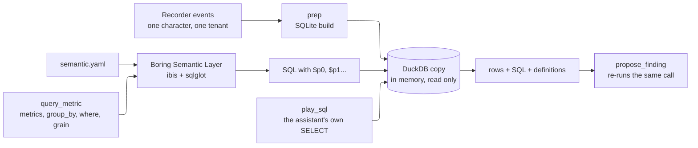

# Semantic layer

**For:** anyone asking their AI about a character, and anyone curious how the numbers are
defined. **At the end:** you know which metrics exist, what each one counts, and how to check
an answer.

The MCP server has two ways to ask the play data a question. `play_sql` runs whatever SELECT
the assistant writes. `query_metric` asks for **named metrics**: `played_s` by `level`,
`dungeon_s` by `zone` per week. The server writes the SQL from one model file,
[`wowstats/analysis/semantic.yaml`](../../wowstats/analysis/semantic.yaml), and sends back the
rows, the SQL it ran and each metric's definition and caveats. 75 metrics (3 of them across
two models), 39 dimensions, three time grains (day, week, month).

The character page reads the same file: its time per level, XP an hour, kill and quest totals,
dungeon runs and deaths come out of the layer when the page's answers are built (see
[The pages read it too](#the-pages-read-it-too)). One definition for the page and your AI.

## Why a semantic layer

"How long did level 30 take?" has four honest answers in this data, and they don't agree:

| Metric | Counts | Level 30 on the demo |
|---|---|---|
| `played_s` | Polestar's split: the game's /played inside the level | 11,240 s |
| `online_s` | the Recorder's timeline: every interval between two records of a login | 11,221 s |
| `active_s` | the same timeline, AFK flag off | 11,221 s |
| `calendar_s` | wall clock from the previous ding to this one, nights included | 101,240 s |

With raw SQL the assistant picks one of them without telling you, and the next chat picks
another. With the layer each one has a name, a one-line definition and its caveats, declared
once. The assistant names the one it means, and the answer says which one it got.

Two more things come free with it. Every answer carries the SQL that made it, so you (or the
judge) can re-run it. And the values you filter on are bound as parameters (`$p0`, `$p1`): a
zone called `Westfall'; DROP TABLE levels; --` is just a zone that matches nothing.

The tables underneath moved from SQLite to DuckDB for this: a columnar engine made for
exactly these GROUP BYs, and the dialect the layer compiles to.
The layer itself is [Boring Semantic Layer](https://github.com/boringdata/boring-semantic-layer)
(MIT): measures, dimensions, time grains and ratios in a YAML file, compiled to SQL through ibis
and sqlglot. Only the compiler runs here (no ibis backend, so no pandas or pyarrow in the image).
The others I looked at:

- **dbt MetricFlow** (Apache-2.0): the reference design, but 0.214 caps Python at
  3.14 and the image runs 3.15. It also wants a dbt manifest and a time spine table.
- **Cube**: a Node server next to the app, heavier than the whole image.
- **Malloy**: its own query language to learn, and the Python package was last released in
  September 2024.
- **Wren Engine**: pulls pandas, pyarrow and boto3.

## How a question runs



- **One character at a time.** The database behind both tools holds the calling person's
  character and nothing else (the same tenant scoping as every other tool). A friend naming the
  owner's character gets "no events", from `play_sql` and `query_metric` alike.
- **Several models, no fan-out.** Metrics from different tables (`online_s` from the timeline,
  `played_s` from the level splits, `kills` from the records) are each aggregated on their own
  table, then joined on the `group_by` columns. A level's 11,240 s is never counted once per
  timeline row. With three models or more, each one joins on the keys of every model before
  it, so a level the first model lacks still lines up with the third instead of splitting
  into two rows.
- **Locked down.** DuckDB runs with no file or network access, no extensions, a 256 MB memory
  limit and a 5 s timeout. A query that reads `read_csv`, `read_parquet`, a URL or `ATTACH`
  is refused, and so is one calling `repeat`, `lpad` or a scalar `range` (DuckDB's memory limit
  doesn't count one huge value: `lpad('x', 500000000)` made 1.6 GB in a test).
- **Both sides of a ratio count the same rows.** A metric read from two sides (a ratio, a
  difference, a cross-model rate) has an `eligibility` in the model file: the rows it reads,
  on both sides. `vs_route` reads whole splits with a planned time. Before that rule, a
  finished level (100 s played, 100 s planned) next to the level in play (no split yet, 100 s
  planned) came out at 0.5 and 100 s ahead of plan; now it's 1.0 and 0. `planned_s` asked on
  its own is still the whole target, every level with a plan in it.
- **Too little evidence is empty, never zero.** A metric with `min_evidence` is NULL below
  it, and the answer adds a `<metric>_evidence` column with the count. `gold_delta_copper`
  needs two snapshots with money, taken at different times: one snapshot used to read as a
  change of 0. So 0 in the evidence column means no snapshot at all (unavailable), 1 means one
  (unknown), 2 or more with a 0 in the metric is a purse that really didn't move.
  `query_metric` also sums it up per metric under `min_evidence`: rows measured, unknown and
  unavailable.
- **`more` means more.** The SQL asks for one row past `limit` (`LIMIT 4` for a limit of 3)
  and the extra row only sets `more`. With `LIMIT n` the runner never saw row n+1, so a
  `limit: 1` over three zones said `more: false`.

## Examples on the demo

All on `Testchar-Demo` from [the demo](../self-host/demo.md) (made-up data). Rows trimmed.

**Dungeon time per zone, per week:**

```json
{"metrics": ["dungeon_s"], "group_by": ["zone"], "grain": "week",
 "where": [{"dimension": "dungeon", "op": "is not null"}], "order_by": ["-dungeon_s"]}
```

| zone | week | dungeon_s |
|---|---|---|
| Desolace | 2026-11-09 | 2663 |
| Stranglethorn Vale | 2026-11-16 | 2598 |
| Stonetalon Mountains | 2026-11-09 | 1995 |

(The demo's dungeon runs keep the outdoor zone name; in the game the zone usually becomes the
dungeon. Group by `dungeon` for the dungeon itself.)

**XP per played hour, by level** (a ratio: `level_xp` over `played_s`):

```json
{"metrics": ["xp_per_hour", "level_xp", "played_s"], "group_by": ["level"],
 "where": [{"dimension": "level", "op": "=", "value": 30}]}
```

| level | xp_per_hour | level_xp | played_s |
|---|---|---|---|
| 30 | 17615.66 | 55000 | 11240 |

**Where the deaths happen:**

```json
{"metrics": ["deaths", "kills", "deaths_per_100_kills"], "group_by": ["zone"],
 "order_by": ["-deaths"], "limit": 3}
```

| zone | deaths | kills | deaths_per_100_kills |
|---|---|---|---|
| Stranglethorn Vale | 3 | 281 | 1.068 |
| Wetlands | 1 | 151 | 0.662 |
| Ashenvale | 1 | 93 | 1.075 |

**Same metric, two grains.** `"grain": "day"` gives one row a day; `"grain": "week"` adds them
up (the test suite checks that the weeks sum to the days):

| week | online_s |
|---|---|
| 2026-11-09 | 75162 |
| 2026-11-16 | 16591 |

**Against the route planner** (a ratio, `played_s / planned_s`, over whole splits only):

```json
{"metrics": ["played_s", "planned_s", "vs_route"], "group_by": ["level"], "limit": 3}
```

| level | played_s | planned_s | vs_route |
|---|---|---|---|
| 22 | 6420 | 8454 |  |
| 23 | 7310 | 4632 | 1.578 |
| 24 | 8520 | 5300 | 1.608 |

Level 22 is the demo's first tracked level: its split began partway through, so it has no
`vs_route`. 6,420 s against a whole level's 8,454 s would say "faster than plan" for a level
nobody timed from the start.

**Which quest paid the most XP per minute** (`quest_xp_per_min`, done quests only):

```json
{"metrics": ["quest_xp_per_min", "done_quest_xp", "done_quest_s", "quest_wall_s"],
 "group_by": ["quest"], "order_by": ["-quest_xp_per_min"], "limit": 3}
```

| quest | quest_xp_per_min | done_quest_xp | done_quest_s | quest_wall_s |
|---|---|---|---|---|
| Demo quest 951 | 1219.3 | 3221 | 158.5 | 317 |
| Demo quest 409 | 1211.1 | 3724 | 184.5 | 369 |
| Demo quest 505 | 1042.7 | 3128 | 180 | 540 |

**Time per guide step**, with the step's name from the route reference:

```json
{"metrics": ["online_s"], "group_by": ["guide_title", "step", "step_title"],
 "where": [{"dimension": "step_title", "op": "is not null"}], "order_by": ["-online_s"], "limit": 3}
```

| guide_title | step | step_title | online_s |
|---|---|---|---|
| Wetlands, Ashenvale, Ironforge & Stormwind City | 64 | Shael'dryn | 1892 |
| Wetlands, Ashenvale, Ironforge & Stormwind City | 100 | Jorgen and Elling Trias | 1476 |
| Wetlands & Hillsbrad Foothills | 30 | Prospector Whelgar | 1226 |

**Kills per hour of combat** (`kills` from the records over `combat_s` from the timeline):

```json
{"metrics": ["kills_per_combat_hour", "kills", "combat_s"], "group_by": ["level"], "limit": 3}
```

| level | kills_per_combat_hour | kills | combat_s |
|---|---|---|---|
| 22 | 64.8 | 96 | 5330 |
| 23 | 69.7 | 121 | 6253 |
| 24 | 84.2 | 175 | 7486 |

## Time on a quest

A quest's time is `quest_s`: every online second while the quest sat in the log, **shared
equally among the quests open in that second**. Two quests open for an hour get 30 minutes
each.

The obvious answers are wrong. Wall time from accept to hand-in (`quest_wall_s`) counts the
nights in between: Demo quest 1018 was picked up at 23:22 and handed in the next evening,
73,560 s of wall time for 3,186 s of shared play. Online time while open (`quest_open_s`)
counts the same second once per open quest: on the demo the quests hold about 2 at a time, so
it adds up to 172,284 s, nearly twice the 91,753 s played that week.

Shared, the times add up: on the demo `quest_s` sums to 86,283 s, the online time with at least
one quest in the log, nothing counted twice (a test checks it). What it can't know is which
quest you were working on: a quest that sits in the log while you finish three others takes
its share of their time, so one carried for days looks slow. `quests_open_avg` says how crowded
the log was. The pairing itself: each accept meets the next hand-in or abandon of the same
quest id; a hand-in with no accept before it (picked up before tracking started) is `untimed`,
with its XP and no time.

## Money spent

Nothing the kit reads saves spending. The Recorder has the money a quest pays (and offers), and
a vendor or trainer window opening, never a price paid. Polestar's alts list and Syndicator
keep the purse at logout. Auctionator keeps prices, not sales.

So the layer has `unexplained_gold_delta`: between two logout snapshots, how much the purse
moved minus the quest money handed in between them. That's loot coin, vendor and auction sales
and mail in, less repairs, purchases, training, flights and mail out, all together. It is never
"repairs". A move counts in the level of its first snapshot; filter `dings = 0` for the moves
inside one level. On the demo the rest is the flights: -86 copper at 22, -116 at 24.

`gold_delta_copper` (last snapshot minus first, per group) needs two snapshots with money at
different times. By day on the demo, 2026-11-15 has one: its delta is empty and
`gold_delta_copper_evidence` says 1. The days around it have 2 or 3.

[Accountant Classic](https://www.curseforge.com/wow/addons/accountant-classic) (GPL-2.0, lists
Forever) saves money in and out per source (training, taxi, trade, auction
house, merchants, repairs, mail, quests, loot) per session, day, week, month and total, in
`Accountant_ClassicSaveData`. The kit doesn't read it. It counts by
calendar window, not by level, so even with it a level's repairs would come from the totals at
each logout.

## Across two models

`kills_per_combat_hour`, `deaths_per_online_hour` and `quest_xp_per_played_hour` read metrics
from two models. They sit under `cross_model_metrics` in the model file, as an expression over
metric names (numbers, `+ - * /` and parentheses only). Boring Semantic Layer's own joins go
from one model's rows to another's by a key; the layer already answers every multi-model
question by aggregating each model on its own and joining the results on the `group_by`
columns, so a ratio across two models is computed on that joined row. No fan-out, any grain.
They group and filter by the dimensions both models have (level, character, class, time), and
refuse the others.

## The pages read it too

The character page's numbers used to be counted by the page's own code, next to the layer's.
Now the page takes them from the layer:

| On the page | Metric |
|---|---|
| Time, XP, quests, kills and XP/hour of each level | `played_s`, `level_xp`, `split_quests`, `split_kills`, `xp_per_hour` |
| "A level, over the last 5" | `avg_level_s` on the last 5 whole levels |
| XP an hour (the pace), and the time to the next level from it | `xp_per_hour` on the last 3 whole levels |
| Played since tracking began, kills, quests | `played_s`, `split_kills`, `split_quests` (plus the level in play, live) |
| Each dungeon run's time, XP and XP/hour | `run_s`, `run_xp`, `run_xp_per_hour` by `run` |
| Deaths: how many, by zone, by level | `deaths` |

DuckDB runs when the answers are built (the full view's background builder after new data,
the publisher's static builds), once per character and data, never for a page view. It reads
only the feeds those metrics need (level splits, dungeon runs, and the Recorder's level,
session, zone and death records), not the whole history the analysis copies. On the demo every
answer says exactly what it said before the move (`tests/test_layer_pages.py`, against a
snapshot taken before).

Two definitions the page used to have its own way of are now the layer's, in shared code
rather than through DuckDB:

- **Sessions**: more than 330 s without a Recorder record ends one, for the journal, the
  Overview, the timeline, the MCP's `sessions` tool and the layer's `sessions`
  (`stores.split_sessions`). It used to be 20 minutes or a login on the page, 20 minutes on 5
  minute buckets in the MCP.
- **The route's time for a level**: the class's median over the side's starting races, else
  the median over classes, for the Overview's pace, the MCP and `planned_s` (`Route.level`).
  The page used to take your race's own run when the route export had one.

The hero line's gold is the purse at the last logout, a fact rather than a metric.

Without DuckDB installed (a `pip install` without the `mcp` extra; the image has it), the page
counts those numbers itself, the same way.

## What to equip next

Two models hold the gear advice, scored for the spec the player set (`WEIGHTS`, else the
talents): `worn` (the items on the newest sheet, their share of the slot's best and who they're
built for) and `upgrades` (every upgrade, one row per item and source, with its source in the
gear tool's words and its Wowhead page). `rank_now` ranks a slot's upgrades wearable now by
gain, so "the best three for my head" needs no SQL:

```json
{"metrics": ["upgrade_gain", "upgrade_bis_pct", "upgrade_bis_pct_worn"],
 "group_by": ["slot", "item_id", "item", "fit"],
 "where": [{"dimension": "slot", "op": "=", "value": "Head"},
           {"dimension": "rank_now", "op": "<=", "value": 3}],
 "order_by": ["-upgrade_gain"]}
```

On the seeded evaluation's Holy priest wearing a Shadow circlet (`wrong_spec_gear`):

| slot | item | fit | upgrade_gain | upgrade_bis_pct | upgrade_bis_pct_worn |
|---|---|---|---|---|---|
| Head | Embalmed Shroud | yes | 27.17 | 100 | 17 |
| Head | Earthen Silk Hood | yes | 20.91 | 81 | 17 |
| Head | Electromagnetic Gigaflux Reactivator | yes | 18.68 | 74 | 17 |

Say each as the page does, "17% → 100% on your head", never "+83%". The brief's
`facts.gear_fit` runs this query for every worn item that fits the spec badly, and lists each
item's sources (`upgrade_sources` by `item_id`, `source`, `source_wowhead`) beside it. Their
metrics take the largest value in the group (`aggregation: max`): an item's gain is the same on
each of its source rows, and two items for one slot are alternatives, never a sum.

## Still out of reach

- **Two characters in one query.** Each character is its own database. Ask twice, once per
  `char`.
- **Repairs, by name.** See [Money spent](#money-spent).

## Evidence for a finding

`propose_finding` takes a `query_metric` call instead of SQL: put the call's arguments in
`finding.metric_query`, and the finding's `{placeholders}` name its output columns. The judge
compiles it, re-runs it and compares every number in `expect`. The kept finding stores the
compiled SQL and its parameters, and the nightly recheck re-runs exactly that, as long as
`semantic.yaml` (as loaded) and its views haven't changed since. After a change, every kept
finding is "to revalidate" until an analysis proposes it again (docs/mcp.md, "The play
analysis").

The evidence has to read the play history. A SQL that selects a constant (`SELECT 3 AS n`) or
only the documentation tables re-runs to the same number every time and says nothing about the
data, so the judge refuses it and points to `query_metric`. A query that reads a table can still
compute the wrong thing: the re-run can't catch that.

A `query_metric` call counts in the analysis run like a `play_sql` query: it adds to the run's
query count, and the tables under the metrics it read count as read, so the coverage round
doesn't send a lane back to a table the metrics already covered.

## play_sql speaks DuckDB now

Same tables, same columns, same row cap and timeout. The dialect differs from SQLite in a few
places that matter:

- `/` divides as decimals: `7/2` is 3.5. Use `//` for whole numbers.
- A comparison doesn't sum: `COUNT(*) FILTER (WHERE kind = 'kill')` or
  `SUM(CAST(kind = 'kill' AS INT))`, not `SUM(kind = 'kill')`.
- `strftime` takes the time first: `strftime(to_timestamp(t), '%H')`.

Findings kept before the switch were written for SQLite: the nightly recheck keeps running
those on SQLite, so none of them breaks.

## The catalogue

<!-- generated:semantic-catalogue -->
<!-- From wowstats/analysis/semantic.yaml: edit it there, then run tools/manual/generate.py. -->

### levels

One row per level: Polestar's split when the level is done, the ding time and the route planner's time.

| Metric | Kind | Unit | Definition | Caveats | Read as |
|---|---|---|---|---|---|
| `split_levels` | simple | levels | Levels with a Polestar split (a time played). | The level in play has no split yet; a partial split counts. | sum; time: level_completion; observed. |
| `played_s` | simple | seconds | Time at a level, way 1: Polestar's own split, the game's /played seconds spent in the level. | Counts from the moment tracking started: a level marked partial began before it. Offline time is not in it. | sum; time: level_completion; observed. |
| `calendar_s` | simple | seconds | Time at a level, way 4: wall-clock seconds from the previous ding to this one, offline time included. | NULL for the first tracked level and the level in play. A week off between two dings counts in full. | sum; time: level_completion; reconstructed. |
| `offline_s` | simple | seconds | Time at a level, offline: calendar_s minus played_s, the seconds the game was closed between the two dings. | Whole splits only (NULL for a partial split, the first tracked level and the level in play). A level that took weeks on the calendar with its played time on plan was a break, not slow play: read played_s and vs_route for pace. | sum; time: level_completion; inferred. |
| `level_xp` | simple | xp | XP the level took (Polestar split). | From the split: missing for a level the split never closed. | sum; time: level_completion; observed. |
| `split_quests` | simple | quests | Quests handed in during the level, as Polestar's split counts them. | The split's own count; records.turnin can differ for a partial level. | sum; time: level_completion; observed. |
| `split_kills` | simple | kills | Kills during the level, as Polestar's split counts them. | The split's own count; records.kill can differ for a partial level. | sum; time: level_completion; observed. |
| `planned_s` | simple | seconds | The route planner's seconds for the level: for this class, or the median over classes when the class isn't known. | A model of a quick player who knows the route, uncalibrated. NULL when the route reference has no time for the level. | sum; time: level_completion; estimated. |
| `xp_per_hour` | ratio | xp/hour | XP per played hour in the level: level_xp over played_s. | Played time from the split, so idle time in the game counts against it. | ratio_of_sums; time: level_completion; observed. Rows: A level with a split: played time above 0 and its XP known. |
| `vs_route` | ratio | ratio | Played time over the route planner's time: 1.0 is on plan, 2.0 twice as long. | As uncalibrated as planned_s. Reads whole splits with a planned time only (eligibility): planned_s on its own is the total target, every level with a plan. NULL when no level qualifies. | ratio_of_sums; time: level_completion; estimated. Rows: A whole split (partial = 0, played time above 0) with a planned time. The level in play has no split and a partial split began partway through the level, so both stay out of both sides; planned_s on its own still counts them. |
| `offline_share` | ratio | ratio | Share of the calendar time at a level spent offline: offline_s over calendar_s (0.9: nine days in ten the game was closed). | Says how much of a level's calendar was a break, nothing about the pace inside the game. | ratio_of_sums; time: level_completion; inferred. Rows: A whole split with both dings known: its offline time and calendar time are measured. |
| `avg_level_s` | ratio | seconds | Average played seconds a level: played_s over split_levels (the page's "a level, over the last 5"). | Filter partial = 0 for whole levels: a partial split is short. | ratio_of_sums; time: level_completion; observed. Rows: A level with a split (the level in play has none). |
| `over_route_s` | derived | seconds | Seconds played beyond the route planner's time (negative: faster). | As uncalibrated as planned_s. Reads whole splits with a planned time only (eligibility): planned_s on its own is the total target, every level with a plan. NULL when no level qualifies. | sum; time: level_completion; estimated. Rows: A whole split (partial = 0, played time above 0) with a planned time. The level in play has no split and a partial split began partway through the level, so both stay out of both sides; planned_s on its own still counts them. |

Group or filter by: `character`, `class`, `level`, `partial`, `time`.

### timeline

The online time cut at every record: each row an interval inside a login span, with the state at its start.

| Metric | Kind | Unit | Definition | Caveats | Read as |
|---|---|---|---|---|---|
| `online_s` | simple | seconds | Time at a level, way 2: online seconds the Recorder saw, every interval between two records of a login span. | A silence over 330 s ends a span, so a crash or a long loading screen can drop a few minutes. | sum; time: interval_start; reconstructed. |
| `active_s` | simple | seconds | Time at a level, way 3: online seconds with the AFK flag off. | The game sets AFK after 5 idle minutes: those 5 minutes still count as active. | sum; time: interval_start; reconstructed. |
| `afk_s` | simple | seconds | Online seconds with the AFK flag on. | Starts 5 minutes into the idle time (the game's own flag). | sum; time: interval_start; reconstructed. |
| `dungeon_s` | simple | seconds | Online seconds inside a dungeon run. | Inside the instance only: the walk there and the hand-ins are outside (see trip_s). | sum; time: interval_start; reconstructed. |
| `combat_s` | simple | seconds | Online seconds in combat. | From the combat records' on/off pairs. | sum; time: interval_start; reconstructed. |
| `dead_s` | simple | seconds | Online seconds from a death to the revive (ghost run, spirit healer). | Death to revive only; the walk back after a spirit healer is alive time. | sum; time: interval_start; reconstructed. |
| `taxi_s` | simple | seconds | Online seconds on a flight path. | Flight paths only; boats and zeppelins are ride time, not in it. | sum; time: interval_start; reconstructed. |
| `dungeon_share` | ratio | share | Share of online time spent inside dungeons: dungeon_s over online_s. | 0 to 1. NULL when online_s is 0. | ratio_of_sums; time: interval_start; reconstructed. Rows: Every interval: both sides cut the same online time. |
| `afk_share` | ratio | share | Share of online time with the AFK flag on: afk_s over online_s. | 0 to 1. | ratio_of_sums; time: interval_start; reconstructed. Rows: Every interval: both sides cut the same online time. |
| `combat_share` | ratio | share | Share of online time in combat: combat_s over online_s. | 0 to 1. | ratio_of_sums; time: interval_start; reconstructed. Rows: Every interval: both sides cut the same online time. |

Group or filter by: `character`, `class`, `dungeon`, `guide`, `guide_title`, `hour`, `level`, `session_id`, `step`, `step_title`, `subzone`, `time`, `zone`.

### records

Every Recorder record except positions: kills, deaths, quests, loot and the rest.

| Metric | Kind | Unit | Definition | Caveats | Read as |
|---|---|---|---|---|---|
| `kills` | simple | kills | Creatures the player or pet killed (kill records). | Includes kills tapped by another player (records.extra has tapped). | sum; time: event; observed. |
| `deaths` | simple | deaths | Deaths (death records). | The zone is where the player died, not where the corpse run ended. | sum; time: event; observed. |
| `quests_done` | simple | quests | Quests handed in (turnin records). | A quest handed in twice (repeatable) counts twice. | sum; time: event; observed. |
| `quests_accepted` | simple | quests | Quests accepted (accept records). | Re-accepting after an abandon counts again. | sum; time: event; observed. |
| `quests_abandoned` | simple | quests | Quests abandoned (abandon records). | Only what the player abandoned; a failed quest is a fail record. | sum; time: event; observed. |
| `kill_xp` | simple | xp | XP from kills (kill records' xp_reward). | Rested bonus included, as the game reports it. | sum; time: event; observed. |
| `quest_xp` | simple | xp | XP from quest hand-ins (turnin records' xp_reward). | Discovery XP is apart (explore records). | sum; time: event; observed. |
| `quest_money_copper` | simple | copper | Money quest hand-ins paid, copper. | Quest rewards only; loot, sales and costs are not in it (see gold_delta_copper). | sum; time: event; observed. |
| `quest_xp_share` | derived | share | Share of kill and quest XP that came from quests: quest_xp over quest_xp + kill_xp. | Leaves out discovery XP and dungeon bonus XP. | ratio_of_sums; time: event; observed. Rows: Kill and turnin records: the top is a part of the bottom. |
| `deaths_per_100_kills` | ratio | deaths/100 kills | Deaths per 100 kills. | NULL without kills; a death to a fall or drowning counts too. | ratio_of_sums; time: event; observed. Rows: Every record of the group: deaths and kills are counted on the same records. |

Group or filter by: `character`, `class`, `hour`, `kind`, `level`, `session_id`, `time`, `zone`.

### sessions

Login spans: a silence of more than 330 s between Recorder records ends one.

| Metric | Kind | Unit | Definition | Caveats | Read as |
|---|---|---|---|---|---|
| `session_count` | simple | sessions | Login spans. | A /reload doesn't split a span; a crash longer than 330 s does. | sum; time: interval_start; reconstructed. |
| `session_s` | simple | seconds | Seconds from a span's first record to its last. | Close to online_s for the same spans, without the timeline's cut. | sum; time: interval_start; reconstructed. |
| `session_xp` | simple | xp | XP gained during the spans (xp records). | From the XP bar every 5 minutes: a span shorter than that can show 0. | sum; time: interval_start; observed. |
| `avg_session_s` | ratio | seconds | Average span length: session_s over session_count. | One long evening moves it a lot on few sessions. | ratio_of_sums; time: interval_start; reconstructed. Rows: A span with a duration. |
| `xp_per_session_hour` | ratio | xp/hour | XP per hour of login span: session_xp over session_s. | AFK time inside a span counts against it. | ratio_of_sums; time: interval_start; reconstructed. Rows: A span with a duration and an XP reading. |

Group or filter by: `character`, `class`, `level_start`, `session_id`, `start_hour`, `time`, `weekday`.

### dungeon_runs

Polestar's instance runs: one row per run, enter to leave.

| Metric | Kind | Unit | Definition | Caveats | Read as |
|---|---|---|---|---|---|
| `run_count` | simple | runs | Dungeon runs. | A wipe and re-entry can show as two runs. | sum; time: interval_start; observed. |
| `run_s` | simple | seconds | Seconds inside the instance, as Polestar times the run (the `dungeons` tool's number). | Inside only. The trip around it: trip_s. | sum; time: interval_start; observed. |
| `run_xp` | simple | xp | XP gained inside the instance. | Kills inside; the quests handed in after are trip XP (trip_xp). | sum; time: interval_start; observed. |
| `run_xp_per_hour` | ratio | xp/hour | XP per hour inside: run_xp over run_s (the `dungeons` tool's xp_per_hour). | Leaves out the quest XP the run unlocks. | ratio_of_sums; time: interval_start; observed. Rows: A run with a time above 0 and its XP known. |

Group or filter by: `character`, `class`, `dungeon`, `level`, `run`, `time`.

### dungeon_trips

A dungeon trip: from the first pickup guide step to the last hand-in around one run, online time.

| Metric | Kind | Unit | Definition | Caveats | Read as |
|---|---|---|---|---|---|
| `trip_count` | simple | trips | Dungeon trips. | One per run; bracket says whether guide steps widened it. | sum; time: interval_start; reconstructed. |
| `trip_s` | simple | seconds | Online seconds from the trip's start to its end: pickup, travel, inside, travel back, hand-in. | Online time only: logging out mid-trip doesn't count. | sum; time: interval_start; reconstructed. |
| `trip_inside_s` | simple | seconds | Online seconds inside the instance during the trip. | Online time, so it can differ from run_s by a few seconds. | sum; time: interval_start; reconstructed. |
| `trip_travel_s` | simple | seconds | Online seconds getting to the instance and back to the first hand-in. | Needs guide steps for the edges: an `instance` bracket trip has 0. | sum; time: interval_start; reconstructed. |
| `trip_xp` | simple | xp | XP inside the instance plus XP from the trip's quests handed in during the trip. | A trip quest handed in a day later is not in it. | sum; time: interval_start; reconstructed. |
| `trip_xp_per_hour` | ratio | xp/hour | XP per online hour of the whole trip: trip_xp over trip_s. | The number to compare with questing XP/hour; run_xp_per_hour flatters dungeons. | ratio_of_sums; time: interval_start; reconstructed. Rows: A trip with online time. |
| `trip_inside_share` | ratio | share | Share of the trip spent inside the instance. | 0 to 1. | ratio_of_sums; time: interval_start; reconstructed. Rows: A trip with online time. |

Group or filter by: `bracket`, `character`, `class`, `dungeon`, `level`, `time`.

### snapshots

The character snapshots the shipper sends at logout and /reload: money, XP, bind.

| Metric | Kind | Unit | Definition | Caveats | Read as |
|---|---|---|---|---|---|
| `snapshot_count` | simple | snapshots | Snapshots (logouts and reloads). | Only what the shipper read: a crash leaves none. | sum; time: snapshot_observation; observed. |
| `gold_delta_copper` | derived | copper | Money on the group's last snapshot minus money on its first, copper. | Not additive: a week's delta is not the sum of its days (the change between days is in neither). NULL with fewer than two snapshots with money at different times in the group: gold_delta_copper_evidence beside it counts them (0: no snapshot, 1: one, not enough). | endpoint_difference; time: snapshot_observation; observed. Needs two snapshots with money, taken at different times (else NULL; `gold_delta_copper_evidence` counts them). |

Group or filter by: `character`, `class`, `level`, `time`, `zone`.

### quests

Each quest the log held: its accept paired with its hand-in or abandon, and the online time it took.

| Metric | Kind | Unit | Definition | Caveats | Read as |
|---|---|---|---|---|---|
| `quest_count` | simple | quests | Quests (one per accept, or per hand-in with no accept seen). | A repeatable quest counts once per accept. | sum; time: quest_closure; reconstructed. |
| `quest_s` | simple | seconds | Time on quests: every online second while a quest was in the log, shared equally among the quests open in that second. | Additive: the quests' times sum to the online time with a quest open, nothing counted twice. It can't tell which quest the player worked on, so a quest that sits in the log takes its share of the others' time. NULL for untimed quests. | sum; time: quest_closure; allocated. |
| `quest_open_s` | simple | seconds | Online seconds while the quest was in the log, in full for each open quest. | Not additive across quests: ten open quests each count the same evening. Use quest_s for time spent. | sum; time: quest_closure; reconstructed. |
| `quest_wall_s` | simple | seconds | Calendar seconds from accept to hand-in or abandon. | Counts the nights and days off in between: never a time spent. | sum; time: quest_closure; reconstructed. |
| `quest_reward_xp` | simple | xp | XP the hand-ins paid (untimed quests included). | Same hand-ins as quest_xp in records, grouped by quest. | sum; time: quest_closure; observed. |
| `quest_reward_copper` | simple | copper | Money the hand-ins paid, copper. | Quest rewards only. | sum; time: quest_closure; observed. |
| `done_quest_xp` | simple | xp | XP of the done quests (accept and hand-in both seen). | Leaves out untimed quests, whose time is unknown. NULL without a done quest. | sum; time: quest_closure; observed. |
| `done_quest_s` | simple | seconds | quest_s of the done quests. | Abandoned and open quests' time is in quest_s, not here. NULL without a done quest. | sum; time: quest_closure; allocated. |
| `quest_xp_per_min` | ratio | xp/minute | XP per minute on quests: done_quest_xp over done_quest_s. | Done quests only. Time is the shared quest_s, so a quick quest done while ten sat in the log looks quicker than it was, and one carried for days looks slower. Kill XP on the way is not in it. | ratio_of_sums; time: quest_closure; allocated. Rows: A done quest with its shared time and its XP known. |
| `quests_open_avg` | ratio | quests | How many quests were in the log on average while these were: quest_open_s over quest_s. | 1 means one quest at a time; read it next to quest_s. | ratio_of_sums; time: quest_closure; allocated. Rows: A quest with both times (untimed quests have neither). |

Group or filter by: `character`, `class`, `done_why`, `level`, `level_accepted`, `quest`, `quest_id`, `status`, `time`, `zone`.

### gold_moves

The purse between two consecutive snapshots (logout or /reload): what it moved and the part the records name (quest money).

| Metric | Kind | Unit | Definition | Caveats | Read as |
|---|---|---|---|---|---|
| `gold_moves` | simple | moves | Moves between two snapshots. | A crash leaves no snapshot: the next move spans both sessions. | sum; time: snapshot_observation; reconstructed. |
| `gold_moved_copper` | simple | copper | How much the purse moved, copper: the sum of each move's change. | Additive, unlike gold_delta_copper: a week is the sum of its moves. A move counts in the level and day of its first snapshot. | sum; time: snapshot_observation; reconstructed. |
| `gold_quest_copper` | simple | copper | Money hand-ins paid inside the moves, copper. | Quest rewards the Recorder saw; one handed in with the Recorder off is unexplained. | sum; time: snapshot_observation; observed. |
| `unexplained_gold_delta` | simple | copper | The purse's change no record explains, copper: gold_moved_copper minus gold_quest_copper. | Loot coin, vendor and auction sales and mail in, less repairs, vendor purchases, training, flights, auction deposits and mail out, all together. No addon the kit reads saves spending (the Recorder has quest money only; Auctionator saves prices, not sales), so this is never repairs. A move counts in the level of its first snapshot: filter dings = 0 for moves inside one level. | sum; time: snapshot_observation; inferred. |

Group or filter by: `character`, `class`, `dings`, `level`, `time`.

### upgrades

The gear advice's upgrades for the spec the gear is scored for (the player's WEIGHTS setting, else the talents): one row per item and source, items within 3 levels. The decision data behind 'what should I equip next and where do I get it'.

| Metric | Kind | Unit | Definition | Caveats | Read as |
|---|---|---|---|---|---|
| `upgrade_gain` | simple | points | Score gain over what is worn in the slot (Polestar's points, for the scored spec): the biggest in the group. | The gear advice as of the newest character sheet, scored with the weights the player chose. Not additive: two items for one slot are alternatives. Group by item_id for one item's gain. | max; time: snapshot_observation; estimated. |
| `upgrade_bis_pct` | simple | percent | The item's score as a percent of the best its slot can hold at this level for the scored spec (100: the best). | Say it with upgrade_bis_pct_worn as the page does: '17% → 100% on your head', never as '+83%'. NULL when there is nothing to measure against. | max; time: snapshot_observation; estimated. |
| `upgrade_bis_pct_worn` | simple | percent | The same percent for what is worn in that slot now. | NULL for an empty slot, or when there is nothing to measure against. | max; time: snapshot_observation; estimated. |
| `upgrade_sources` | simple | sources | Ways to get the upgrades: one per item and source. | An item with a drop and a quest counts twice; group by item_id and source to list them. | sum; time: snapshot_observation; estimated. |

Group or filter by: `character`, `class`, `fills_empty`, `fit`, `instance`, `item`, `item_id`, `now`, `rank_now`, `slot`, `source`, `source_kind`, `source_wowhead`, `zone`.

### worn

The items worn on the newest character sheet, as the gear advice scores them for the spec the gear is scored for.

| Metric | Kind | Unit | Definition | Caveats | Read as |
|---|---|---|---|---|---|
| `worn_items` | simple | items | Items worn. | The newest sheet only; a shirt or tabard counts when it has a name. | sum; time: snapshot_observation; observed. |
| `worn_score` | simple | points | The worn items' score for the scored spec (Polestar's points): one item's, or the whole gear's summed over slots. | NULL for an item the gear data doesn't know. | sum; time: snapshot_observation; estimated. |
| `worn_bis_pct` | simple | percent | The worn item's score as a percent of the best its slot can hold at this level for the scored spec (100: the best). | Group by slot and item_id: over several slots it is the best of them. NULL when there is nothing to measure against. | max; time: snapshot_observation; estimated. |

Group or filter by: `built_for`, `character`, `class`, `fit`, `item`, `item_id`, `scored_for`, `slot`.

### Across two models

Each model aggregates on its own to the question's group_by, the results join on those columns, then the expression runs on the joined row: no fan-out. They group and filter by the dimensions their models share.

| Metric | Kind | Unit | Expression | Definition | Caveats | Read as | Group or filter by |
|---|---|---|---|---|---|---|---|
| `kills_per_combat_hour` | ratio | kills/hour | `kills / (combat_s / 3600)` | Kills per hour in combat: kills (records) over combat_s (timeline). | Combat time includes fights that ended in no kill (fleeing, dying, a tapped mob). NULL without combat time. | ratio_of_sums; time: event, interval_start; reconstructed. Rows: Inside a login span the Recorder saw, on both sides. | `character`, `class`, `hour`, `level`, `session_id`, `time`, `zone` |
| `deaths_per_online_hour` | ratio | deaths/hour | `deaths / (online_s / 3600)` | Deaths per online hour: deaths (records) over online_s (timeline). | Online time includes AFK; filter or compare with active_s. | ratio_of_sums; time: event, interval_start; reconstructed. Rows: Inside a login span the Recorder saw, on both sides. | `character`, `class`, `hour`, `level`, `session_id`, `time`, `zone` |
| `quest_xp_per_played_hour` | ratio | xp/hour | `quest_xp / (played_s / 3600)` | XP from quest hand-ins per played hour in the level: quest_xp (records) over played_s (levels). | Levels only share level, character, class and time with records: group by one of those. Whole splits only, on both sides. | ratio_of_sums; time: event, level_completion; observed. Rows: Levels with a whole split: the quest XP of those levels over their played time. The level in play and a partial split stay out of both sides. | `character`, `class`, `level` |

### Dimensions

| Dimension | Models | Definition |
|---|---|---|
| `bracket` | dungeon_trips | guides (lookup guide steps bracket it) or instance (enter and leave only). |
| `built_for` | worn | Who the item's stats are made for, in words (healers, damage casters...). |
| `character` | levels, timeline, records, sessions, dungeon_runs, dungeon_trips, snapshots, quests, gold_moves, upgrades, worn | The character (one per query: the char argument). |
| `class` | levels, timeline, records, sessions, dungeon_runs, dungeon_trips, snapshots, quests, gold_moves, upgrades, worn | The character's class, from its latest session record. |
| `dings` | gold_moves | Level-ups between the two snapshots: 0 for a move inside one level. |
| `done_why` | quests | For 'done (inferred)': the evidence, e.g. a reward only that quest gives worn or in the bags, or Questie's completed list. NULL otherwise. |
| `dungeon` | timeline, dungeon_runs, dungeon_trips | Dungeon name while inside a dungeon run, else NULL. |
| `fills_empty` | upgrades | 1 when the slot is empty now. |
| `fit` | upgrades, worn | How the item fits the scored spec: yes (built for it), any, spec (built for another spec of the class), class (made for another class), unknown. |
| `guide` | timeline | The Polestar guide active then (the last step record), its id. NULL before the first step record. |
| `guide_title` | timeline | That guide's title, from the route reference (NULL when the reference doesn't have the guide). |
| `hour` | timeline, records | Hour of day 0-23, local time. |
| `instance` | upgrades | Dungeon or raid of an instance drop or quest, else NULL. |
| `item` | upgrades, worn | Item name. |
| `item_id` | upgrades, worn | Item id (its Wowhead page: item=<id>). |
| `kind` | records | Record kind (record_kinds: kill, death, turnin, accept...). |
| `level` | levels, timeline, records, dungeon_runs, dungeon_trips, snapshots, quests, gold_moves | Character level. |
| `level_accepted` | quests | Level at the accept (NULL for untimed). |
| `level_start` | sessions | Level at the start of the span. |
| `now` | upgrades | 1 when the character can wear it at its level now, 0 within 3 levels. |
| `partial` | levels | 1 when Polestar's split began partway through the level (tracking started then), 0 for a whole level, NULL with no split (the level in play). |
| `quest` | quests | Quest title (the records' own; "Quest <id>" when none names it). Two quests with one title group together: add quest_id. |
| `quest_id` | quests | Quest id. |
| `rank_now` | upgrades | The item's place in its slot among the upgrades wearable now, by gain: 1 is the biggest. NULL for an item not wearable yet. Filter rank_now <= 3 for each slot's top three. |
| `run` | dungeon_runs | One run, named by when it started (unix seconds): group by it to list the runs one by one. |
| `scored_for` | worn | The spec the gear advice scores for: the player's WEIGHTS setting, else the talents. |
| `session_id` | timeline, records, sessions | Login span (sessions). |
| `slot` | upgrades, worn | The slot the item would go in (Head, Chest, Finger...; both rings are Finger). |
| `source` | upgrades | One source in the gear advice's words: 'drop: Fallen Champion in Scarlet Monastery: Library (dungeon, levels 30-38), 38.5%', 'quest ...', 'craft: Tailoring 150; ...', 'in your bags: equip it'. |
| `source_kind` | upgrades | quest, drop, craft, bags or bank (or another kind the gear data names: reputation, vendor...). |
| `source_wowhead` | upgrades | The source's Wowhead page (the quest, the boss, the craft's spell); NULL when it has none. |
| `start_hour` | sessions | Hour of the start, local time. |
| `status` | quests | done (accept and hand-in seen), abandoned, open (still in the log), untimed (handed in, accepted before tracking began) or 'done (inferred)' (still in the log, but handed in with the Recorder off: done_why says what shows it). |
| `step` | timeline | The guide's step number then (from 1). Group by guide too: step numbers restart in each guide. |
| `step_title` | timeline | That step's title, from the route reference (NULL when the reference doesn't have it). |
| `subzone` | timeline | Subzone text. |
| `time` | levels, timeline, records, sessions, dungeon_runs, dungeon_trips, snapshots, quests, gold_moves | When the level ended (the ding), local time. NULL while the level is in play. Grains: day, week, month. |
| `weekday` | sessions | Mon..Sun of the start, local time. |
| `zone` | timeline, records, snapshots, quests, upgrades | Zone name, as the last zone record said (inside a dungeon, the game usually names the dungeon). |

<!-- /generated:semantic-catalogue -->
