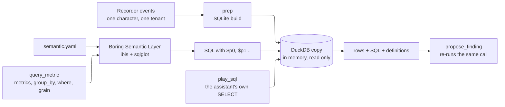

# Semantic layer

**For:** anyone asking their AI about a character, and anyone curious how the numbers are
defined. **At the end:** you know which metrics exist, what each one counts, and how to check
an answer.

The MCP server has two ways to ask the play data a question. `play_sql` runs whatever SELECT
the assistant writes. `query_metric` asks for **named metrics**: `played_s` by `level`,
`dungeon_s` by `zone` per week. The server writes the SQL from one model file,
[`wowstats/analysis/semantic.yaml`](../../wowstats/analysis/semantic.yaml), and sends back the
rows, the SQL it ran and each metric's definition and caveats. 245 metrics (11 of them across
models), 88 dimensions, three time grains (day, week, month), and thirteen
[views per grain](#views-per-grain) that `play_sql` reads like tables.

The character page reads the same file: its time per level, XP an hour, kill and quest totals,
dungeon runs and deaths come out of the layer when the page's answers are built (see
[The pages read it too](#the-pages-read-it-too)). One definition for the page and your AI.

## Why a semantic layer

"How long did level 30 take?" has four honest answers in this data, and they don't agree:

| Metric | Counts | Level 30 on the demo |
|---|---|---|
| `played_s` | Polestar's split: the game's /played inside the level | 11,240 s |
| `online_s` | the Recorder's timeline: every interval between two records of a login | 11,221 s |
| `active_s` | the same timeline, AFK flag off | 11,221 s |
| `calendar_s` | wall clock from the previous ding to this one, nights included | 101,240 s |

With raw SQL the assistant picks one of them without telling you, and the next chat picks
another. With the layer each one has a name, a one-line definition and its caveats, declared
once. The assistant names the one it means, and the answer says which one it got.

Two more things come free with it. Every answer carries the SQL that made it, so you (or the
judge) can re-run it. And the values you filter on are bound as parameters (`$p0`, `$p1`): a
zone called `Westfall'; DROP TABLE levels; --` is just a zone that matches nothing.

The tables underneath moved from SQLite to DuckDB for this: a columnar engine made for
exactly these GROUP BYs, and the dialect the layer compiles to.
The layer itself is [Boring Semantic Layer](https://github.com/boringdata/boring-semantic-layer)
(MIT): measures, dimensions, time grains and ratios in a YAML file, compiled to SQL through ibis
and sqlglot. Only the compiler runs here (no ibis backend, so no pandas or pyarrow in the image).
The others I looked at:

- **dbt MetricFlow** (Apache-2.0): the reference design, but 0.214 caps Python at
  3.14 and the image runs 3.15. It also wants a dbt manifest and a time spine table.
- **Cube**: a Node server next to the app, heavier than the whole image.
- **Malloy**: its own query language to learn, and the Python package was last released in
  September 2024.
- **Wren Engine**: pulls pandas, pyarrow and boto3.

## How a question runs



- **One character at a time.** The database behind both tools holds the calling person's
  character and nothing else (the same tenant scoping as every other tool). A friend naming the
  owner's character gets "no events", from `play_sql` and `query_metric` alike.
- **Several models, no fan-out.** Metrics from different tables (`online_s` from the timeline,
  `played_s` from the level splits, `kills` from the records) are each aggregated on their own
  table, then joined on the `group_by` columns. A level's 11,240 s is never counted once per
  timeline row. With three models or more, each one joins on the keys of every model before
  it, so a level the first model lacks still lines up with the third instead of splitting
  into two rows.
- **Locked down.** DuckDB runs with no file or network access, no extensions, a 256 MB memory
  limit and a 5 s timeout. A query that reads `read_csv`, `read_parquet`, a URL or `ATTACH`
  is refused, and so is one calling `repeat`, `lpad` or a scalar `range` (DuckDB's memory limit
  doesn't count one huge value: `lpad('x', 500000000)` made 1.6 GB in a test).
- **Both sides of a ratio count the same rows.** A metric read from two sides (a ratio, a
  difference, a cross-model rate) has an `eligibility` in the model file: the rows it reads,
  on both sides. `vs_route` reads whole splits with a planned time. Before that rule, a
  finished level (100 s played, 100 s planned) next to the level in play (no split yet, 100 s
  planned) came out at 0.5 and 100 s ahead of plan; now it's 1.0 and 0. `planned_s` asked on
  its own is still the whole target, every level with a plan in it.
- **Too little evidence is empty, never zero.** A metric with `min_evidence` is NULL below
  it, and the answer adds a `<metric>_evidence` column with the count. `gold_delta_copper`
  needs two snapshots with money, taken at different times: one snapshot used to read as a
  change of 0. So 0 in the evidence column means no snapshot at all (unavailable), 1 means one
  (unknown), 2 or more with a 0 in the metric is a purse that really didn't move.
  `query_metric` also sums it up per metric under `min_evidence`: rows measured, unknown and
  unavailable.
- **`more` means more.** The SQL asks for one row past `limit` (`LIMIT 4` for a limit of 3)
  and the extra row only sets `more`. With `LIMIT n` the runner never saw row n+1, so a
  `limit: 1` over three zones said `more: false`.

## Examples on the demo

All on `Testchar-Demo` from [the demo](../self-host/demo.md) (made-up data). Rows trimmed.

**Dungeon time per zone, per week:**

```json
{"metrics": ["dungeon_s"], "group_by": ["zone"], "grain": "week",
 "where": [{"dimension": "dungeon", "op": "is not null"}], "order_by": ["-dungeon_s"]}
```

| zone | week | dungeon_s |
|---|---|---|
| Desolace | 2026-11-09 | 2663 |
| Stranglethorn Vale | 2026-11-16 | 2598 |
| Stonetalon Mountains | 2026-11-09 | 1995 |

(The demo's dungeon runs keep the outdoor zone name; in the game the zone usually becomes the
dungeon. Group by `dungeon` for the dungeon itself.)

**XP per played hour, by level** (a ratio: `level_xp` over `played_s`):

```json
{"metrics": ["xp_per_hour", "level_xp", "played_s"], "group_by": ["level"],
 "where": [{"dimension": "level", "op": "=", "value": 30}]}
```

| level | xp_per_hour | level_xp | played_s |
|---|---|---|---|
| 30 | 17615.66 | 55000 | 11240 |

**Where the deaths happen:**

```json
{"metrics": ["deaths", "kills", "deaths_per_100_kills"], "group_by": ["zone"],
 "order_by": ["-deaths"], "limit": 3}
```

| zone | deaths | kills | deaths_per_100_kills |
|---|---|---|---|
| Stranglethorn Vale | 3 | 281 | 1.068 |
| Wetlands | 1 | 151 | 0.662 |
| Ashenvale | 1 | 93 | 1.075 |

**Same metric, two grains.** `"grain": "day"` gives one row a day; `"grain": "week"` adds them
up (the test suite checks that the weeks sum to the days):

| week | online_s |
|---|---|
| 2026-11-09 | 75162 |
| 2026-11-16 | 16591 |

**Against the route planner** (a ratio, `played_s / planned_s`, over whole splits only):

```json
{"metrics": ["played_s", "planned_s", "vs_route"], "group_by": ["level"], "limit": 3}
```

| level | played_s | planned_s | vs_route |
|---|---|---|---|
| 22 | 6420 | 8454 |  |
| 23 | 7310 | 4632 | 1.578 |
| 24 | 8520 | 5300 | 1.608 |

Level 22 is the demo's first tracked level: its split began partway through, so it has no
`vs_route`. 6,420 s against a whole level's 8,454 s would say "faster than plan" for a level
nobody timed from the start.

**Which quest paid the most XP per minute** (`quest_xp_per_min`, done quests only):

```json
{"metrics": ["quest_xp_per_min", "done_quest_xp", "done_quest_s", "quest_wall_s"],
 "group_by": ["quest"], "order_by": ["-quest_xp_per_min"], "limit": 3}
```

| quest | quest_xp_per_min | done_quest_xp | done_quest_s | quest_wall_s |
|---|---|---|---|---|
| Demo quest 951 | 1219.3 | 3221 | 158.5 | 317 |
| Demo quest 409 | 1211.1 | 3724 | 184.5 | 369 |
| Demo quest 505 | 1042.7 | 3128 | 180 | 540 |

**Time per guide step**, with the step's name from the route reference:

```json
{"metrics": ["online_s"], "group_by": ["guide_title", "step", "step_title"],
 "where": [{"dimension": "step_title", "op": "is not null"}], "order_by": ["-online_s"], "limit": 3}
```

| guide_title | step | step_title | online_s |
|---|---|---|---|
| Wetlands, Ashenvale, Ironforge & Stormwind City | 64 | Shael'dryn | 1892 |
| Wetlands, Ashenvale, Ironforge & Stormwind City | 100 | Jorgen and Elling Trias | 1476 |
| Wetlands & Hillsbrad Foothills | 30 | Prospector Whelgar | 1226 |

**Kills per hour of combat** (`kills` from the records over `combat_s` from the timeline):

```json
{"metrics": ["kills_per_combat_hour", "kills", "combat_s"], "group_by": ["level"], "limit": 3}
```

| level | kills_per_combat_hour | kills | combat_s |
|---|---|---|---|
| 22 | 64.8 | 96 | 5330 |
| 23 | 69.7 | 121 | 6253 |
| 24 | 84.2 | 175 | 7486 |

## Time on a quest

A quest's time is `quest_s`: every online second while the quest sat in the log, **shared
equally among the quests open in that second**. Two quests open for an hour get 30 minutes
each.

The obvious answers are wrong. Wall time from accept to hand-in (`quest_wall_s`) counts the
nights in between: Demo quest 1018 was picked up at 23:22 and handed in the next evening,
73,560 s of wall time for 3,186 s of shared play. Online time while open (`quest_open_s`)
counts the same second once per open quest: on the demo the quests hold about 2 at a time, so
it adds up to 172,284 s, nearly twice the 91,753 s played that week.

Shared, the times add up: on the demo `quest_s` sums to 86,283 s, the online time with at least
one quest in the log, nothing counted twice (a test checks it). What it can't know is which
quest you were working on: a quest that sits in the log while you finish three others takes
its share of their time, so one carried for days looks slow. `quests_open_avg` says how crowded
the log was. The pairing itself: each accept meets the next hand-in or abandon of the same
quest id; a hand-in with no accept before it (picked up before tracking started) is `untimed`,
with its XP and no time.

## Money spent

Nothing the kit reads saves spending. The Recorder has the money a quest pays (and offers), and
a vendor or trainer window opening, never a price paid. Polestar's alts list and Syndicator
keep the purse at logout. Auctionator keeps prices, not sales.

So the layer has `unexplained_gold_delta`: between two logout snapshots, how much the purse
moved minus the quest money handed in between them. That's loot coin, vendor and auction sales
and mail in, less repairs, purchases, training, flights and mail out, all together. It is never
"repairs". A move counts in the level of its first snapshot; filter `dings = 0` for the moves
inside one level. On the demo the rest is the flights: -86 copper at 22, -116 at 24.

`gold_delta_copper` (last snapshot minus first, per group) needs two snapshots with money at
different times. By day on the demo, 2026-11-15 has one: its delta is empty and
`gold_delta_copper_evidence` says 1. The days around it have 2 or 3.

[Accountant Classic](https://www.curseforge.com/wow/addons/accountant-classic) (GPL-2.0, lists
Forever) saves money in and out per source (training, taxi, trade, auction
house, merchants, repairs, mail, quests, loot) per session, day, week, month and total, in
`Accountant_ClassicSaveData`. The kit doesn't read it. It counts by
calendar window, not by level, so even with it a level's repairs would come from the totals at
each logout.

## Across two models

`kills_per_combat_hour`, `deaths_per_online_hour` and `quest_xp_per_played_hour` read metrics
from two models. They sit under `cross_model_metrics` in the model file, as an expression over
metric names (numbers, `+ - * /` and parentheses only). Boring Semantic Layer's own joins go
from one model's rows to another's by a key; the layer already answers every multi-model
question by aggregating each model on its own and joining the results on the `group_by`
columns, so a ratio across two models is computed on that joined row. No fan-out, any grain.
They group and filter by the dimensions both models have (level, character, class, time), and
refuse the others.

## The pages read it too

The character page's numbers used to be counted by the page's own code, next to the layer's.
Now the page takes them from the layer:

| On the page | Metric |
|---|---|
| Time, XP, quests, kills and XP/hour of each level | `played_s`, `level_xp`, `split_quests`, `split_kills`, `xp_per_hour` |
| "A level, over the last 5" | `avg_level_s` on the last 5 whole levels |
| XP an hour (the pace), and the time to the next level from it | `xp_per_hour` on the last 3 whole levels |
| Played since tracking began | `played_s` (plus the level in play, live) |
| Kills and quests over the completed levels, and the current level's so far beside them | `climb_kills`, `climb_quests` by `in_play` (below) |
| Each dungeon run's time, XP and XP/hour | `run_s`, `run_xp`, `run_xp_per_hour` by `run` |
| Deaths: how many, by zone, by level | `deaths` |

DuckDB runs when the answers are built (the full view's background builder after new data,
the publisher's static builds), once per character and data, never for a page view. It reads
only the feeds those metrics need (level splits, dungeon runs, and the Recorder's level,
session, zone and death records), not the whole history the analysis copies. On the demo every
answer says exactly what it said before the move (`tests/test_layer_pages.py`, against a
snapshot taken before).

Two definitions the page used to have its own way of are now the layer's, in shared code
rather than through DuckDB:

- **Sessions**: more than 330 s without a Recorder record ends one, for the journal, the
  Overview, the timeline, the MCP's `sessions` tool and the layer's `sessions`
  (`stores.split_sessions`). It used to be 20 minutes or a login on the page, 20 minutes on 5
  minute buckets in the MCP.
- **The route's time for a level**: the class's median over the side's starting races, else
  the median over classes, for the Overview's pace, the MCP and `planned_s` (`Route.level`).
  The page used to take your race's own run when the route export had one.

The hero line's gold is the purse at the last logout, a fact rather than a metric.

There is no second way to count them. DuckDB and the layer are core dependencies, and when
the layer fails for a character the page shows its standard failure state: the last good
answer, marked out of date, never numbers counted another way. The server logs one JSON line
(`"event": "semantic_failed"`) and the full view's `/healthz` says `"semantic": "failing"`
([Monitor it](../self-host/monitoring.md)). A missing data source is not a failure: the
metrics it feeds are NULL, and the page says what's unknown.

### Which kills and quests

"How many kills?" has two honest answers mid-level, so the count says its population.
`climb_kills` and `climb_quests` count Polestar's split for a level that has one (it counts the
whole level), else the Recorder's records at that level. `in_play` picks the population:

| Population | Filter | Demo (Testchar, level 32) |
|---|---|---|
| The completed levels | `in_play = 0` | 1,188 kills, 94 quests (levels 22-31) |
| The current level so far | `in_play = 1` | 74 kills, 5 quests |
| Including the current level | none | 1,262 kills, 99 quests |

The page's climb says "over the completed levels" and puts the current level's so far beside
it. The MCP's `character_summary` returns all three under `counts`: `completed_levels`,
`current_level` and `including_current_level` (`wowstats.analysis.pages.climb`, one function
for both).

## What to equip next

Two models hold the gear advice, scored for the spec the player set (`WEIGHTS`, else the
talents): `worn` (the items on the newest sheet, their share of the slot's best and who they're
built for) and `upgrades` (every upgrade, one row per item and source, with its source in the
gear tool's words and its Wowhead page). `rank_now` ranks a slot's upgrades wearable now by
gain, so "the best three for my head" needs no SQL:

```json
{"metrics": ["upgrade_gain", "upgrade_bis_pct", "upgrade_bis_pct_worn"],
 "group_by": ["slot", "item_id", "item", "fit"],
 "where": [{"dimension": "slot", "op": "=", "value": "Head"},
           {"dimension": "rank_now", "op": "<=", "value": 3}],
 "order_by": ["-upgrade_gain"]}
```

On the seeded evaluation's Holy priest wearing a Shadow circlet (`wrong_spec_gear`):

| slot | item | fit | upgrade_gain | upgrade_bis_pct | upgrade_bis_pct_worn |
|---|---|---|---|---|---|
| Head | Embalmed Shroud | yes | 27.17 | 100 | 17 |
| Head | Earthen Silk Hood | yes | 20.91 | 81 | 17 |
| Head | Electromagnetic Gigaflux Reactivator | yes | 18.68 | 74 | 17 |

Say each as the page does, "17% → 100% on your head", never "+83%". The brief's
`facts.gear_fit` runs this query for every worn item that fits the spec badly, and lists each
item's sources (`upgrade_sources` by `item_id`, `source`, `source_wowhead`) beside it. Their
metrics take the largest value in the group (`aggregation: max`): an item's gain is the same on
each of its source rows, and two items for one slot are alternatives, never a sum.

## Views per grain

The owner's call (2026-11-22): every tool and brief fact reads through the layer. A SELECT
the assistant writes is the one reader the layer can't hand a metric to, so the layer hands it
views instead: `per_level`, `per_session`, `per_zone`, `per_dungeon`, `per_trip`, `per_guide`,
`per_quest`, `per_death`, `per_week`, `per_slot`, `per_faction`, `per_flight_node` and
`per_quest_giver`, one row per key. Nobody wrote their SQL.
Each is declared in `semantic.yaml` under `views` (its entity, its metrics, a few dimensions
that hold one value per key) and compiled at startup by the same compiler as `query_metric`:
each model aggregates to the entity, the parts join on it. So a view's `vs_route` is `query_metric`'s `vs_route` by level, eligibility included, and
`gold_delta_copper` is NULL below two snapshots with `gold_delta_copper_evidence` beside it.

```sql
SELECT level, played_s, calendar_s, longest_gap_s, recorder_coverage, deaths, vs_route
FROM per_level WHERE level BETWEEN 30 AND 33
```

`recorder_coverage` is the share of the level's played time the Recorder saw (1.0: all of
it; NULL: can't be measured, so unknown). Read the level's deaths, kills and quests with it: a
0 at 0.6 coverage may be play the Recorder missed. `per_slot` gives the worn item an upgrade
replaces (the weaker ring or trinket), its fit to the scored spec, the best upgrade wearable now
and the two numbers to say as "17% → 100% on your head" (`upgrade_bis_pct_worn` →
`best_upgrade_bis_pct`).

A metric that can't be grouped by the view's entity is refused when the catalogue loads, so a
view never shows a number it would have had to fake. `tests/invariants/test_views.py`
checks every column against `query_metric` at the same grain on the demo, and that no key
comes out twice. `play_sql` lists them first; the raw tables stay as the fallback.

## Still out of reach

- **Two characters in one query.** Each character is its own database. Ask twice, once per
  `char`.
- **Repairs, by name.** See [Money spent](#money-spent).

## Evidence for a finding

`propose_finding` takes a `query_metric` call instead of SQL: put the call's arguments in
`finding.metric_query`, and the finding's `{placeholders}` name its output columns. The judge
compiles it, re-runs it and compares every number in `expect`. The kept finding stores the
compiled SQL and its parameters, and the nightly recheck re-runs exactly that, as long as
the definitions it reads haven't changed since: its metrics, the dimensions it groups, filters
or cuts time by, their models and the model views under them (`semantic_reads`). After such a
change the finding is "to revalidate" until an analysis proposes it again; a metric it doesn't
read can be added or changed without touching it (docs/mcp.md, "The play analysis").

The evidence has to read the play history. A SQL that selects a constant (`SELECT 3 AS n`) or
only the documentation tables re-runs to the same number every time and says nothing about the
data, so the judge refuses it and points to `query_metric`. A query that reads a table can still
compute the wrong thing: the re-run can't catch that.

A `query_metric` call counts in the analysis run like a `play_sql` query: it adds to the run's
query count, and the tables under the metrics it read count as read, so the coverage round
doesn't send a lane back to a table the metrics already covered.

## play_sql speaks DuckDB now

Same tables, same columns, same row cap and timeout. The dialect differs from SQLite in a few
places that matter:

- `/` divides as decimals: `7/2` is 3.5. Use `//` for whole numbers.
- A comparison doesn't sum: `COUNT(*) FILTER (WHERE kind = 'kill')` or
  `SUM(CAST(kind = 'kill' AS INT))`, not `SUM(kind = 'kill')`.
- `strftime` takes the time first: `strftime(to_timestamp(t), '%H')`.

Findings kept before the switch were written for SQLite: the nightly recheck keeps running
those on SQLite, so none of them breaks.

## The catalogue

<!-- generated:semantic-catalogue -->
<!-- From wowstats/analysis/semantic.yaml: edit it there, then run tools/manual/generate.py. -->

### levels

One row per level: Polestar's split when the level is done, the ding time and the route planner's time.

| Metric | Kind | Unit | Definition | Caveats | Read as |
|---|---|---|---|---|---|
| `split_levels` | simple | levels | Levels with a Polestar split (a time played). | The level in play has no split yet; a partial split counts. | sum; time: level_completion; observed. |
| `played_s` | simple | seconds | Time at a level, way 1: Polestar's own split, the game's /played seconds spent in the level. | Counts from the moment tracking started: a level marked partial began before it. Offline time is not in it. | sum; time: level_completion; observed. |
| `calendar_s` | simple | seconds | Time at a level, way 4: wall-clock seconds from the previous ding to this one, offline time included. | NULL for the first tracked level and the level in play. A week off between two dings counts in full. | sum; time: level_completion; reconstructed. |
| `offline_s` | simple | seconds | Time at a level, offline: calendar_s minus played_s, the seconds the game was closed between the two dings. | Whole splits only (NULL for a partial split, the first tracked level and the level in play). A level that took weeks on the calendar with its played time on plan was a break, not slow play: read played_s and vs_route for pace. | sum; time: level_completion; inferred. |
| `level_xp` | simple | xp | XP the level took (Polestar split). | From the split: missing for a level the split never closed. | sum; time: level_completion; observed. |
| `split_quests` | simple | quests | Quests handed in during the level, as Polestar's split counts them. | The split's own count; records.turnin can differ for a partial level. | sum; time: level_completion; observed. |
| `split_kills` | simple | kills | Kills during the level, as Polestar's split counts them. | The split's own count; records.kill can differ for a partial level. | sum; time: level_completion; observed. |
| `climb_kills` | simple | kills | Kills over the climb: Polestar's split count for a level with a split, else the Recorder's kill records at that level (the level in play, or Polestar off). Pick the population with in_play: 0 the completed levels, 1 the current level so far, no filter both. | Always say the population: the completed levels (in_play = 0) or including the current level. A level without a split counts only what the Recorder saw while it was on. NULL for a level neither counted. | sum; time: level_completion; observed. |
| `climb_quests` | simple | quests | Quests handed in over the climb: Polestar's split count for a level with a split, else the Recorder's turn-in records at that level (the level in play, or Polestar off). Pick the population with in_play: 0 the completed levels, 1 the current level so far, no filter both. | Always say the population: the completed levels (in_play = 0) or including the current level. A level without a split counts only what the Recorder saw while it was on. NULL for a level neither counted. | sum; time: level_completion; observed. |
| `planned_s` | simple | seconds | The route planner's seconds for the level: for this class, or the median over classes when the class isn't known. | A model of a quick player who knows the route, uncalibrated. NULL when the route reference has no time for the level. | sum; time: level_completion; estimated. |
| `class_planned_s` | simple | seconds | The route planner's seconds for the level for the character's own class only: planned_s without its fallback to the median over classes. | NULL when the class isn't known (no Recorder session record names it) or the route reference has no time for the level: the planner then falls back to the route for the side and class it knows from elsewhere. As uncalibrated as planned_s. | sum; time: level_completion; estimated. |
| `longest_gap_s` | simple | seconds | The longest stretch inside the level (previous ding to this one, or to the last record for the level in play) with no Recorder session. | Time offline, or play the Recorder missed when recorder_missed_s is above 0. Not additive: over several levels it is the longest of them. NULL for the first tracked level. | max; time: level_completion; reconstructed. |
| `recorder_missed_s` | simple | seconds | Played seconds in the level that no Recorder session covers: the coverage's Recorder gap for the level. | 0 when the Recorder saw the whole level. NULL when it can't be measured: a partial split, the first tracked level, the level in play, or a level before the Recorder's first session. | sum; time: level_completion; inferred. |
| `longest_gap_from` | simple | local time | When the longest silence (longest_gap_s) began: the end of the Recorder session before it, local time. | Over several levels, the start of the longest of their silences. NULL where longest_gap_s is NULL. | top; time: level_completion; reconstructed. |
| `longest_gap_to` | simple | local time | When the longest silence (longest_gap_s) ended: the start of the Recorder session after it, or the ding, local time. | Over several levels, the end of the longest of their silences. NULL where longest_gap_s is NULL. | top; time: level_completion; reconstructed. |
| `xp_per_hour` | ratio | xp/hour | XP per played hour in the level: level_xp over played_s. | Played time from the split, so idle time in the game counts against it. | ratio_of_sums; time: level_completion; observed. Rows: A level with a split: played time above 0 and its XP known. |
| `vs_route` | ratio | ratio | Played time over the route planner's time: 1.0 is on plan, 2.0 twice as long. | As uncalibrated as planned_s. Reads whole splits with a planned time only (eligibility): planned_s on its own is the total target, every level with a plan. NULL when no level qualifies. | ratio_of_sums; time: level_completion; estimated. Rows: A whole split (partial = 0, played time above 0) with a planned time. The level in play has no split and a partial split began partway through the level, so both stay out of both sides; planned_s on its own still counts them. |
| `offline_share` | ratio | ratio | Share of the calendar time at a level spent offline: offline_s over calendar_s (0.9: nine days in ten the game was closed). | Says how much of a level's calendar was a break, nothing about the pace inside the game. | ratio_of_sums; time: level_completion; inferred. Rows: A whole split with both dings known: its offline time and calendar time are measured. |
| `avg_level_s` | ratio | seconds | Average played seconds a level: played_s over split_levels (the page's "a level, over the last 5"). | Filter partial = 0 for whole levels: a partial split is short. | ratio_of_sums; time: level_completion; observed. Rows: A level with a split (the level in play has none). |
| `recorder_coverage` | ratio | share | Share of the level's played time the Recorder saw: played_s minus recorder_missed_s, over played_s (1.0: every minute). | The Recorder's counts for the level (deaths, kills, quests_done, online_s) cover this share of its play: below 1, a 0 there may be play it missed. NULL when it can't be measured (see recorder_missed_s): unknown, never full. | ratio_of_sums; time: level_completion; inferred. Rows: A level whose Recorder gap is measured: a whole split after the Recorder's first session. |
| `over_route_s` | derived | seconds | Seconds played beyond the route planner's time (negative: faster). | As uncalibrated as planned_s. Reads whole splits with a planned time only (eligibility): planned_s on its own is the total target, every level with a plan. NULL when no level qualifies. | sum; time: level_completion; estimated. Rows: A whole split (partial = 0, played time above 0) with a planned time. The level in play has no split and a partial split began partway through the level, so both stay out of both sides; planned_s on its own still counts them. |

Group or filter by: `character`, `class`, `ding_t`, `in_play`, `level`, `partial`, `time`.

### timeline

The online time cut at every record: each row an interval inside a login span, with the state at its start.

| Metric | Kind | Unit | Definition | Caveats | Read as |
|---|---|---|---|---|---|
| `online_s` | simple | seconds | Time at a level, way 2: online seconds the Recorder saw, every interval between two records of a login span. | A silence over 330 s ends a span, so a crash or a long loading screen can drop a few minutes. | sum; time: interval_start; reconstructed. |
| `active_s` | simple | seconds | Time at a level, way 3: online seconds with the AFK flag off. | The game sets AFK after 5 idle minutes: those 5 minutes still count as active. | sum; time: interval_start; reconstructed. |
| `afk_s` | simple | seconds | Online seconds with the AFK flag on. | Starts 5 minutes into the idle time (the game's own flag). | sum; time: interval_start; reconstructed. |
| `dungeon_s` | simple | seconds | Online seconds inside a dungeon run. | Inside the instance only: the walk there and the hand-ins are outside (see trip_s). | sum; time: interval_start; reconstructed. |
| `combat_s` | simple | seconds | Online seconds in combat. | From the combat records' on/off pairs. | sum; time: interval_start; reconstructed. |
| `dead_s` | simple | seconds | Online seconds from a death to the revive (ghost run, spirit healer). | Death to revive only; the walk back after a spirit healer is alive time. | sum; time: interval_start; reconstructed. |
| `taxi_s` | simple | seconds | Online seconds on a flight path. | Flight paths only; boats and zeppelins are ride time, not in it. | sum; time: interval_start; reconstructed. |
| `first_online_t` | simple | unix seconds | When the group's first online interval began, unix seconds (a guide step: when it first came up). | Not additive: over several groups it is the earliest. Online time only: a step shown while offline isn't seen. | min; time: interval_start; reconstructed. |
| `ride_s` | simple | seconds | Online seconds between a ride record's on and its off: a boat, a zeppelin, a tram. | From the Recorder's ride records' on/off pairs; flight paths are taxi_s, not in it. | sum; time: interval_start; reconstructed. |
| `solo_s` | simple | seconds | Online seconds with no group (group_size 0). | Only after the session's first group record: the time before it is group_unknown_s, never solo. Without the Recorder: 0, and online_s too (/psrec on, then /reload). | sum; time: interval_start; reconstructed. |
| `grouped_s` | simple | seconds | Online seconds in a party or a raid (group_size above 0). | A group counts from its group record to the next one, whoever is in it: the Recorder never says who. Without the Recorder: 0 (/psrec on, then /reload). | sum; time: interval_start; reconstructed. |
| `group_unknown_s` | simple | seconds | Online seconds before the session's first group record: solo or grouped, unknown. | The Recorder writes a group record at each session's start; an older Recorder may not, and its sessions are unknown here (update the Recorder). Read solo_s and grouped_s against what is left. | sum; time: interval_start; reconstructed. |
| `mounted_move_s` | simple | seconds | Online seconds moving on a mount: after a position record with the mount flag and a speed, up to 20 seconds past it. | The Recorder writes a position at least every 20 seconds while the character moves, so time more than 20 s past the last one counts as a stop. Flights and boats are taxi_s and ride_s. Without the Recorder's positions: 0 (/psrec on, then /reload). | sum; time: interval_start; reconstructed. |
| `unmounted_move_s` | simple | seconds | Online seconds moving on foot, alive, out of water: after a position record with a speed and no mount, up to 20 seconds past it. | Counted as mounted_move_s (stops past 20 s left out). Swimming is swim_s, the run back as a ghost ghost_s. Without the Recorder's positions: 0 (/psrec on, then /reload). | sum; time: interval_start; reconstructed. |
| `swim_s` | simple | seconds | Online seconds with the last position in water (its swimming flag). | Until the next position record: floating still counts. Without the Recorder's positions: 0 (/psrec on, then /reload). | sum; time: interval_start; reconstructed. |
| `ghost_s` | simple | seconds | Online seconds as a ghost: from the first position after the release (flag 32) to the revive. | The run back to the corpse or a spirit healer; lying dead before the release is dead_s, not here. Without the Recorder's positions: 0 (/psrec on, then /reload). | sum; time: interval_start; reconstructed. |
| `group_share` | ratio | share | Share of the online time with a known group spent grouped: grouped_s over grouped_s + solo_s. | 0 to 1. Leaves out group_unknown_s on both sides. NULL without a group record: no Recorder (/psrec on, then /reload), or one older than its group records (update the Recorder). | ratio_of_sums; time: interval_start; reconstructed. Rows: Intervals after a group record: the group is known on both sides. |
| `dungeon_share` | ratio | share | Share of online time spent inside dungeons: dungeon_s over online_s. | 0 to 1. NULL when online_s is 0. | ratio_of_sums; time: interval_start; reconstructed. Rows: Every interval: both sides cut the same online time. |
| `afk_share` | ratio | share | Share of online time with the AFK flag on: afk_s over online_s. | 0 to 1. | ratio_of_sums; time: interval_start; reconstructed. Rows: Every interval: both sides cut the same online time. |
| `combat_share` | ratio | share | Share of online time in combat: combat_s over online_s. | 0 to 1. | ratio_of_sums; time: interval_start; reconstructed. Rows: Every interval: both sides cut the same online time. |

Group or filter by: `character`, `class`, `dungeon`, `group_size`, `guide`, `guide_title`, `hour`, `in_raid`, `level`, `session_id`, `step`, `step_title`, `subzone`, `time`, `week`, `zone`.

### records

Every Recorder record except positions: kills, deaths, quests, loot and the rest.

| Metric | Kind | Unit | Definition | Caveats | Read as |
|---|---|---|---|---|---|
| `kills` | simple | kills | Creatures the player or pet killed (kill records). | Includes kills tapped by another player (records.extra has tapped). | sum; time: event; observed. |
| `deaths` | simple | deaths | Deaths (death records). | The zone is where the player died, not where the corpse run ended. | sum; time: event; observed. |
| `quests_done` | simple | quests | Quests handed in (turnin records). | A quest handed in twice (repeatable) counts twice. | sum; time: event; observed. |
| `quests_accepted` | simple | quests | Quests accepted (accept records). | Re-accepting after an abandon counts again. | sum; time: event; observed. |
| `zone_visits` | simple | visits | Arrivals in a zone or subzone: zone records (the game's zone or subzone text changed). | Counted in the zone the record names: walking from one subzone to another inside a zone counts again. | sum; time: event; observed. |
| `guide_steps` | simple | steps | Guide steps Polestar moved to (step records). | Every move of Polestar's pointer, a step shown again included. Group by guide for one guide's. | sum; time: event; observed. |
| `flights` | simple | flights | Flight paths taken (taxi records). | Counted at the take-off; their time in the air is taxi_s. | sum; time: event; observed. |
| `quests_abandoned` | simple | quests | Quests abandoned (abandon records). | Only what the player abandoned; a failed quest is a fail record. | sum; time: event; observed. |
| `kill_xp` | simple | xp | XP from kills (kill records' xp_reward). | Rested bonus included, as the game reports it. NULL (unknown) when a kill of the group doesn't say what it paid: kills_without_xp counts them. 0 without a kill. | sum; time: event; observed. |
| `quest_xp` | simple | xp | XP from quest hand-ins (turnin records' xp_reward). | Discovery XP is apart (explore records). | sum; time: event; observed. |
| `quest_money_copper` | simple | copper | Money quest hand-ins paid, copper. | Quest rewards only; loot, sales and costs are not in it (see gold_delta_copper). | sum; time: event; observed. |
| `deaths_above` | simple | deaths | Deaths to a likely killer 3 or more levels above the character (death records: npc_level minus the record's level). | The killer is Polestar_Recorder's pick, likely, not certain (no combat log). A death with no pick or no level isn't counted. | sum; time: event; inferred. |
| `level_gap_max` | simple | levels | The largest level gap between a death's likely killer and the character: npc_level minus the record's level. | Not additive: over several deaths it is the largest of them. NULL when no death of the group has a killer and a level. | max; time: event; inferred. |
| `come_back_level` | simple | level | The highest level among the likely killers 3 or more levels above the character: the level to come back at. | Not additive: the largest of the group. NULL when no death of the group was to a creature 3+ levels above. | max; time: event; inferred. |
| `skill_rank` | simple | rank | The highest rank the skill records saw: group or filter by skill_id (Riding is 762). | Only ranks the Recorder saw change: a skill learned before it ran and never raised since has no record. NULL without a skill record. | max; time: event; observed. |
| `skill_ups` | simple | skill-ups | Skill rank changes (skill records): a profession, a weapon skill or Riding going up a point. | Every skill line together: group by guide (forever/professions/...) for the points made while a profession guide was up. | sum; time: event; observed. |
| `steps_done` | simple | steps | Guide steps Polestar moved to (step records with a step number, the guide picks left out). | A step shown twice (back, then next) counts twice. A step jumped over has no record: steps_jumped. | sum; time: event; observed. |
| `step_s` | simple | seconds | Polestar's own step timer: the seconds since the previous step record, as the shipper computes them for each step record, summed on the step it moved to (the guide_steps tool's time), to the millisecond. | Wall-clock time between two step records, as the shipper reads it: a logout or a break between them counts in full. For time played on a step, active_s grouped by guide and step (timeline). | sum; time: event; observed. |
| `step_picks` | simple | picks | Guides picked or switched (step records with reason pick, or with no step number): not a step done. | Includes a guide finished or emptied (no step number left). | sum; time: event; observed. |
| `steps_skipped` | simple | steps | Steps the player skipped in the guide (skip records). | Explicit skips only; steps passed over by a jump forward are steps_jumped. | sum; time: event; observed. |
| `steps_jumped` | simple | steps | Steps passed over: a step record 2 to 25 steps past the guide's previous step record counts the steps in between. | Counted on the record that jumped, from the guide's previous step record (picks included) over the whole history: a jump of more than 25 is a new start, not a skip. | sum; time: event; reconstructed. |
| `first_record_t` | simple | unix seconds | When the group's first record was written, unix seconds. | Not additive: over several groups it is the earliest. | min; time: event; observed. |
| `last_record_t` | simple | unix seconds | When the group's newest record was written, unix seconds (by zone: the last time the character was there). | Not additive: over several groups it is the newest. Only what the Recorder saw. | max; time: event; observed. |
| `step_zone` | simple | zone | The zone of the group's first step record (a guide step: where it first came up). | Group by guide and step. The zone the character was in, from the zone records; NULL without one. | top; time: event; observed. |
| `session_records` | simple | records | The Recorder's chunk headers (session records): at login, /reload and every new 5-minute chunk while the game runs. | 0 when the Recorder never ran: the level splits and sheets came from Polestar or the shipper alone. | sum; time: event; observed. |
| `level_max` | simple | level | Highest level any record of the group carries. | NULL with no record in the group. | max; time: event; observed. |
| `level_now` | simple | level | Level on the group's newest record that carries one. | NULL with no record in the group. | latest; time: event; observed. |
| `explore_xp` | simple | xp | XP from discovering places (explore records' xp_reward): the third source beside kill_xp and quest_xp. | Discoveries the Recorder saw; a place found with it off pays XP nobody counted. 0 without an explore record. | sum; time: event; observed. |
| `kills_without_xp` | simple | kills | Kill records that don't say what the kill paid (no xp_reward): their XP is unknown, and kill_xp leaves them out. | Above 0, kill_xp and the XP-per-hour metrics built on it undercount: a Recorder older than the kill XP field wrote those kills. Read kill_xp only where this is 0. | sum; time: event; observed. |
| `zero_xp_kills` | simple | kills | Kills that paid no XP (xp_reward 0): a creature grey to the character, or one another player tapped first. | A kill with no xp_reward at all is unknown, not here (kills_without_xp). | sum; time: event; observed. |
| `rides` | simple | rides | Boat, zeppelin and tram rides boarded (ride records turning on). | Counted where the ride began; its time is ride_s. Flight paths are flights. | sum; time: event; observed. |
| `quest_xp_share` | derived | share | Share of kill and quest XP that came from quests: quest_xp over quest_xp + kill_xp. | Leaves out discovery XP and dungeon bonus XP. | ratio_of_sums; time: event; observed. Rows: Kill and turnin records: the top is a part of the bottom. |
| `deaths_per_100_kills` | ratio | deaths/100 kills | Deaths per 100 kills. | NULL without kills; a death to a fall or drowning counts too. | ratio_of_sums; time: event; observed. Rows: Every record of the group: deaths and kills are counted on the same records. |

Group or filter by: `character`, `class`, `death_t`, `dungeon_trip`, `elite`, `guide`, `hour`, `item_id`, `kind`, `level`, `npc_id`, `npc_level`, `record_t`, `run`, `session_id`, `skill_id`, `step`, `time`, `week`, `zone`.

### sessions

Login spans: a silence of more than 330 s between Recorder records ends one.

| Metric | Kind | Unit | Definition | Caveats | Read as |
|---|---|---|---|---|---|
| `session_count` | simple | sessions | Login spans. | A /reload doesn't split a span; a crash longer than 330 s does. | sum; time: interval_start; reconstructed. |
| `session_s` | simple | seconds | Seconds from a span's first record to its last. | Close to online_s for the same spans, without the timeline's cut. | sum; time: interval_start; reconstructed. |
| `session_xp` | simple | xp | XP gained during the spans (xp records). | From the XP bar every 5 minutes: a span shorter than that can show 0. | sum; time: interval_start; observed. |
| `distance_yd` | simple | yards | Yards covered during the spans: the distance between the Recorder's position records, summed. | Since the Recorder ran, never a lifetime total. Straight lines between positions a few seconds apart: a winding path is a little longer. 0 for a span with no position record (an older Recorder): read it with session_s. | sum; time: interval_start; reconstructed. |
| `avg_session_s` | ratio | seconds | Average span length: session_s over session_count. | One long evening moves it a lot on few sessions. | ratio_of_sums; time: interval_start; reconstructed. Rows: A span with a duration. |
| `xp_per_session_hour` | ratio | xp/hour | XP per hour of login span: session_xp over session_s. | AFK time inside a span counts against it. | ratio_of_sums; time: interval_start; reconstructed. Rows: A span with a duration and an XP reading. |

Group or filter by: `character`, `class`, `end_t`, `level_end`, `level_start`, `session_id`, `start_hour`, `start_t`, `time`, `week`, `weekday`.

### zone_time

Time per zone the Recorder's zone records give: from each zone record to the next zone record of its session, else to the session's last record (the pages' rule).

| Metric | Kind | Unit | Definition | Caveats | Read as |
|---|---|---|---|---|---|
| `zone_s` | simple | seconds | Seconds in a zone: from its zone record to the next zone record of the session, else to the session's last record. | The zone records' own times, the zones the journal and the zones tool list. online_s by zone cuts the timeline at every record instead, by the zone or subzone text each record carries: the two differ. | sum; time: interval_start; reconstructed. |

Group or filter by: `character`, `class`, `session_id`, `time`, `zone`.

### dungeon_runs

Polestar's instance runs: one row per run, enter to leave.

| Metric | Kind | Unit | Definition | Caveats | Read as |
|---|---|---|---|---|---|
| `run_count` | simple | runs | Dungeon runs. | A wipe and re-entry can show as two runs. | sum; time: interval_start; observed. |
| `run_s` | simple | seconds | Seconds inside the instance, as Polestar times the run (the `dungeons` tool's number). | Inside only. The trip around it: trip_s. | sum; time: interval_start; observed. |
| `run_xp` | simple | xp | XP gained inside the instance. | Kills inside; the quests handed in after are trip XP (trip_xp). | sum; time: interval_start; observed. |
| `run_xp_per_hour` | ratio | xp/hour | XP per hour inside: run_xp over run_s (the `dungeons` tool's xp_per_hour). | Leaves out the quest XP the run unlocks. | ratio_of_sums; time: interval_start; observed. Rows: A run with a time above 0 and its XP known. |

Group or filter by: `character`, `class`, `dungeon`, `level`, `run`, `time`, `trip`, `week`.

### dungeon_trips

A dungeon trip: from the first pickup guide step to the last hand-in around one run, online time.

| Metric | Kind | Unit | Definition | Caveats | Read as |
|---|---|---|---|---|---|
| `trip_count` | simple | trips | Dungeon trips. | One per run; bracket says whether guide steps widened it. | sum; time: interval_start; reconstructed. |
| `trip_s` | simple | seconds | Online seconds from the trip's start to its end: pickup, travel, inside, travel back, hand-in. | Online time only: logging out mid-trip doesn't count. | sum; time: interval_start; reconstructed. |
| `trip_inside_s` | simple | seconds | Online seconds inside the instance during the trip. | Online time, so it can differ from run_s by a few seconds. | sum; time: interval_start; reconstructed. |
| `trip_travel_s` | simple | seconds | Online seconds getting to the instance and back to the first hand-in. | Needs guide steps for the edges: an `instance` bracket trip has 0. | sum; time: interval_start; reconstructed. |
| `trip_pickup_s` | simple | seconds | Online seconds picking up the dungeon's quests at the start of the trip (lookup pickup guide steps). | 0 for a trip with no pickup steps (bracket instance). | sum; time: interval_start; reconstructed. |
| `trip_travel_to_s` | simple | seconds | Online seconds from the trip's start (or the last pickup) to entering the instance. | Online time only. trip_travel_s is this plus trip_travel_back_s. | sum; time: interval_start; reconstructed. |
| `trip_travel_back_s` | simple | seconds | Online seconds from leaving the instance to the first hand-in. | Online time only; 0 when the trip ends at the instance's door. | sum; time: interval_start; reconstructed. |
| `trip_handin_s` | simple | seconds | Online seconds handing in the dungeon's quests at the end of the trip (lookup hand-in guide steps). | 0 for a trip with no hand-in steps. | sum; time: interval_start; reconstructed. |
| `trip_xp_inside` | simple | xp | XP gained inside the instance during the trip (kills, and anything else that paid inside). | The XP of the run, at the level it was run: another level pays its kills differently. | sum; time: interval_start; observed. |
| `trip_xp_quests` | simple | xp | XP from the trip's quests handed in during the trip. | A trip quest handed in a day later is not in it. | sum; time: interval_start; observed. |
| `trip_quests_handed_in` | simple | quests | The trip's quests handed in during the trip. | Only the dungeon's own quests (the lookup guide steps'), handed in before the trip ended. | sum; time: interval_start; observed. |
| `trip_quest_money_copper` | simple | copper | Money the trip's quest hand-ins paid, copper. | Quest rewards only; the loot's worth is not in it. | sum; time: interval_start; observed. |
| `trip_xp` | simple | xp | XP inside the instance plus XP from the trip's quests handed in during the trip. | A trip quest handed in a day later is not in it. | sum; time: interval_start; reconstructed. |
| `trip_xp_per_hour` | ratio | xp/hour | XP per online hour of the whole trip: trip_xp over trip_s. | The number to compare with questing XP/hour; run_xp_per_hour flatters dungeons. | ratio_of_sums; time: interval_start; reconstructed. Rows: A trip with online time. |
| `trip_inside_share` | ratio | share | Share of the trip spent inside the instance. | 0 to 1. | ratio_of_sums; time: interval_start; reconstructed. Rows: A trip with online time. |

Group or filter by: `bracket`, `character`, `class`, `dungeon`, `level`, `time`, `trip`, `trip_end`, `trip_loot`, `trip_start`.

### snapshots

The character snapshots the shipper sends at logout and /reload: money, XP, bind.

| Metric | Kind | Unit | Definition | Caveats | Read as |
|---|---|---|---|---|---|
| `snapshot_count` | simple | snapshots | Snapshots (logouts and reloads). | Only what the shipper read: a crash leaves none. | sum; time: snapshot_observation; observed. |
| `gold_delta_copper` | derived | copper | Money on the group's last snapshot minus money on its first, copper. | Not additive: a week's delta is not the sum of its days (the change between days is in neither). NULL with fewer than two snapshots with money at different times in the group: gold_delta_copper_evidence beside it counts them (0: no snapshot, 1: one, not enough). | endpoint_difference; time: snapshot_observation; observed. Needs two snapshots with money, taken at different times (else NULL; `gold_delta_copper_evidence` counts them). |
| `snapshot_first_level` | simple | level | The level on the group's first snapshot. | A point, not a sum: the first sheet of the group (with snapshot_first_xp, where the character stood). | earliest; time: snapshot_observation; observed. |
| `snapshot_first_xp` | simple | xp | The XP into its level on the group's first snapshot. | Read it with snapshot_first_level. | earliest; time: snapshot_observation; observed. |
| `snapshot_last_level` | simple | level | The level on the group's last snapshot. | A point, not a sum: the newest sheet of the group. | latest; time: snapshot_observation; observed. |
| `snapshot_last_xp` | simple | xp | The XP into its level on the group's last snapshot. | Read it with snapshot_last_level. | latest; time: snapshot_observation; observed. |
| `snapshot_last_xp_max` | simple | xp | XP the level needs, on the group's last snapshot. | The newest snapshot where it is known: a newest snapshot without it gives the one before. NULL with no snapshot in the group. | latest; time: snapshot_observation; observed. |
| `money_copper` | simple | copper | Money on the newest snapshot, copper. | The newest snapshot where it is known: a newest snapshot without it gives the one before. NULL with no snapshot in the group. | latest; time: snapshot_observation; observed. |
| `snapshot_last_zone` | simple | zone | Zone on the group's last snapshot. | The newest snapshot where it is known: a newest snapshot without it gives the one before. NULL with no snapshot in the group. | latest; time: snapshot_observation; observed. |
| `bind` | simple | place | Where the hearthstone is bound, on the newest snapshot. | The newest snapshot where it is known: a newest snapshot without it gives the one before. NULL with no snapshot in the group. | latest; time: snapshot_observation; observed. |
| `resting` | simple | flag | 1 when the newest snapshot was taken in a rested area (an inn or a city), else 0. | The newest snapshot where it is known: a newest snapshot without it gives the one before. NULL with no snapshot in the group. | latest; time: snapshot_observation; observed. |

Group or filter by: `character`, `class`, `level`, `time`, `zone`.

### quests

Each quest the log held: its accept paired with its hand-in or abandon, and the online time it took.

| Metric | Kind | Unit | Definition | Caveats | Read as |
|---|---|---|---|---|---|
| `quest_count` | simple | quests | Quests (one per accept, or per hand-in or objectives done with no accept seen). | A repeatable quest counts once per accept. | sum; time: quest_closure; reconstructed. |
| `quest_s` | simple | seconds | Time on quests: every online second while a quest was in the log, shared equally among the quests open in that second. | Additive: the quests' times sum to the online time with a quest open, nothing counted twice. It can't tell which quest the player worked on, so a quest that sits in the log takes its share of the others' time. NULL for untimed quests. | sum; time: quest_closure; allocated. |
| `quest_open_s` | simple | seconds | Online seconds while the quest was in the log, in full for each open quest. | Not additive across quests: ten open quests each count the same evening. Use quest_s for time spent. | sum; time: quest_closure; reconstructed. |
| `quest_wall_s` | simple | seconds | Calendar seconds from accept to hand-in or abandon. | Counts the nights and days off in between: never a time spent. | sum; time: quest_closure; reconstructed. |
| `quest_reward_xp` | simple | xp | XP the hand-ins paid (untimed quests included). | Same hand-ins as quest_xp in records, grouped by quest. | sum; time: quest_closure; observed. |
| `quest_reward_copper` | simple | copper | Money the hand-ins paid, copper. | Quest rewards only. | sum; time: quest_closure; observed. |
| `done_quest_xp` | simple | xp | XP of the done quests (accept and hand-in both seen). | Leaves out untimed quests, whose time is unknown. NULL without a done quest. | sum; time: quest_closure; observed. |
| `done_quest_s` | simple | seconds | quest_s of the done quests. | Abandoned and open quests' time is in quest_s, not here. NULL without a done quest. | sum; time: quest_closure; allocated. |
| `quest_accepted_t` | simple | unix seconds | When the quest was accepted, unix seconds: the first accept in the group. | NULL for a quest accepted before tracking began (untimed, or open with its objectives seen done). Filter status for one row of a quest taken twice. | min; time: quest_closure; observed. |
| `quest_complete_t` | simple | unix seconds | When its objectives were last reported complete (a complete record between its accept and its close), unix seconds. | NULL while the objectives aren't done, or for a quest with nothing to collect the Recorder saw complete. For an open quest: ready to hand in. | max; time: quest_closure; observed. |
| `quest_xp_per_min` | ratio | xp/minute | XP per minute on quests: done_quest_xp over done_quest_s. | Done quests only. Time is the shared quest_s, so a quick quest done while ten sat in the log looks quicker than it was, and one carried for days looks slower. Kill XP on the way is not in it. | ratio_of_sums; time: quest_closure; allocated. Rows: A done quest with its shared time and its XP known. |
| `quests_open_avg` | ratio | quests | How many quests were in the log on average while these were: quest_open_s over quest_s. | 1 means one quest at a time; read it next to quest_s. | ratio_of_sums; time: quest_closure; allocated. Rows: A quest with both times (untimed quests have neither). |

Group or filter by: `character`, `class`, `done_why`, `level`, `level_accepted`, `quest`, `quest_id`, `status`, `time`, `zone`.

### gold_moves

The purse between two consecutive snapshots (logout or /reload): what it moved and the part the records name (quest money).

| Metric | Kind | Unit | Definition | Caveats | Read as |
|---|---|---|---|---|---|
| `gold_moves` | simple | moves | Moves between two snapshots. | A crash leaves no snapshot: the next move spans both sessions. | sum; time: snapshot_observation; reconstructed. |
| `gold_moved_copper` | simple | copper | How much the purse moved, copper: the sum of each move's change. | Additive, unlike gold_delta_copper: a week is the sum of its moves. A move counts in the level and day of its first snapshot. | sum; time: snapshot_observation; reconstructed. |
| `gold_quest_copper` | simple | copper | Money hand-ins paid inside the moves, copper. | Quest rewards the Recorder saw; one handed in with the Recorder off is unexplained. | sum; time: snapshot_observation; observed. |
| `unexplained_gold_delta` | simple | copper | The purse's change no record explains, copper: gold_moved_copper minus gold_quest_copper. | Loot coin, vendor and auction sales and mail in, less repairs, vendor purchases, training, flights, auction deposits and mail out, all together. No addon the kit reads saves spending (the Recorder has quest money only; Auctionator saves prices, not sales), so this is never repairs. A move counts in the level of its first snapshot: filter dings = 0 for moves inside one level. | sum; time: snapshot_observation; inferred. |
| `gold_move_online_s` | simple | seconds | Online seconds (timeline) between the two snapshots of each move, summed. | 0 for a move the Recorder didn't see (switched off, or not installed): the money moved, the time is unknown. | sum; time: snapshot_observation; reconstructed. |
| `gold_changes` | simple | moves | Moves where the purse changed. | A move that earned and spent the same counts as no change. | sum; time: snapshot_observation; observed. |
| `gold_first_t` | simple | unix seconds | When the group's first move started: its first snapshot, Unix seconds. | An edge of the window, not a measure of it. | min; time: snapshot_observation; observed. |
| `gold_last_t` | simple | unix seconds | When the group's last move ended: its last snapshot, Unix seconds. | An edge of the window, not a measure of it. | max; time: snapshot_observation; observed. |
| `gold_earned_copper` | simple | copper | Money the purse gained over the moves that ended richer, copper: the positive moves summed. | Since the first snapshot, never a lifetime total. Each move is net: money earned and spent between the same two snapshots cancels, so the true income is at least this. | sum; time: snapshot_observation; reconstructed. |
| `gold_per_online_hour` | ratio | copper/hour | Net gold per online hour: gold_moved_copper over gold_move_online_s, copper an hour. | Everything earned less everything spent. NULL when no move has online time (no Recorder): the plan then estimates the time from the level splits. | ratio_of_sums; time: snapshot_observation; reconstructed. Rows: Moves with online time the Recorder saw: the money and the hours come from the same moves. A move it missed would add money with no time. |

Group or filter by: `character`, `class`, `dings`, `level`, `time`, `week`.

### rested

The intervals between two Recorder XP records (about 5 minutes) in which the rested pool went down: how much it went down and the kill XP of the same interval.

| Metric | Kind | Unit | Definition | Caveats | Read as |
|---|---|---|---|---|---|
| `rested_intervals` | simple | intervals | Intervals in which the rested pool went down. | Only while the Recorder ran: its XP records bound the intervals. | sum; time: event; observed. |
| `rested_used_xp` | simple | xp | Rested XP used: how far the pool went down, summed over the intervals. | Kills inside a dungeon trip use it too: rested_per_kill_xp leaves those intervals out. | sum; time: event; observed. |
| `rested_kill_xp` | simple | xp | Kill XP recorded in the same intervals, outside dungeon trips (kill records' xp_reward). | Rested bonus included, as the game reports it. | sum; time: event; observed. |
| `rested_per_kill_xp` | ratio | xp/xp | Rested XP used per point of kill XP: rested_used_xp over rested_kill_xp, measured, no rule assumed. | NULL without outdoor kill XP, or with fewer than three intervals to measure. | ratio_of_sums; time: event; observed. Rows: Intervals with no kill inside a dungeon trip: the rested used and the kill XP are of the same kills. Needs three intervals outside dungeon trips where the pool went down (else NULL; `rested_per_kill_xp_evidence` counts them). |

Group or filter by: `character`, `class`, `level`, `session_id`, `time`, `zone`.

### loot

Every item the Recorder saw looted (loot_items), with the record it came in.

| Metric | Kind | Unit | Definition | Caveats | Read as |
|---|---|---|---|---|---|
| `looted_items` | simple | items | Items looted, a stack counted by its size. | Only what the Recorder saw; what it is worth is the item's (vendor price, the player's own scans), not here. | sum; time: event; observed. |
| `first_looted_t` | simple | unix seconds | When the group's first item was looted, unix seconds: by item_id, when the character first got it. | Not additive: over several groups it is the earliest. Only what the Recorder saw: an item looted before it ran isn't here. | min; time: event; observed. |

Group or filter by: `character`, `class`, `item_id`, `level`, `session_id`, `time`, `trip_id`, `week`, `zone`.

### xp

The XP bar as the Recorder reads it every 5 minutes: each row an xp record, with the guide step in force then.

| Metric | Kind | Unit | Definition | Caveats | Read as |
|---|---|---|---|---|---|
| `xp_gained` | simple | xp | XP the bar gained between two readings, every source together (kills, quests, discovery, rested bonus). | Read every 5 minutes: the XP of the last minutes before a logout counts at the next reading. By guide and step: the reading's own interval, so XP made just before a step change can land on the next step. | sum; time: event; observed. |
| `bar_t` | simple | unix seconds | When the newest XP bar reading of the group was taken, unix seconds (UTC). | NULL with no reading in the group. | max; time: event; observed. |
| `bar_level` | simple | level | Level on the newest XP bar reading. | The newest reading where it is known: a newest reading without it gives the one before. NULL with no reading in the group. | latest; time: event; observed. |
| `bar_xp` | simple | xp | XP into the level on the newest XP bar reading. | The newest reading where it is known: a newest reading without it gives the one before. NULL with no reading in the group. | latest; time: event; observed. |
| `bar_xp_max` | simple | xp | XP the level needs, on the newest XP bar reading. | The newest reading where it is known: a newest reading without it gives the one before. NULL with no reading in the group. | latest; time: event; observed. |
| `bar_rested_xp` | simple | xp | Rested XP left on the newest XP bar reading. | The newest reading where it is known: a newest reading without it gives the one before. NULL with no reading in the group. | latest; time: event; observed. |

Group or filter by: `character`, `class`, `guide`, `hour`, `level`, `session_id`, `step`, `time`, `week`, `zone`.

### progress

The character's level over time: one row per XP bar reading (the Recorder) and, apart, per logout snapshot (the character sheet), with the online time the Recorder saw up to each reading. The series a session plan is reviewed against.

| Metric | Kind | Unit | Definition | Caveats | Read as |
|---|---|---|---|---|---|
| `progress_readings` | simple | readings | Readings in the series: XP bar readings, or snapshots. | Readings with a level only. Filter on source: XP bar readings come every 5 minutes, snapshots at logout. | sum; time: event; observed. |
| `progress_t` | simple | unix seconds | When the group's newest reading was taken, unix seconds (UTC). | NULL with no reading in the group. | max; time: event; observed. |
| `progress_level` | simple | level | The level with the fraction of it done, on the group's newest reading: 32.5 is halfway through level 32. | A point, not a sum: by day it is where the day ended. The whole level when the reading has no XP the level needs. | latest; time: event; observed. |
| `progress_xp` | simple | xp | XP into the level on the group's newest reading. | Read it with the reading's level. NULL when the reading has none. | latest; time: event; observed. |
| `progress_online_s` | simple | seconds | Online seconds the Recorder saw from its first record up to the group's newest reading: every timeline interval that had ended by then. | A running total, not additive: by day it is the total at the day's last reading, and a day's own time is the difference between two days. NULL on snapshot rows: without the Recorder there is no online time (the plan estimates it from Polestar's level splits). | max; time: event; reconstructed. |

Group or filter by: `character`, `class`, `level`, `reading`, `source`, `time`.

### upgrades

The gear advice's upgrades for the spec the gear is scored for (the player's WEIGHTS setting, else the talents): one row per item and source, items within 3 levels. The decision data behind 'what should I equip next and where do I get it'.

| Metric | Kind | Unit | Definition | Caveats | Read as |
|---|---|---|---|---|---|
| `upgrade_gain` | simple | points | Score gain over what is worn in the slot (Polestar's points, for the scored spec): the biggest in the group. | The gear advice as of the newest character sheet, scored with the weights the player chose. Not additive: two items for one slot are alternatives. Group by item_id for one item's gain. | max; time: snapshot_observation; estimated. |
| `upgrade_gain_share_pct` | simple | percent | The item's gain as a percent of the score of everything worn now. | Lead with it and upgrade_gain; a percent over the replaced item misleads against a weak one. Group by item_id. | max; time: snapshot_observation; estimated. |
| `upgrade_bis_pct` | simple | percent | The item's score as a percent of the best its slot can hold at this level for the scored spec (100: the best). | Say it with upgrade_bis_pct_worn as the page does: '17% → 100% on your head', never as '+83%'. NULL when there is nothing to measure against. | max; time: snapshot_observation; estimated. |
| `upgrade_bis_pct_worn` | simple | percent | The same percent for what is worn in that slot now. | NULL for an empty slot, or when there is nothing to measure against. | max; time: snapshot_observation; estimated. |
| `upgrade_sources` | simple | sources | Ways to get the upgrades: one per item and source. | An item with a drop and a quest counts twice; group by item_id and source to list them. | sum; time: snapshot_observation; estimated. |
| `best_upgrade` | simple | item | The best upgrade wearable now: the item with the biggest gain (rank_now 1), its name. | Group by slot: over several slots it is the first name in alphabetical order among their best. NULL when nothing wearable now beats what is worn. | top; time: snapshot_observation; estimated. |
| `best_upgrade_id` | simple | item id | The best upgrade wearable now, its item id (its Wowhead page: item=<id>). | Group by slot, as best_upgrade. | top; time: snapshot_observation; estimated. |
| `best_upgrade_gain` | simple | points | The best upgrade's score gain over what is worn (Polestar's points, for the scored spec). | Group by slot, as best_upgrade. Not additive: one slot's best is not another's. | top; time: snapshot_observation; estimated. |
| `best_upgrade_bis_pct` | simple | percent | The best upgrade's score as a percent of the best its slot can hold at this level for the scored spec. | Say it with upgrade_bis_pct_worn as the page does: '17% → 64% on your head', never as '+47%'. NULL when there is nothing to measure against. | top; time: snapshot_observation; estimated. |

Group or filter by: `character`, `class`, `fills_empty`, `fit`, `instance`, `item`, `item_id`, `now`, `rank_now`, `slot`, `slot_id`, `source`, `source_kind`, `source_wowhead`, `with_item_id`, `zone`.

### worn

The items worn on the newest character sheet, as the gear advice scores them for the spec the gear is scored for.

| Metric | Kind | Unit | Definition | Caveats | Read as |
|---|---|---|---|---|---|
| `worn_items` | simple | items | Items worn. | The newest sheet only; a shirt or tabard counts when it has a name. | sum; time: snapshot_observation; observed. |
| `worn_score` | simple | points | The worn items' score for the scored spec (Polestar's points): one item's, or the whole gear's summed over slots. | NULL for an item the gear data doesn't know. | sum; time: snapshot_observation; estimated. |
| `worn_bis_pct` | simple | percent | The worn item's score as a percent of the best its slot can hold at this level for the scored spec (100: the best). | Group by slot and item_id: over several slots it is the best of them. NULL when there is nothing to measure against. | max; time: snapshot_observation; estimated. |
| `worn_item` | simple | item | The worn item an upgrade replaces: the slot's item, or the weaker of two (rings, trinkets) by score. | Group by slot: over several slots it is the first name in alphabetical order among their weakest. Weaker by the scored spec's points; an item the gear data doesn't score counts as the stronger. | top; time: snapshot_observation; observed. |
| `worn_item_id` | simple | item id | That worn item's id (its Wowhead page: item=<id>). | Group by slot, as worn_item. | top; time: snapshot_observation; observed. |
| `worn_fit` | simple | fit | How that worn item fits the scored spec: yes, any, spec (built for another spec of the class), class (made for another class) or unknown. | Group by slot, as worn_item. The spec is the player's WEIGHTS setting, else the talents (scored_for). | top; time: snapshot_observation; estimated. |
| `worn_item_bis_pct` | simple | percent | That worn item's score as a percent of the best its slot can hold at this level for the scored spec. | Group by slot, as worn_item. NULL when there is nothing to measure against. | top; time: snapshot_observation; estimated. |
| `slots_at_bis` | simple | slots | Inventory slots whose worn item is the best its slot can hold at this level for the scored spec (worn_bis_pct 100). | The newest sheet only. The best is the gear reference's, dungeons and quests: at 60 a slot only raids fill can read 100 while a raid item would beat it. Read it with slots_scored: a slot the reference can't score is in neither. | count_distinct; time: snapshot_observation; estimated. |
| `slots_scored` | simple | slots | Inventory slots worn with something to measure against (a worn_bis_pct): what slots_at_bis counts out of. | The newest sheet only. 0 without a sheet (no Syndicator) or a scored spec. | count_distinct; time: snapshot_observation; estimated. |
| `slots_unscored` | simple | slots | Inventory slots worn that the gear reference can't score (no worn_bis_pct): name them rather than call them done. | The newest sheet only. A shirt or tabard counts: group by slot to see which. | count_distinct; time: snapshot_observation; estimated. |

Group or filter by: `built_for`, `character`, `class`, `fit`, `item`, `item_id`, `scored_for`, `slot`, `slot_id`.

### sheets

Every character sheet the shipper sent (Syndicator, feed wow-gear): one row per item worn on a sheet, so the gear over time, level by level.

| Metric | Kind | Unit | Definition | Caveats | Read as |
|---|---|---|---|---|---|
| `sheets` | simple | sheets | Character sheets saved: one per logout or /reload with Syndicator on. | 0 without Syndicator: the gear history then is today's gear only (worn). Not additive across groups: a sheet with items in two slots counts in each. | count_distinct; time: snapshot_observation; observed. |
| `sheet_items` | simple | items | Items worn, summed over the sheets: one per item and sheet. | Group by sheet for what one sheet held. An empty slot has no row. | sum; time: snapshot_observation; observed. |
| `first_worn_t` | simple | unix seconds | The first sheet that shows the group's item, unix seconds: group by item_id for when each item was first worn. | No earlier than the first sheet: an item worn before Syndicator ran shows on its first sheet. Not additive: over several groups it is the earliest. | min; time: snapshot_observation; observed. |
| `last_worn_t` | simple | unix seconds | The newest sheet that shows the group's item, unix seconds: before the newest sheet's time, the item was taken off. | Not additive: over several groups it is the newest. | max; time: snapshot_observation; observed. |
| `gear_changes` | simple | changes | Slot changes: an inventory slot holding another item than on its previous sheet. | Counted on the sheet that shows the new item. Several swaps between two sheets count once; swapping two rings between fingers counts two. A slot's first sheet is no change. | sum; time: snapshot_observation; reconstructed. |

Group or filter by: `character`, `class`, `item`, `item_id`, `level`, `sheet`, `slot`, `slot_id`, `time`, `week`.

### professions

The professions on the newest character sheet, with their ranks (Polestar's, the cap filled from the Recorder's skill records).

| Metric | Kind | Unit | Definition | Caveats | Read as |
|---|---|---|---|---|---|
| `profession_rank` | simple | skill points | The profession's skill rank on the newest sheet. | Group by profession: over several it is the highest. The newest sheet only. | max; time: snapshot_observation; observed. |
| `profession_max_rank` | simple | skill points | The rank the profession can reach before its next trainer (the cap). | Group by profession. From the newest skill record when the sheet's own cap is older. | max; time: snapshot_observation; observed. |

Group or filter by: `character`, `class`, `profession`, `skill_id`.

### done_quests

The quests known done, one row per quest, with the first source that says so (wowstats.quests.completed).

| Metric | Kind | Unit | Definition | Caveats | Read as |
|---|---|---|---|---|---|
| `quests_known_done` | simple | quests | Quests known done, whatever the source. | A quest done before the Recorder ran is here only when another source says so; done_source reward, battlenet and inferred are deduced, not seen. | sum; time: event; observed. |

Group or filter by: `character`, `class`, `done_source`, `quest_id`, `time`.

### position

Where the character stands in Polestar's levelling route, one row: the step Polestar shows, the furthest step its pointer reached, and the step to do next.

| Metric | Kind | Unit | Definition | Caveats | Read as |
|---|---|---|---|---|---|
| `route_guide` | simple | guide | The guide the newest step record is in, its id. | One row: where the character stands now. NULL before the first step record of a levelling guide. | max; time: event; observed. |
| `route_guide_title` | simple | guide | That guide's title, from the route reference. | NULL when the reference doesn't have the guide. | max; time: event; observed. |
| `route_shown_step` | simple | step | The step Polestar shows: the newest step record's. | Polestar falls back to the first unfinished step at login, so it can be behind the furthest step. | max; time: event; observed. |
| `route_shown_title` | simple | step | That step's title, from the route reference. | NULL when the reference doesn't have the step. | max; time: event; observed. |
| `route_reason` | simple | reason | Why Polestar moved to the shown step (next, done, skip, auto, pick). | The newest step record's own reason. | max; time: event; observed. |
| `route_furthest_step` | simple | step | The furthest step Polestar's pointer reached in the guide: the step the character was on, not yet done. | Steps reached by next, done, skip or auto; a pick doesn't move it. | max; time: event; observed. |
| `route_next_step` | simple | step | The step to do next: the furthest step, or the first step after it named after where the character stands when Polestar fell back. | route_next_why says which rule chose it. The plan, the next_step tool and play_sql read this one step. | max; time: event; inferred. |
| `route_next_title` | simple | step | That step's title, from the route reference. | NULL when the reference doesn't have the step. | max; time: event; observed. |
| `route_next_why` | simple | text | Why that step is next, in words. | Names the step Polestar fell back to and where the character stands when it moved the plan on. | max; time: event; inferred. |
| `route_subzone` | simple | place | The subzone on the newest record that has one. | The newest record with a subzone or a zone; NULL with none. | max; time: event; observed. |
| `route_zone` | simple | zone | The zone on that record. | The same record as route_subzone. | max; time: event; observed. |

Group or filter by: `character`, `class`.

### dings

The Recorder's level records: one row per ding, with the game's /played total the record carries.

| Metric | Kind | Unit | Definition | Caveats | Read as |
|---|---|---|---|---|---|
| `dings_seen` | simple | levels | Level-ups the Recorder saw (level records). | A ding with the Recorder off has no record: Polestar's splits (levels) still have it. 0 without the Recorder (/psrec on, then /reload). | sum; time: event; observed. |
| `played_total_at_ding_s` | simple | seconds | The game's /played total at the ding, seconds since level 1, as the level record carries it: group by level for each level's. | A point, not a sum: over several levels it is the newest ding's. NULL when the level record carries no played time. Then the total comes from Altoholic's /played, which character_summary carries forward with the level splits: install Altoholic and log in once. | latest; time: event; observed. |

Group or filter by: `character`, `class`, `level`, `session_id`, `time`, `week`, `zone`.

### revives

Each death to its revive (the prep's dead spans): how the character came back and the time it took, with the run back as a ghost.

| Metric | Kind | Unit | Definition | Caveats | Read as |
|---|---|---|---|---|---|
| `revives` | simple | revives | Deaths with a revive seen (revive records). | A death the character logged out on has no revive in its session. 0 without the Recorder (/psrec on, then /reload). | sum; time: event; observed. |
| `corpse_runs` | simple | deaths | Deaths ended at the corpse: the run back as a ghost. | From the revive record's how. 0 without the Recorder (/psrec on, then /reload). | sum; time: event; observed. |
| `spirit_res` | simple | deaths | Deaths ended at a spirit healer (resurrection sickness, durability lost). | From the revive record's how. 0 without the Recorder (/psrec on, then /reload). | sum; time: event; observed. |
| `player_res` | simple | deaths | Deaths ended by another player's resurrection. | Never who: the Recorder doesn't say. 0 without the Recorder (/psrec on, then /reload). | sum; time: event; observed. |
| `revive_s` | simple | seconds | Seconds from each death to its revive: what the deaths cost, summed. | Deaths with a revive seen only (revives). Wall clock inside one session: lying dead, the release, the run back. NULL without one (no Recorder: /psrec on, then /reload). | sum; time: event; reconstructed. |
| `corpse_run_s` | simple | seconds | Online seconds as a ghost in the deaths ended at the corpse: the runs back, summed. | From the timeline's ghost flag (the first position after the release): a run with no position record reads 0. NULL without a corpse run (no Recorder: /psrec on, then /reload). | sum; time: event; reconstructed. |
| `avg_corpse_run_s` | ratio | seconds | Average run back to the corpse: corpse_run_s over corpse_runs. | A long one says the graveyard is far from where the deaths happen. NULL without a corpse run (no Recorder: /psrec on, then /reload). | ratio_of_sums; time: event; reconstructed. Rows: Deaths ended at the corpse, on both sides. |

Group or filter by: `character`, `class`, `death_t`, `how`, `level`, `session_id`, `time`, `week`, `zone`.

### zone_levels

The zone records' time (zone_time) cut at each ding, so a zone's time splits by level.

| Metric | Kind | Unit | Definition | Caveats | Read as |
|---|---|---|---|---|---|
| `zone_level_s` | simple | seconds | Seconds in a zone at a level: zone_s cut at each ding. | Group by zone and level. Summed over levels it is zone_s. A level's edges are its dings (the Recorder's, else Polestar's split time). Without the Recorder there are no zone records: nothing (/psrec on, then /reload). | sum; time: interval_start; reconstructed. |

Group or filter by: `character`, `class`, `level`, `session_id`, `time`, `week`, `zone`.

### offers

What each quest giver offered when its window opened (the Recorder's offer records): one row per window, quest and state.

| Metric | Kind | Unit | Definition | Caveats | Read as |
|---|---|---|---|---|---|
| `giver_windows` | simple | windows | Quest giver windows opened (offer records). | Only windows that listed a quest. Without the Recorder: 0 (/psrec on, then /reload). | count_distinct; time: event; observed. |
| `quests_offered` | simple | quests | Quests a giver offered to pick up, each counted once. | Not additive across givers: a quest two givers offer counts in each. Only givers whose window the character opened with the Recorder on (/psrec on, then /reload). | count_distinct; time: event; observed. |
| `quests_skipped` | simple | quests | Quests offered to pick up that the character never accepted and isn't known to have done. | Accepted means an accept record or a known done quest (quests_done): a quest taken with the Recorder off and still in the log reads skipped: install Questie, whose completed list fills quests_done. Group by quest_id for which; their text stays in the game. | count_distinct; time: event; inferred. |
| `quests_held_back` | simple | quests | Quests a giver starts in Polestar's data but didn't show: a prerequisite, level or side missing. | Polestar's list of what the giver starts, against what the game showed: a quest of the other side counts too. Group by quest_id and look each up (kb tools) for what it needs. Only givers opened with the Recorder on (/psrec on, then /reload). | count_distinct; time: event; inferred. |
| `giver_zone` | simple | zone | The zone of the group's newest window: by npc_id, where the quest giver stands. | A point, not a sum. NULL when the window's record had no zone. No windows without the Recorder (/psrec on, then /reload). | latest; time: event; observed. |

Group or filter by: `character`, `class`, `level`, `npc_id`, `quest_id`, `state`, `subzone`, `taken`, `time`, `week`, `zone`.

### quest_rewards

The items each quest offered at its accept (the newest accept record of the quest), and the one picked at the hand-in.

| Metric | Kind | Unit | Definition | Caveats | Read as |
|---|---|---|---|---|---|
| `reward_choice_quests` | simple | quests | Quests that offered a choice of reward. | Only quests accepted with the Recorder on: a quest taken before it has no list (/psrec on, then /reload). | count_distinct; time: event; observed. |
| `rewards_offered` | simple | items | Reward choices offered: one per item to pick from, summed over the quests. | Group by quest_id for one quest's list. Only quests accepted with the Recorder on (/psrec on, then /reload). | sum; time: event; observed. |
| `rewards_picked` | simple | items | Choices picked at the hand-in (the turn-in record's item). | Group by quest_id and item_id for which one. What a pick was worth against the others isn't here: the gear advice scores today's upgrades, not the choice at the hand-in. Only hand-ins with the Recorder on (/psrec on, then /reload). | sum; time: event; observed. |
| `reward_picks_unknown` | simple | quests | Choice quests handed in whose pick the turn-in record doesn't name. | An older Recorder's turn-in records name no item: the pick is unknown, never "none": update the Recorder. | count_distinct; time: event; observed. |

Group or filter by: `character`, `chosen`, `class`, `handed_in`, `item_id`, `quest_id`, `reward_kind`.

### quest_loot

The loot an unfinished quest objective wanted (loot_items.wanted_quest_id): one row per item and loot window.

| Metric | Kind | Unit | Definition | Caveats | Read as |
|---|---|---|---|---|---|
| `wanted_looted_items` | simple | items | Items looted for a quest objective, a stack counted by its size. | An item counts for a quest when exactly one wanted objective fits it (by its name, or by the quest's progress right after a one-item loot); an item two quests want counts for neither. NULL without such loot (no Recorder: /psrec on, then /reload). | sum; time: event; inferred. |

Group or filter by: `character`, `class`, `item_id`, `level`, `quest_id`, `session_id`, `time`, `week`, `zone`.

### loot_value

Every item the Recorder saw looted at a vendor's price: the game client's sell price (item_values), never an auction price.

| Metric | Kind | Unit | Definition | Caveats | Read as |
|---|---|---|---|---|---|
| `loot_vendor_copper` | simple | copper | What a vendor pays for the loot, copper: each item's sell price times the stack. | Vendor value only, said so: the player's own auction scans stay out of the analysis. An item without a known sell price (a quest item, or one the item catalog lacks) adds nothing: loot_items_unpriced counts them. NULL when no item has a price: the item catalog loads with the dashboard pages (dashboard_refresh), the loot with the Recorder (/psrec on, then /reload). Coin looted is not in it (gold_moved_copper has it). | sum; time: event; estimated. |
| `loot_items_unpriced` | simple | items | Items looted with no vendor price known, a stack counted by its size. | A quest item sells for nothing; an item missing from the item catalog reads here too. The catalog loads with the dashboard pages: refresh the dashboard (dashboard_refresh) for more prices. | sum; time: event; observed. |

Group or filter by: `character`, `class`, `item_id`, `level`, `session_id`, `time`, `trip_id`, `week`, `zone`.

### flight_nodes

The flight paths the character knows: each taxi node the flight map listed (flightmaster records), with the flights from and to it.

| Metric | Kind | Unit | Definition | Caveats | Read as |
|---|---|---|---|---|---|
| `known_flight_nodes` | simple | nodes | Flight paths known: the nodes the newest flight map listed. | As of the newest flight map opened: a path learned since reads after the next one. 0 before the first flight map with the Recorder on: open a flight map once. | sum; time: snapshot_observation; observed. |
| `flight_maps_opened` | simple | maps | Flight maps opened, counted at the node they were opened at. | Only with the Recorder on (/psrec on, then /reload). | sum; time: snapshot_observation; observed. |
| `node_flights_from` | simple | flights | Flights that left from the node (taxi records). | Group by node_id. A taxi record without its node isn't counted: records' flights counts every take-off. A node shows once a flight map listed it: open a flight map once. | sum; time: snapshot_observation; observed. |
| `node_flights_to` | simple | flights | Flights bound for the node (taxi records). | Group by node_id, as node_flights_from: open a flight map once for the nodes. | sum; time: snapshot_observation; observed. |
| `node_first_known_t` | simple | unix seconds | When a flight map first listed the node, unix seconds. | No earlier than the first flight map the Recorder saw: a path learned before it reads from then. | min; time: snapshot_observation; observed. |

Group or filter by: `character`, `class`, `known_now`, `node_id`, `time`.

### reputation

The character's reputation changes (the Recorder's rep records): one row per change, with the online time since the faction's previous one and the points to its next tier.

| Metric | Kind | Unit | Definition | Caveats | Read as |
|---|---|---|---|---|---|
| `rep_changes` | simple | changes | Reputation changes the Recorder saw (rep records). | 0 without the Recorder: Battle.net's reputations are out of the analysis (/psrec on, then /reload). | sum; time: event; observed. |
| `rep_gained` | simple | points | Reputation points gained (lost: negative), summed over the changes. | Group by faction_id: points of two factions don't add up to anything. A change the Recorder had no earlier value for has no gain. NULL without one (no Recorder: /psrec on, then /reload). | sum; time: event; observed. |
| `rep_standing_now` | simple | points | The faction's points on its newest change, counted from the start of neutral (the game's own value: friendly from 3,000). | Group by faction_id. As of the newest change the Recorder saw (/psrec on, then /reload). | latest; time: event; observed. |
| `rep_reaction_now` | simple | tier | The faction's tier on its newest change: 4 neutral, 5 friendly, 6 honored, 7 revered, 8 exalted. | Group by faction_id. As of the newest change the Recorder saw (/psrec on, then /reload). | latest; time: event; observed. |
| `rep_to_next_points` | simple | points | Points from the newest change to the faction's next tier. | The tiers' widths are the KB's reputation.thresholds, low confidence (one commercial source). NULL below neutral, at exalted, or without that rule. | latest; time: event; estimated. |
| `rep_online_s` | simple | seconds | Online seconds between each change and the faction's change before it: the time the gains were made in. | Every online second in between counts, whatever was done: the pace at the way the character plays. NULL for a faction's first change (the Recorder sees the next: /psrec on, then /reload). | sum; time: event; reconstructed. |
| `rep_per_online_hour` | ratio | points/hour | Reputation points per online hour: rep_gained over rep_online_s. | Group by faction_id. Measured from the faction's first change the Recorder saw to its newest: a faction gained twice has one window. NULL with fewer than two changes (the Recorder sees them: /psrec on, then /reload). | ratio_of_sums; time: event; reconstructed. Rows: Changes with a gain and online time since the faction's change before: the points and the hours of the same windows. |
| `rep_to_next_s` | derived | seconds | Online seconds to the faction's next tier at the pace so far: rep_to_next_points over rep_per_online_hour, in seconds. | Group by faction_id. An estimate: the tiers are the KB's low-confidence reputation.thresholds and the pace is the past one (a turn-in burst moves it). Negative when the faction lost points over the window: no tier ahead at that pace. NULL with fewer than two changes. | ratio_of_sums; time: event; estimated. Rows: As rep_per_online_hour; the points to go are the newest such change's. |

Group or filter by: `character`, `class`, `faction_id`, `level`, `reaction`, `session_id`, `time`, `week`, `zone`.

### attunements

The quest chains that unlock a raid (Onyxia's Lair: the Drakefire Amulet) for the character's side, step by step, with what quests_done says is done.

| Metric | Kind | Unit | Definition | Caveats | Read as |
|---|---|---|---|---|---|
| `attunement_steps` | simple | quests | Quests in the chain. | forever-db's prerequisites, for the character's side. Group by attunement. Which are done comes from quests_done: install Questie for the ones before tracking. | sum; time: quest_closure; observed. |
| `attunement_steps_done` | simple | quests | Quests of the chain known done. | A quest done before any tracking reads not done: install Questie, whose completed list fills quests_done. | sum; time: quest_closure; observed. |
| `attunement_next_quest` | simple | quest id | The chain's first quest not known done (its Wowhead page: quest=<id>). | Group by attunement. Can be one done before any tracking: install Questie, whose completed list fills quests_done. NULL when every step is done. | top; time: quest_closure; inferred. |
| `attunement_next_min_level` | simple | level | The level that quest needs. | forever-db's minimum level, as attunement_next_quest. A step done before any tracking reads not done: install Questie. | top; time: quest_closure; observed. |

Group or filter by: `attunement`, `chain_step`, `character`, `class`, `done`, `done_source`, `faction`, `quest_id`.

### achievements

The achievements the Recorder saw the character earn (achieve records); none from before it.

| Metric | Kind | Unit | Definition | Caveats | Read as |
|---|---|---|---|---|---|
| `achievements_seen` | simple | achievements | Achievements earned while the Recorder ran. | Since the Recorder ran only, never the whole list: Battle.net has that, and its achievements stay out of the analysis. Legacy points by name are the character page's (Battle.net). | sum; time: event; observed. |

Group or filter by: `achievement_id`, `character`, `class`, `level`, `time`, `week`, `zone`.

### class_spells

The class trainer's ranks up to the character's level (the bundled class reference, for its race), each with what spells_known says: learned, missing, a talent's, or unknown. Exact with Altoholic's spellbook; without it, the Recorder's learn records give an estimate.

| Metric | Kind | Unit | Definition | Caveats | Read as |
|---|---|---|---|---|---|
| `spells_trainable_now` | simple | ranks | Trainer ranks the character can learn at its level and doesn't know (status missing). | Exact with Altoholic's spellbook (spells_basis altoholic). Without it, an estimate from the Recorder's learn records: ranks from levels at or below the one the Recorder started at are unknown, not here (spells_unknown), and a rank learned with the Recorder off reads missing. Install Altoholic for the exact list. | sum; time: snapshot_observation; inferred. |
| `training_cost_copper` | simple | copper | What the missing ranks cost at the trainer, copper. | Forever's training lists before any reputation discount; a rank the lists only know from the client has no cost and adds nothing. NULL with nothing missing. An estimate without Altoholic's spellbook (spells_trainable_now): install Altoholic for the exact list. | sum; time: snapshot_observation; estimated. |
| `spells_unknown` | simple | ranks | Trainer ranks from the level the Recorder started at or below, never seen learned: learned before it, or still to learn. | Ranks learned before the Recorder unknown: without Altoholic's spellbook only the Recorder's learn records are read. Install Altoholic for the exact list; 0 once its spellbook is in. | sum; time: snapshot_observation; inferred. |
| `spell_ranks_learned` | simple | ranks | Trainer ranks known (Altoholic's spellbook or the Recorder's learn records), or a later rank of (a rank needs the one before). | Without Altoholic's spellbook, since the Recorder ran only: install Altoholic for the ranks learned before it. | sum; time: snapshot_observation; observed. |

Group or filter by: `character`, `class`, `needs_talent`, `rank`, `spell`, `spell_id`, `spell_level`, `spell_status`, `spells_basis`.

### riding

The riding tiers with a sourced cost in the KB (riding.apprentice, riding.journeyman), against the money on the newest snapshot.

| Metric | Kind | Unit | Definition | Caveats | Read as |
|---|---|---|---|---|---|
| `riding_cost_copper` | simple | copper | The tier's training cost, copper (the training comes with a mount). | The KB's rule, medium confidence, before the home city's Honored discount. Group by tier. | max; time: snapshot_observation; estimated. |
| `riding_gold_gap_copper` | simple | copper | What the tier's training still needs: its cost minus the money on the newest snapshot, 0 when the money covers it or the riding skill already reaches it. | Group by tier. A riding rank trained before the Recorder ran has no skill record and reads untrained. NULL without a snapshot with money: log out once (the shipper reads the money at logout and /reload). | max; time: snapshot_observation; estimated. |

Group or filter by: `character`, `class`, `tier`, `tier_level`.

### Across two models

Each model aggregates on its own to the question's group_by, the results join on those columns, then the expression runs on the joined row: no fan-out. They group and filter by the dimensions their models share.

| Metric | Kind | Unit | Expression | Definition | Caveats | Read as | Group or filter by |
|---|---|---|---|---|---|---|---|
| `kills_per_combat_hour` | ratio | kills/hour | `kills / (combat_s / 3600)` | Kills per hour in combat: kills (records) over combat_s (timeline). | Combat time includes fights that ended in no kill (fleeing, dying, a tapped mob). NULL without combat time. | ratio_of_sums; time: event, interval_start; reconstructed. Rows: Inside a login span the Recorder saw, on both sides. | `character`, `class`, `guide`, `hour`, `level`, `session_id`, `step`, `time`, `week`, `zone` |
| `deaths_per_online_hour` | ratio | deaths/hour | `deaths / (online_s / 3600)` | Deaths per online hour: deaths (records) over online_s (timeline). | Online time includes AFK; filter or compare with active_s. | ratio_of_sums; time: event, interval_start; reconstructed. Rows: Inside a login span the Recorder saw, on both sides. | `character`, `class`, `guide`, `hour`, `level`, `session_id`, `step`, `time`, `week`, `zone` |
| `xp_per_zone_hour` | ratio | xp/hour | `xp_gained / (zone_s / 3600)` | XP an hour in a zone: xp_gained (the XP bar's readings) over zone_s (the zone records' time). | An XP reading carries the zone or subzone text the game shows, a zone record the zone: XP read under a subzone's name has no zone time and reads NULL there. Group by zone (or session_id, time). NULL without zone time. | ratio_of_sums; time: event, interval_start; reconstructed. Rows: XP readings with a change, and zone records with time: both sides only count what was measured. | `character`, `class`, `session_id`, `time`, `zone` |
| `quest_xp_per_played_hour` | ratio | xp/hour | `quest_xp / (played_s / 3600)` | XP from quest hand-ins per played hour in the level: quest_xp (records) over played_s (levels). | Levels only share level, character, class and time with records: group by one of those. Whole splits only, on both sides. | ratio_of_sums; time: event, level_completion; observed. Rows: Levels with a whole split: the quest XP of those levels over their played time. The level in play and a partial split stay out of both sides. | `character`, `class`, `level` |
| `kill_xp_per_online_hour` | ratio | xp/hour | `kill_xp / (online_s / 3600)` | XP from kills per online hour: kill_xp (records) over online_s (timeline). Group by level and zone for where grinding paid. | Every online hour of the group, questing and travel included, so the three source rates add up to the XP the records name per hour. Read kills_without_xp beside it: above 0, the kill side undercounts. NULL without online time (the Recorder off). | ratio_of_sums; time: event, interval_start; reconstructed. Rows: Inside a login span the Recorder saw, on both sides. | `character`, `class`, `guide`, `hour`, `level`, `session_id`, `step`, `time`, `week`, `zone` |
| `quest_xp_per_online_hour` | ratio | xp/hour | `quest_xp / (online_s / 3600)` | XP from quest hand-ins per online hour: quest_xp (records) over online_s (timeline). | Online time, not played time: quest_xp_per_played_hour is the level split's version. A quest pays where it is handed in, so a zone of hand-ins reads high and the zone of its kills low. NULL without online time. | ratio_of_sums; time: event, interval_start; reconstructed. Rows: Inside a login span the Recorder saw, on both sides. | `character`, `class`, `guide`, `hour`, `level`, `session_id`, `step`, `time`, `week`, `zone` |
| `explore_xp_per_online_hour` | ratio | xp/hour | `explore_xp / (online_s / 3600)` | XP from discovering places per online hour: explore_xp (records) over online_s (timeline). | Small beside kills and quests; high in a zone crossed for the first time. NULL without online time. | ratio_of_sums; time: event, interval_start; reconstructed. Rows: Inside a login span the Recorder saw, on both sides. | `character`, `class`, `guide`, `hour`, `level`, `session_id`, `step`, `time`, `week`, `zone` |
| `xp_per_active_hour` | ratio | xp/hour | `xp_gained / (active_s / 3600)` | XP per hour with the AFK flag off: xp_gained (the XP bar's readings) over active_s (timeline). | Not by zone: an XP reading carries the subzone text where the timeline has the zone (kill_xp_per_online_hour and its two siblings are by zone). The game sets AFK after 5 idle minutes, so those minutes count as active. NULL without active time. | ratio_of_sums; time: event, interval_start; reconstructed. Rows: XP readings with a change and online intervals, both inside a login span the Recorder saw. | `character`, `class`, `guide`, `hour`, `level`, `session_id`, `step`, `time`, `week` |
| `dungeon_vs_quest_xp_ratio` | ratio | ratio | `(trip_xp / trip_s) / (quest_xp / played_s)` | A dungeon trip's XP per hour over questing's at the same level: trip_xp per trip_s (dungeon_trips) over quest_xp per played_s (records, levels). 2.0: the trips paid twice the hand-ins' rate. | Group by level: trips by their start level, quests by the level split. The quest side is every hand-in of the level (the trips' own included) over its whole played time (the trips' too), as quest_xp_per_played_hour reads it. NULL at a level without a trip or without a whole split: then Polestar's dungeon floor is the guide, not this. | ratio_of_sums; time: interval_start, event, level_completion; reconstructed. Rows: Trips with online time, against the levels with a whole split: their quest XP over their played time. | `character`, `class`, `level` |
| `runs_per_online_hour` | ratio | runs/hour | `run_count / (online_s / 3600)` | Dungeon runs per online hour: run_count (dungeon_runs) over online_s (timeline). By dungeon: runs per hour spent inside it, the farm's pace. | Grouped by dungeon, the hours are the ones inside it (the walk in and out is not); otherwise every online hour of the group. Its loot's worth isn't here: only the items (trip_loot). NULL without online time. | ratio_of_sums; time: interval_start, interval_start; reconstructed. Rows: Every run Polestar timed, against the online time inside a login span the Recorder saw. | `character`, `class`, `dungeon`, `level`, `time`, `week` |
| `loot_value_per_online_hour` | ratio | copper/hour | `loot_vendor_copper / (online_s / 3600)` | What the loot would fetch at a vendor per online hour: loot_vendor_copper (loot_value) over online_s (timeline), copper an hour. Group by zone or level for where farming pays. | Vendor value only, said so: the player's own auction prices stay out of the analysis, so an item worth more at the auction house reads low. Coin looted is in gold_per_online_hour, not here. NULL without online time or without an item with a known price (no Recorder: /psrec on, then /reload). | ratio_of_sums; time: event, interval_start; estimated. Rows: Loot and online time inside a login span the Recorder saw, on both sides. | `character`, `class`, `level`, `session_id`, `time`, `week`, `zone` |

### Store models

Read by the tools that fetch their rows from the store for one answer (players, people, prices, talent_changes): the rows go into an in-memory copy for that call and nothing is kept, so the store's own retention (30 days for Battle.net data) is the only one. query_metric doesn't read them.

| Metric | Model | Unit | Definition | Read as |
|---|---|---|---|---|
| `player_sightings` | players | sightings | Sightings: the update.probed saves that listed the player, summed. | sum; time: event; observed. |
| `player_grouped_sightings` | players | sightings | Sightings in a group or a dungeon (contexts grouped and dungeon). | sum; time: event; observed. |
| `player_days` | players | days | Days the player was seen. | count_distinct; time: event; observed. |
| `player_group_days` | players | days | Days the player was seen in a group or a dungeon. | count_distinct; time: event; observed. |
| `player_last_seen` | players | time | When the player was last seen, UTC ISO time. | max; time: event; observed. |
| `player_level` | players | level | The highest level the saves gave the player. | max; time: event; observed. |
| `price_scan_days` | prices | days | Scan days: one per item and day the player scanned it. | sum; time: snapshot_observation; observed. |
| `price_item` | prices | name | The item's name on its newest scan. | latest; time: snapshot_observation; observed. |
| `price_latest_copper` | prices | copper | The lowest buyout per unit on the newest scan day, copper. | latest; time: snapshot_observation; observed. |
| `price_latest_high_copper` | prices | copper | The highest buyout per unit on the newest scan day, copper. | latest; time: snapshot_observation; observed. |
| `price_latest_t` | prices | unix seconds | The newest scan day's time, Unix seconds. | max; time: snapshot_observation; observed. |
| `price_min_copper` | prices | copper | The lowest of the days' lowest buyouts, copper. | min; time: snapshot_observation; observed. |
| `price_max_copper` | prices | copper | The highest of the days' lowest buyouts, copper. | max; time: snapshot_observation; observed. |
| `price_change_copper` | prices | copper | The lowest buyout on the newest scan day minus on the first, copper. | endpoint_difference; time: snapshot_observation; observed. Needs two scan days (else NULL; `price_change_copper_evidence` counts them). |
| `talent_change_count` | talent_changes | changes | Changes: builds that differ from the one before. | sum; time: snapshot_observation; observed. |
| `talent_ranks_gained` | talent_changes | ranks | Ranks gained: each gained talent's new rank minus its old one, summed. | sum; time: snapshot_observation; observed. |
| `talent_ranks_dropped` | talent_changes | ranks | Ranks dropped: each dropped talent's old rank minus its new one, summed. | sum; time: snapshot_observation; observed. |
| `run_party_size` | run_groups | players | The largest party during the run. | max; time: event; observed. |
| `run_bosses` | run_groups | bosses | Boss fights won in the run. | sum; time: event; observed. |
| `run_wipes` | run_groups | wipes | Boss fights lost in the run. | sum; time: event; observed. |
| `run_deaths` | run_groups | deaths | The character's deaths in the run. | sum; time: event; observed. |

### Views per grain

Each view is the metrics below compiled at one entity, one row per key, added to the character's DuckDB copy beside the models' views. `play_sql` reads them by name; each metric column is the metric of that name, its rules included.

| View | One row per | Columns | Definition |
|---|---|---|---|
| `per_level` | `level` | `level`, `partial`, `ding_t`, `played_s`, `calendar_s`, `offline_s`, `longest_gap_s`, `longest_gap_from`, `longest_gap_to`, `recorder_missed_s`, `recorder_coverage`, `online_s`, `active_s`, `afk_s`, `afk_share`, `deaths`, `deaths_per_online_hour`, `planned_s`, `class_planned_s`, `vs_route`, `split_quests`, `quests_done`, `xp_gained`, `kill_xp`, `quest_xp`, `explore_xp`, `kills_without_xp`, `dungeon_vs_quest_xp_ratio`, `ride_s`, `gold_moved_copper`, `gold_delta_copper`, `gold_delta_copper_evidence`, `gold_changes`, `gold_move_online_s`, `gold_per_online_hour`, `money_copper`, `looted_items`, `gear_changes`, `rested_used_xp`, `rested_kill_xp`, `rested_per_kill_xp`, `rested_per_kill_xp_evidence` | One row per level: time played, wall clock and the longest silence, how much of it the Recorder saw, active and AFK time, deaths, the route plan against the play, quests, XP by source (kills, quests, discoveries), dungeon trips against questing, gold and its rate, the money at the level's end, loot, gear changes, and the rested XP the kills used. |
| `per_session` | `session_id` | `session_id`, `weekday`, `start_hour`, `start_t`, `end_t`, `level_start`, `level_end`, `session_s`, `session_xp`, `xp_per_session_hour`, `online_s`, `active_s`, `afk_s`, `afk_share`, `combat_s`, `combat_share`, `dungeon_s`, `dead_s`, `taxi_s`, `ride_s`, `xp_per_active_hour`, `kills`, `deaths`, `quests_done`, `quests_accepted`, `deaths_per_online_hour`, `kills_per_combat_hour`, `xp_gained`, `zone_s`, `guide_steps`, `steps_skipped`, `flights`, `distance_yd` | One row per login span: when it began and ended, its length and XP, online, active, AFK, combat, dungeon, dead, flight and ride time, XP per active hour, kills, deaths, quests, the zone records' time, guide steps, skips, flights and the yards covered. |
| `per_zone` | `zone` | `zone`, `online_s`, `active_s`, `combat_s`, `combat_share`, `dungeon_s`, `dead_s`, `taxi_s`, `ride_s`, `kills`, `zero_xp_kills`, `deaths`, `quests_done`, `kill_xp`, `quest_xp`, `explore_xp`, `kill_xp_per_online_hour`, `quest_xp_per_online_hour`, `explore_xp_per_online_hour`, `deaths_per_online_hour`, `kills_per_combat_hour`, `rides`, `zone_s`, `zone_visits`, `xp_gained`, `xp_per_zone_hour` | One row per zone the Recorder saw: online, combat, dungeon, dead, flight and ride time, kills (those that paid nothing apart), deaths, quests, XP by source and each source's XP per online hour, rides boarded, the zone records' own time and visits, and the XP bar's gain there. |
| `per_dungeon` | `dungeon` | `dungeon`, `run_count`, `run_s`, `run_xp`, `run_xp_per_hour`, `runs_per_online_hour`, `trip_count`, `trip_s`, `trip_travel_s`, `trip_xp`, `trip_xp_per_hour`, `trip_inside_share` | One row per dungeon: runs and their time and XP inside, runs per hour inside (the farm's pace), trips with the travel around them and their XP an hour. |
| `per_trip` | `trip` | `trip`, `dungeon`, `level`, `trip_start`, `trip_end`, `trip_loot`, `trip_s`, `trip_pickup_s`, `trip_travel_to_s`, `trip_inside_s`, `trip_travel_back_s`, `trip_handin_s`, `trip_xp_inside`, `trip_xp_quests`, `trip_quests_handed_in`, `trip_quest_money_copper` | One row per dungeon trip: when, at what level, its time phase by phase (pickup, travel there, inside, travel back, hand-in), its XP inside and from its quests, and what its run looted. |
| `per_guide` | `guide` | `guide`, `online_s`, `active_s`, `xp_gained`, `steps_done`, `step_s`, `steps_skipped`, `steps_jumped`, `step_picks`, `skill_ups`, `first_record_t`, `last_record_t` | One row per Polestar guide: time and XP while it was up, Polestar's steps (done, skipped, jumped, picks, its own step timer), skill-ups, first and last record. |
| `per_quest` | `quest_id` | `quest_id`, `quest_count`, `quest_s`, `quest_open_s`, `quest_reward_xp`, `quest_accepted_t`, `quest_complete_t` | One row per quest id: times in the log, shared and open time, XP, first accept and last objectives done. |
| `per_death` | `death_t` | `death_t`, `zone`, `level`, `npc_id`, `npc_level`, `deaths`, `level_gap_max` | One row per death the Recorder saw: where, at what level, and the likely killer Polestar_Recorder picked (its NPC id and level), with the level gap to it. |
| `per_week` | `week` | `week`, `online_s`, `active_s`, `afk_share`, `session_count`, `session_s`, `xp_gained`, `kill_xp`, `quest_xp`, `explore_xp`, `kills`, `deaths`, `quests_done`, `run_count`, `looted_items`, `gold_moved_copper`, `gold_earned_copper`, `gear_changes`, `distance_yd` | One row per week (local time, from Monday): online, active and AFK time, login spans, the XP bar's gain and XP by source, kills, deaths, quests, dungeon runs, loot, the purse's moves and gains, gear changes and the yards covered. A source that sent nothing that week leaves its columns NULL. |
| `per_slot` | `slot` | `slot`, `scored_for`, `worn_items`, `worn_item`, `worn_item_id`, `worn_fit`, `worn_item_bis_pct`, `best_upgrade`, `best_upgrade_id`, `best_upgrade_gain`, `best_upgrade_bis_pct`, `upgrade_bis_pct_worn`, `upgrade_sources` | One row per gear slot, for the spec the gear is scored for: the worn item and its fit, the best upgrade wearable now, and the two percents the page says as 'NN% → NN%' (upgrade_bis_pct_worn → best_upgrade_bis_pct). |
| `per_faction` | `faction_id` | `faction_id`, `rep_changes`, `rep_gained`, `rep_standing_now`, `rep_reaction_now`, `rep_to_next_points`, `rep_online_s`, `rep_per_online_hour`, `rep_to_next_s` | One row per faction the Recorder saw change: the changes, the points gained, where it stands now and how far the next tier is, the pace per online hour and the online time to the next tier at that pace. |
| `per_flight_node` | `node_id` | `node_id`, `known_flight_nodes`, `node_first_known_t`, `flight_maps_opened`, `node_flights_from`, `node_flights_to` | One row per flight path the flight map listed: known on the newest map or not, when first listed, maps opened there and flights from and to it. |
| `per_quest_giver` | `npc_id` | `npc_id`, `giver_zone`, `giver_windows`, `quests_offered`, `quests_skipped`, `quests_held_back` | One row per quest giver whose window the character opened: where it stands, the windows, the quests it offered, the ones never taken and the ones it held back (a prerequisite, level or side missing). |

### Dimensions

| Dimension | Models | Definition |
|---|---|---|
| `achievement_id` | achievements | Achievement id (its Wowhead page: achievement=<id>). |
| `attunement` | attunements | What the chain unlocks. |
| `bracket` | dungeon_trips | guides (lookup guide steps bracket it) or instance (enter and leave only). |
| `built_for` | worn | Who the item's stats are made for, in words (healers, damage casters...). |
| `chain_step` | attunements | The quest's place in the chain, from 1 (each after the quests it needs). |
| `character` | levels, timeline, records, sessions, zone_time, dungeon_runs, dungeon_trips, snapshots, quests, gold_moves, rested, loot, xp, progress, upgrades, worn, sheets, professions, done_quests, position, dings, revives, zone_levels, offers, quest_rewards, quest_loot, loot_value, flight_nodes, reputation, attunements, achievements, class_spells, riding | The character (one per query: the char argument). |
| `chosen` | quest_rewards | For a choice: 1 picked at the hand-in, 0 another one picked, NULL not handed in or the pick unknown; NULL for a reward. |
| `class` | levels, timeline, records, sessions, zone_time, dungeon_runs, dungeon_trips, snapshots, quests, gold_moves, rested, loot, xp, progress, upgrades, worn, sheets, professions, done_quests, position, dings, revives, zone_levels, offers, quest_rewards, quest_loot, loot_value, flight_nodes, reputation, attunements, achievements, class_spells, riding | The character's class, from its latest session record. |
| `death_t` | records, revives | One death, named by when its death record was written (unix seconds); NULL on every other record. Group by it to list the deaths one by one (per_death). |
| `ding_t` | levels | When the level ended, unix seconds (UTC): the Recorder's ding, else the split's own time (for a split still growing, its last update). NULL for the level in play without a split. Group by it to place a level in time. |
| `dings` | gold_moves | Level-ups between the two snapshots: 0 for a move inside one level. |
| `done` | attunements | 1 when quests_done has the quest, else 0. |
| `done_source` | done_quests, attunements | How it is known done, the first source that says so: turnin or flagged (the Recorder), questie or altoholic (the addon's completed list), reward (an item only its reward gives), battlenet (a reward Battle.net says is worn), inferred (a quest that needs it is done). |
| `done_why` | quests | For 'done (inferred)': the evidence, e.g. a reward only that quest gives worn or in the bags, or Questie's completed list. NULL otherwise. |
| `dungeon` | timeline, dungeon_runs, dungeon_trips | Dungeon name while inside a dungeon run, else NULL. |
| `dungeon_trip` | records | The dungeon trip the record falls in (dungeon_trips), NULL outside one: filter is null for play outside dungeons. |
| `elite` | records | 1 when a kill's creature was an elite, a rare elite or a boss (classification e, R or b), else 0. |
| `end_t` | sessions | When the span ended, unix seconds (UTC): its last record. |
| `faction` | attunements | Alliance or Horde: the character's side, both when it isn't known. |
| `faction_id` | reputation | The game's faction id (its Wowhead page: faction=<id>). Its name: the KB's Faction table is a follow-up, so look the id up for now. |
| `fills_empty` | upgrades | 1 when the slot is empty now. |
| `fit` | upgrades, worn | How the item fits the scored spec: yes (built for it), any, spec (built for another spec of the class), class (made for another class), unknown. |
| `group_size` | timeline | The group then, from the session's last group record: 0 solo, 1-4 the other party members, or a raid's size with the character. NULL before the session's first group record: unknown, never solo. |
| `guide` | timeline, records, xp | The Polestar guide active then (the last step record), its id. NULL before the first step record. |
| `guide_title` | timeline | That guide's title, from the route reference (NULL when the reference doesn't have the guide). |
| `handed_in` | quest_rewards | 1 when a turnin record of the quest exists, else 0. |
| `hour` | timeline, records, xp | Hour of day 0-23, local time. |
| `how` | revives | How the character came back: c at the corpse, s at a spirit healer, r resurrected by another player. NULL: no revive seen (logged out dead, or the Recorder stopped). |
| `in_play` | levels | The climb's population: 1 for the level being played (the highest level known, with no ding out of it and no whole split), 0 for a completed level. Filter in_play = 0 for the completed levels, in_play = 1 for the current level so far; no filter counts both. |
| `in_raid` | timeline | 1 in a raid, 0 not, from the same group record (NULL: unknown). |
| `instance` | upgrades | Dungeon or raid of an instance drop or quest, else NULL. |
| `item` | upgrades, worn, sheets | Item name. |
| `item_id` | records, loot, upgrades, worn, sheets, quest_rewards, quest_loot, loot_value | Item id (its Wowhead page: item=<id>): a turn-in's chosen reward, a craft's item made, a cast's item used. |
| `kind` | records | Record kind (record_kinds: kill, death, turnin, accept...). |
| `known_now` | flight_nodes | 1 when the newest flight map lists the node, else 0. |
| `level` | levels, timeline, records, dungeon_runs, dungeon_trips, snapshots, quests, gold_moves, rested, loot, xp, progress, sheets, dings, revives, zone_levels, offers, quest_loot, loot_value, reputation, achievements | Character level. |
| `level_accepted` | quests | Level at the accept (NULL for untimed). |
| `level_end` | sessions | Level at the end of the span (its last record with one). |
| `level_start` | sessions | Level at the start of the span. |
| `needs_talent` | class_spells | The talent the spell's first rank comes from, NULL for a trainer spell. |
| `node_id` | flight_nodes | The game's taxi node id. Its name and place: the KB's TaxiNodes table is a follow-up, so look the id up for now. |
| `now` | upgrades | 1 when the character can wear it at its level now, 0 within 3 levels. |
| `npc_id` | records, offers | The NPC the record names: a kill's creature, a trainer record's trainer, or a death's likely killer as Polestar_Recorder picks it (the last hostile creature that targeted the player within 10 s). NULL for a record that names none and for a death with no pick. |
| `npc_level` | records | That creature's level (a kill's creature, a death's likely killer). |
| `partial` | levels | 1 when Polestar's split began partway through the level (tracking started then), 0 for a whole level, NULL with no split (the level in play). |
| `profession` | professions | The profession's name (Tailoring, Cooking...). |
| `quest` | quests | Quest title (the records' own; "Quest <id>" when none names it). Two quests with one title group together: add quest_id. |
| `quest_id` | quests, done_quests, offers, quest_rewards, quest_loot, attunements | Quest id. |
| `rank` | class_spells | The rank (1 for a spell with one). |
| `rank_now` | upgrades | The item's place in its slot among the upgrades wearable now, by gain: 1 is the biggest. NULL for an item not wearable yet. Filter rank_now <= 3 for each slot's top three. |
| `reaction` | reputation | The tier after the change: 1 hated .. 4 neutral, 5 friendly, 6 honored, 7 revered, 8 exalted. |
| `reading` | progress | One reading of the series, numbered from 1 in time order within its source: group by it (with source) to list the series point by point. |
| `record_t` | records | One record, named by when it was written (unix seconds): group by it to list the records one by one. |
| `reward_kind` | quest_rewards | choice (one of several to pick) or reward (given with the quest). |
| `run` | records, dungeon_runs | The dungeon run the record falls in, named by when it started (unix seconds, as dungeon_runs names it), NULL outside a run. |
| `scored_for` | worn | The spec the gear advice scores for: the player's WEIGHTS setting, else the talents. |
| `session_id` | timeline, records, sessions, zone_time, rested, loot, xp, dings, revives, zone_levels, quest_loot, loot_value, reputation | Login span (sessions). |
| `sheet` | sheets | One sheet, named by when it was saved (unix seconds): group by it to list the sheets one by one. |
| `skill_id` | records, professions | The skill line of a skill record (762: Riding; the professions' own ids), else NULL. |
| `slot` | upgrades, worn, sheets | The slot the item would go in (Head, Chest, Finger...; both rings are Finger). |
| `slot_id` | upgrades, worn, sheets | The inventory slot 1-19: which of two rings (11, 12) or trinkets (13, 14) it is measured against or worn in. |
| `source` | progress, upgrades | Which series: xp (the Recorder's XP bar readings, with online time) or snapshot (the logout and /reload character sheets, no online time). Filter on one: the two are measured apart. |
| `source_kind` | upgrades | quest, drop, craft, bags or bank (or another kind the gear data names: reputation, vendor...). |
| `source_wowhead` | upgrades | The source's Wowhead page (the quest, the boss, the craft's spell); NULL when it has none. |
| `spell` | class_spells | The spell's name (the game client's). |
| `spell_id` | class_spells | Spell id (its Wowhead page: spell=<id>). |
| `spell_level` | class_spells | The level the trainer teaches it from. |
| `spell_status` | class_spells | learned (spells_known has it or a later rank), missing (still to train: with Altoholic's spellbook any rank not known; without it, ranks from a level above the one the Recorder started at), talent (a rank of a talent's spell with no rank learned) or unknown (without Altoholic's spellbook, from that level or below: learned before the Recorder, or not). |
| `spells_basis` | class_spells | altoholic: Altoholic's spellbook is in spells_known, the list is exact. recorder: only the Recorder's learn records, an estimate (ranks learned before the Recorder unknown). |
| `start_hour` | sessions | Hour of the start, local time. |
| `start_t` | sessions | When the span began, unix seconds (UTC): its first record. |
| `state` | offers | available (offered to pick up), active (in the log), done (this giver's quest the game flags completed), not_offered (the giver starts it in Polestar's data but didn't show it: a prerequisite, level or side missing). |
| `status` | quests | done (accept and hand-in seen), abandoned, failed (the game failed it: still in the log, can't be handed in), open (still in the log; accepted before tracking began when only its objectives were seen done), untimed (handed in, accepted before tracking began) or 'done (inferred)' (still in the log, but handed in with the Recorder off: done_why says what shows it). |
| `step` | timeline, records, xp | The guide's step number then (from 1). Group by guide too: step numbers restart in each guide. |
| `step_title` | timeline | That step's title, from the route reference (NULL when the reference doesn't have it). |
| `subzone` | timeline, offers | Subzone text. |
| `taken` | offers | 1 when the character accepted the quest at some point or it is known done (quests_done), else 0. |
| `tier` | riding | The KB rule of the tier: riding.apprentice (level 40) or riding.journeyman (level 60). |
| `tier_level` | riding | The level the tier is trained from. |
| `time` | levels, timeline, records, sessions, zone_time, dungeon_runs, dungeon_trips, snapshots, quests, gold_moves, rested, loot, xp, progress, sheets, done_quests, dings, revives, zone_levels, offers, quest_loot, loot_value, flight_nodes, reputation, achievements | When the level ended (the ding), local time. NULL while the level is in play. Grains: day, week, month. |
| `trip` | dungeon_runs, dungeon_trips | The dungeon trip around the run (dungeon_trips: the same dungeon, the run starting inside the trip), NULL for a run with no trip. |
| `trip_end` | dungeon_trips | When the trip ended (unix seconds). |
| `trip_id` | loot, loot_value | The dungeon trip it was looted on (dungeon_trips.trip_id), NULL outside one. |
| `trip_loot` | dungeon_trips | What the trip's run looted inside the instance: a JSON list of [item_id, count] (an observation, not a number to add). |
| `trip_start` | dungeon_trips | When the trip started (unix seconds). |
| `week` | timeline, records, sessions, dungeon_runs, gold_moves, loot, xp, sheets, dings, revives, zone_levels, offers, quest_loot, loot_value, reputation, achievements | The week of the interval's start, local time, named by its Monday (YYYY-MM-DD). |
| `weekday` | sessions | Mon..Sun of the start, local time. |
| `with_item_id` | upgrades | For a one-hander: the item in the other hand it is scored with (a weapon is a whole setup), NULL alone or for any other slot. |
| `zone` | timeline, records, zone_time, snapshots, quests, rested, loot, xp, upgrades, dings, revives, zone_levels, offers, quest_loot, loot_value, reputation, achievements | Zone name, as the last zone record said (inside a dungeon, the game usually names the dungeon). |

<!-- /generated:semantic-catalogue -->
