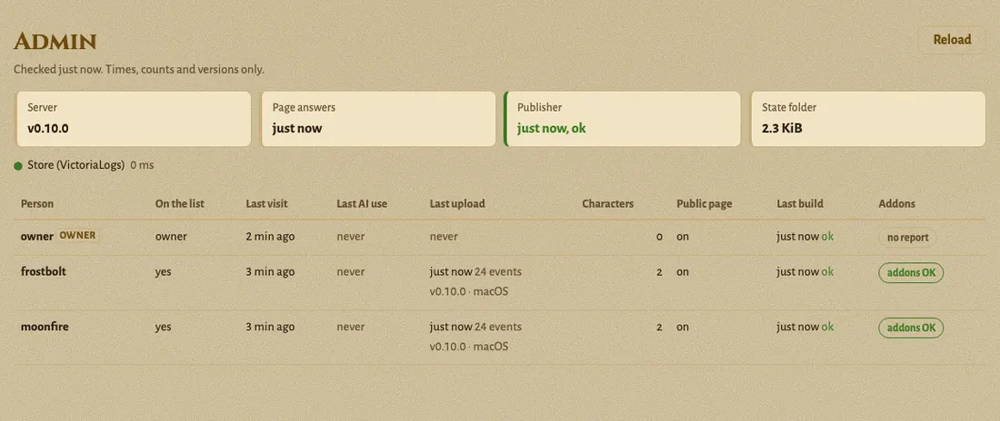

# Admin overview

**For:** the owner of a shared install (several people, `WOW_STATE_DIR`). **At the end:** you know
where the overview is, what each column means, and what it never shows.

Open `https://<your full view>/admin`, logged in as yourself. It's yours alone: anyone else gets
the same "Nothing here" page as any address that leads nowhere, so a friend can't tell it exists.
A one-person install has no overview (there's nobody else to look at).

The page is worked out when you open it, at most every 30 seconds. It doesn't refresh by itself:
press **Reload**.

## The strip at the top

| Tile | What it says |
|---|---|
| Server | the version this server runs |
| Page answers | when the full view last built its answers (it rebuilds when new data arrives) |
| Publisher | the publisher's last pass, and how many sites failed. Red when a site failed or the last pass is more than an hour old |
| Battle.net | the exporter's last good read, from vm-wow (only with `VM_URL`). Red after 6 hours |
| State folder | the size of `WOW_STATE_DIR` |

Below it, the server's own checks, green or red with the time they took: your store
(`VL_URL`), the friends' store (`FRIENDS_VL_URL`), vm-wow (`VM_URL`), the static sites
(`RENDER_FROM`) and the renderer (`RENDER_URL`). Only what the server is set up with. The
renderer and the static sites' upload port are usually out of the full view's reach: those two
come from the publisher's last pass, marked "(publisher)". Nothing here calls anything outside
your install.

## One row per person

| Column | What it says |
|---|---|
| Person | the name on the friends list (yours is marked "owner"), with a red flag when something looks stale |
| On the list | yes, no (they left the list and are being removed) or switched off (`wow-stats users disable`) |
| Last visit | the last time they opened their page (any page or answer of the full view) |
| Last AI use | the last time their AI assistant called the MCP |
| Last upload | when the shipper last sent events, how many, its version and Mac or Windows |
| Characters | how many characters they have. A number, never a name |
| Public page | whether they turned it on in Settings |
| Last build | when the publisher last built their site: "ok", or the error line |
| Addons | the shipper's setup report as one badge: "addons OK", "N missing" (of the two required addons), "Recorder off", or "no report" |

The red flags:

- **no upload for N days**: they have a character and nothing arrived for 3 days or more. Either
  they stopped playing, or their shipper stopped. Ask before you debug.
- **shipper older than the server**: their shipper's version is below the server's. The update
  line on their start page fixes it.
- **auto-update refused**: their shipper's last update check failed, with the reason: most
  often a build signed with another key or none, sometimes a server it couldn't reach. It
  keeps its version.
  [Signing your own build](upgrade.md#signing-your-own-build).

The shipper's version comes from its setup report when it sends one, otherwise from the last
install or update command they ran. A row without a version or OS is someone who installed before
this page existed: it fills in at their next update.

## What it never shows

No character name, level, zone, gold, quest or anything else from the game. No install code,
upload password, key or `sub`. The page isn't logged (the server's log keeps the path, like any
request).

The visit and AI times are one timestamp each per person, in
`users/<account>/activity.json`, written at most every 5 minutes and deleted with the person.
Friends read what you see on their privacy page.

## For scripts

`GET /api/admin/overview` answers the same thing as JSON, to the owner only. The publisher sends
its pass to the full view's share port (`POST /publisher.json`, with the share token); set
`PUBLISH_REPORT_URL` only if that isn't next to `USERS_URL`. Every path:
[HTTP endpoints](../reference/http-endpoints.md).
