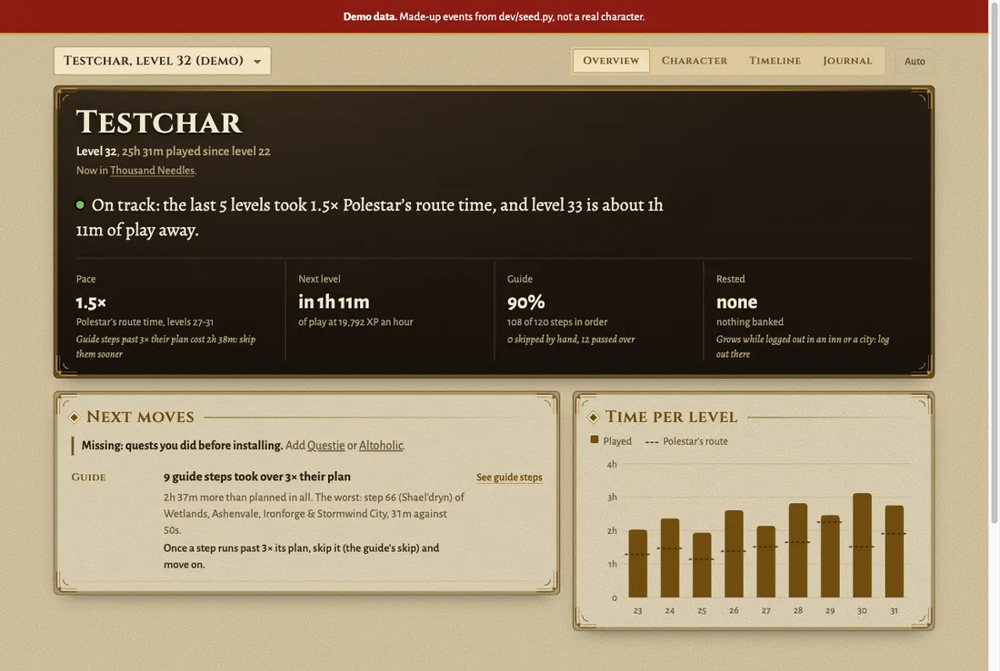

# Try the demo

**For:** anyone curious, before installing anything for real. **At the end:** wow-stats runs on
your computer with a made-up character, you've seen the page, the two sites for friends,
and (if you use Claude Code) your assistant answering from the demo data. About 10 minutes.

You need [Docker](https://docs.docker.com/get-docker/) (Docker Desktop on Mac and Windows,
started once so it says "Engine running") and a copy of this repository: `git clone` it, or
download a release's source zip and unpack it. No game, no Battle.net account, no Docker Hub
login.

## 1. Start the page

From the top of your copy (the folder with `README.md` in it):

```sh
cd deploy/compose
cp .env.example .env
```

Open `.env` in any text editor and set `INGEST_PASSWORD` to anything of 12 characters or more.
Nothing starts without it, and step 2 sends the demo's events with it, the way a player's
computer sends theirs. Set `WOW_STATS_IMAGE={{release_image}}` too: the latest release,
pinned by its digest. On a machine with no internet, or a
small one, also set `MODEL3D=off` and `WOW_ITEMS=off` (no 3D view, no item icons; the
pages still work).

Then start the page. The first time downloads the image, a few hundred MB.

```sh
docker compose pull ui
docker compose up -d ui
```

## 2. Load the demo character

The same line on Mac, Linux and Windows (PowerShell or Git Bash):

```sh
docker compose run --rm demo
```

It plays Nibbet-Gearholt's evenings, the made-up character of the
[docs site's demo](../../site/pages/demo.md), shifted so his last one was yesterday, and sends
them to the page the way a player's computer sends theirs. It prints one line,
`<N> events for Nibbet-Gearholt into http://ui:8080/ingest`, with N in the tens of thousands
(the demo grows with the product, so don't expect an exact number). What to check instead: the
page in step 3 lists Nibbet at level 46.

## 3. Look around

Open <http://127.0.0.1:8080/>: **Nibbet**, a Gnome priest who goes from level 22 to 46 over
four weeks of evenings, with eleven dungeon runs, his gear, talents and professions, Questie's
quest list and two days of auction house scans, under a DEMO DATA banner.



[Your page at a glance](../players/your-page.md) walks through each tab.

The docs site's demo is the same history. Three parts of it need what this kit doesn't run:

- **Battle.net**: the exporter and its VictoriaMetrics, with your own API client
  ([Battle.net](battlenet.md)). The Character tab says so where his talents and Legacy points
  would be;
- **the 3D view**: drawn from the game files a player's computer sends, and the demo has none
  to send. View in 3D says the shipper sends them on its next run;
- **his pictures** (the paperdoll, Back in time at each level): the picture renderer draws
  them from those same files, so a silhouette stands in.

That's what a player without them sees too.

Port 8080 already taken on your computer? `docker compose up` says `port is already
allocated`. Set `UI_PUBLISH=127.0.0.1:18080` in `.env`, run step 1's command again, and open
<http://127.0.0.1:18080/>.

## 4. See the sites for friends

The full view on 8080 is yours. Friends get static copies, rebuilt after each play session:
a public one and a sealed one. Start the two services that build and serve them:

```sh
docker compose up -d publish site
```

Give it a minute (watch `docker compose logs -f publish` until it says it built), then open
<http://127.0.0.1:8081/>: the public site, with only the parts anyone may see. The sealed site
needs its key in the link; print it with:

```sh
docker compose run --rm publish zogzog-key link
```

It prints a link like `http://127.0.0.1:8081/zogzog/#<43 characters>`. Open it: the same page
with the journal, gear advice and prices. Open it without the part after `#`, and it says
"Nothing here." [Share your page](sharing.md) explains the two sites.

## 5. Ask your assistant (Claude Code)

With [Claude Code](https://docs.anthropic.com/en/docs/claude-code) on this computer, still in
`deploy/compose`:

```sh
claude mcp add wow-stats -- docker compose -f "$PWD/compose.yaml" exec -T ui wow-stats mcp-stdio
```

Then in Claude Code: "With wow-stats, which level took Nibbet-Gearholt longest, and how long
was his Blackfathom Deeps run?" It should come back with level 32, about 9 hours, and 83
minutes in Blackfathom Deeps. Other assistants: [Connect your AI](../ai/connect.md).

## 6. Clean up

```sh
docker compose down -v
```

That removes the containers and the demo data. `claude mcp remove wow-stats` removes the
Claude Code entry.

## Next

- [Install it for real](../install.md): the server, the addons and the program on the
  computer you play on.
- [Run it on a server](production.md): a homelab box with HTTPS, a login, and friends.
