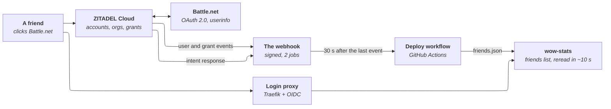

# How I run it

**For:** self-hosters who want a worked example with friends on it. **At the end:** you know
how my install lets friends sign in with their Battle.net account, and what each piece costs.

This is my own install, written down as an example. You don't need any of it: the kit runs
with basic auth, or behind any login proxy that sets the user's `sub`
([Add friends](friends.md)). The part worth copying is the sign-in: friends click
**Battle.net**, and nobody gets in until I say so.

## What runs where

| Piece | Runs on | What it does |
|---|---|---|
| wow-stats (`ui`, `publish`, `static`, the exporter) | My Kubernetes cluster at home | The pages, the MCP, the friends' sites |
| A login proxy | Traefik, with an OIDC plugin as middleware | Logs people in and sets `X-Forwarded-User` to their `sub`. The app runs with `AUTH=proxy` and trusts only Traefik's addresses |
| [ZITADEL Cloud](https://zitadel.com) | Hosted | The identity provider: my account, one org for friends, the Battle.net button |
| Battle.net | Blizzard | Proves who the friend is. Nothing else: no profile, no email |
| A small webhook | One pod, Python standard library only | Fills in what Battle.net doesn't send, and starts a redeploy when someone is approved |
| The deploy | GitHub Actions, started by a GitHub App | Renders the friends list from ZITADEL and applies it |



## Battle.net as an identity provider

I made an API client at Blizzard's developer portal, with
`https://<your-zitadel-instance>/idps/callback` as its redirect URI. In ZITADEL it's a
**generic OAuth 2.0** provider, not an OIDC one. I tried OIDC first: Battle.net publishes its
signing keys (JWKS) in standard base64 instead of base64url, ZITADEL can't parse them
("illegal base64 data at input byte 90"), and every login failed before anything else ran.
The OAuth type skips the ID token, trades the code for an access token and reads the userinfo
endpoint instead, which is all I need.

The provider, in Terraform (ZITADEL's own Terraform provider):

```hcl
resource "zitadel_idp_oauth" "battlenet" {
  name                   = "Battle.net"
  authorization_endpoint = "https://oauth.battle.net/authorize"
  token_endpoint         = "https://oauth.battle.net/token"
  user_endpoint          = "https://oauth.battle.net/userinfo"
  id_attribute           = "sub"
  client_id              = var.battlenet_client_id
  client_secret          = var.battlenet_client_secret
  scopes                 = ["openid"]
  use_pkce               = false # Battle.net's discovery lists no PKCE method

  # The first login makes an account; later ones find it by its link.
  # Never by email or username: a stranger must never land on an existing account.
  is_auto_creation    = true
  is_creation_allowed = true
  is_linking_allowed  = true
  is_auto_update      = false
  auto_linking        = "AUTO_LINKING_OPTION_UNSPECIFIED"
}
```

It's an instance-level provider, so the button shows on the login's first page. The friends
org has domain discovery on: a new account lands in the org whose domain ends its username.

## The webhook fills in the blanks

Battle.net sends a `sub` and a BattleTag (`Name#1234`), nothing else. ZITADEL's login can't
create or link an account without a username, a given name and a family name, so it would
show a "complete your registration" form where the visitor picks a username and an email.
I don't want that, so an Actions v2 **response** hook on `RetrieveIdentityProviderIntent`
rewrites ZITADEL's answer before the login reads it:

```hcl
resource "zitadel_action_target" "hook" {
  name               = "friends-hook"
  endpoint           = "https://<hook-host>/zitadel"
  target_type        = "REST_CALL"
  timeout            = "10s"
  interrupt_on_error = true # hook down: the login fails, no half-made account
  payload_type       = "PAYLOAD_TYPE_JSON"
}

resource "zitadel_action_execution_response" "battlenet_intent" {
  method     = "/zitadel.user.v2.UserService/RetrieveIdentityProviderIntent"
  target_ids = [zitadel_action_target.hook.id]
}
```

The hook's logic, cut down (the real one also checks the signature and handles ZITADEL's two
answer shapes):

```python
def username(battletag, domain):
    name, _, digits = battletag.partition("#")
    local = re.sub(r"[^a-z0-9]", "", ascii_lower(name))
    return f"{local}-{digits}@friends.{domain}"  # the suffix picks the friends org

def fill(resp, domain):
    info = resp["idpInformation"]
    tag, sub = info["rawInformation"]["RawInfo"]["battletag"], info["userId"]
    if resp.get("userId"):  # already linked: a normal login, change nothing
        return resp
    resp["addHumanUser"] = {
        "username": username(tag, domain),
        "profile": {"givenName": tag.partition("#")[0], "familyName": "Battle.net", "displayName": tag},
        # .invalid never resolves, and "verified" means ZITADEL never sends a code
        "email": {"email": f"{sub}@battlenet.invalid", "isVerified": True},
        "idpLinks": [{"idpId": info["idpId"], "userId": sub, "userName": tag}],
    }
    return resp
```

Every call carries ZITADEL's `ZITADEL-Signature` header (an HMAC-SHA256 of the timestamp and
the body, with the target's signing key). Anything unsigned or older than 5 minutes gets a
401. It logs the kind of request and the result, never a token, a claim or a BattleTag.

## Pending until I approve

Anyone with a Battle.net account can click the button. That makes an account in the friends
org with no role. On every other site of mine ZITADEL refuses it (the project's
role check), and on wow-stats the app's own lock does. For wow-stats only, I turned the role
check off, so a new friend reaches the app and gets its **No access yet** page ("You're signed
in, but the person who runs this site hasn't let you in yet") instead of a generic login
error. The app lets in my own
`sub` and the ones on its friends list, nobody else.

To approve someone, in the ZITADEL console:

1. Set their username to the name their page will have (2 to 20 lowercase letters and
   digits). The app never renames a page once it exists, so this comes first.
2. Add the metadata `access` = `friends`.
3. Apply my ZITADEL Terraform: it turns that metadata into a grant on the wow-stats project.

They keep their session. Once the list catches up, a reload of the "No access yet" page takes
them to their page.

## Approval to friends list, without me running anything

The same webhook also gets ZITADEL's **events**: a user added, renamed, deactivated,
reactivated, removed, locked or unlocked, and any grant change.

```hcl
resource "zitadel_action_execution_event" "users" {
  for_each   = toset(["user.human.added", "user.username.changed", "user.deactivated",
                      "user.reactivated", "user.removed", "user.locked", "user.unlocked"])
  event      = each.value
  target_ids = [zitadel_action_target.hook.id]
}

resource "zitadel_action_execution_event" "grants" {
  group      = "user.grant"
  target_ids = [zitadel_action_target.hook.id]
}
```

It keeps the friends org's events only and waits for things to calm down: 30 seconds after the
last one, it asks GitHub (through a GitHub App, with a one-hour token limited to starting
workflows on one repository) to run the deploy of the wow-stats module. The workflow and its
input are fixed in the hook; nothing in a request chooses them. The deploy reads the users
holding the role and writes `friends.json` (ZITADEL user id to page name) into a ConfigMap.

The app rereads the list within about 10 seconds of the file changing, without a restart
([The friends list](friends.md#the-friends-list)). Kubernetes takes about a minute to update a
mounted ConfigMap, so from my click to their page it's 2 to 3 minutes.

Switching someone off is a deactivation in the console: ZITADEL refuses the login, their data
stays. Removing the `access` metadata, or the user, takes them off the list, and wow-stats
deletes their data on the spot.

## Linking an account that already exists

My own account has a passkey. I wanted Battle.net on the same account (same user id, so the
same `sub` everywhere), not a second one. A Battle.net identity can be linked to one account
only, and the first click already linked it to a new pending account. So a small script moves
the link, through ZITADEL's v2 user API:

1. Check the pending account is exactly what a Battle.net click makes (friends org, the
   `.invalid` email, the Battle.net link as its only way in, no grant, no metadata) and the
   existing one has no Battle.net link yet.
2. `DELETE /v2/users/<pending>/links/<idp>/<battlenet-sub>`.
3. `POST /v2/users/<existing>/links` with the same link (put back on the pending one if this
   fails).
4. `DELETE /v2/users/<pending>`. That's a `user.removed` event, so the next deploy drops it
   from the pending list.

From then on the passkey and Battle.net both sign in to the same account. It runs as a dry run
by default and prints ids and states only.

## What it costs

- **A second factor for me.** My org forces MFA, Battle.net or not, so after Battle.net I
  still type a TOTP code. A passkey login stays one step. Friends' MFA is optional ("it's for
  my friends, it's fine").
- **A webhook to keep alive.** When it's down, every Battle.net login fails with a ZITADEL
  error, on purpose (`interrupt_on_error`). Passwords and passkeys don't go through it.
  Approvals wait until it's back, or until I run the deploy by hand.
- **Strangers can make pending accounts.** Neither ZITADEL's login settings nor the provider
  have a sign-up cap for an IdP. They get no data, no site and no MCP, and I delete them from
  the console. If it ever gets noisy, `is_auto_creation = false` keeps Battle.net for
  accounts that are already linked.
- **Almost nothing from Battle.net is kept.** The BattleTag is the account's display name in
  ZITADEL, the email is the `.invalid` placeholder, and profiles never update
  (`is_auto_update = false`). wow-stats keys everything on the `sub`, and the page name is the one I picked.

What a friend's data looks like from my side, and what they can delete:
[What's shared, and with whom](../players/privacy.md).
