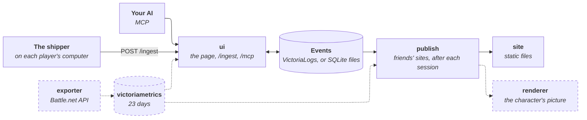

# The host guide

**For:** anyone running wow-stats for themselves, or for themselves and a few friends. **At the
end:** you know what you're signing up for, the three choices to make before your first
event, and the page for each step, in order.

wow-stats is one Docker Compose kit on one machine: a small Linux VM or a box at home. It takes
the events the players' shippers send, keeps them, and works out the pages, the friends' sites
and the answers for everyone's AI from them. You run it; your players trust you with their game
history and with the installer your server hands them.

It's a hobby project: GPL-3.0, no warranty, no support promise, and security fixes land when I
can make them. These pages describe version {{app_version}}.

The kit, with what's optional dashed:

## What you need

- **Docker** with Compose v2, on Linux, a Mac or Windows.
- **A machine that stays on.** 2 vCPU and 2 GiB of RAM is a fine start for one player
  ([Sizing](sizing.md) has the measured numbers).
- **For anything beyond your own computer**: a domain name and a reverse proxy with HTTPS.
  claude.ai and ChatGPT reach your server from theirs, so the AI login needs a public HTTPS
  address too.
- **Optional**: your own Battle.net API client (the WoW Token, your look in 3D), and an AI
  provider's key if you want the server to write "How you play" on your budget.

## Try it first

[The quick start](../quickstart.md) runs the demo character on your computer and gets a first
answer from your AI in about 10 minutes. [Try the demo](demo.md) is the same, step by step,
with the sites for friends.

## Three choices before your first event

**Where your events live.** VictoriaLogs (the default, what I run) or one SQLite file per
person (one container fewer, nothing to size, no archive of older days). They don't convert:
pick before the first event arrives. [Where your events live](../install.md#where-your-events-live).

**Who logs in.** Just you: a password on the page (`UI_AUTH=basic`) is enough. Friends with
their own pages: a login proxy in front and an identity provider (any OIDC one) for them and
their AI. [Add friends](friends.md), [The login for your AI](oidc.md).

**What you share.** The compose kit builds two static copies of your page after each play
session: a public one for anyone with the address, and a sealed one for friends that only
opens with the key in its link. With friends on the install, each person's public page stays
off until they switch it on. [Share your page](sharing.md).

## Set it up, in this order

| Step | Why | Page |
|---|---|---|
| 1. Install it | The server, the addons and the shipper, for yourself | [Install it for real](../install.md) |
| 2. HTTPS and two host names | Friends reach the static sites, you reach your page and the shipper reaches `/ingest` from anywhere, encrypted | [Put it behind a reverse proxy](reverse-proxy.md) |
| 3. A login for your page | The full view shows everything, other players included | [Put it behind a reverse proxy](reverse-proxy.md) |
| 4. Share your page | A public site for anyone, a sealed one for friends with the link | [Share your page](sharing.md) |
| 5. Your AI from anywhere | claude.ai and ChatGPT call your server from theirs: they need HTTPS and an OAuth login | [Set up the login for your AI](oidc.md) |
| 6. Friends with their own pages | Several players, each with their own data, link and AI | [Add friends](friends.md) |
| 7. Battle.net data (optional) | The WoW Token, your look in 3D, what the addons didn't send | [Battle.net data](battlenet.md) |
| 8. Server-side analysis (optional) | Friends who never ask their own AI still get "How you play", on your AI provider and budget | [Server-side analysis](server-analysis.md) |

My own install, friends signing in with Battle.net, as a worked example:
[How I run it](how-i-run-it.md). Without Docker Compose (Kubernetes, Nomad, plain
containers), the same image runs every part: [Deploy without compose](../deploy.md).

## What's locked down for you

- Every published port binds `127.0.0.1`, and the server refuses to start open: a page
  reachable from elsewhere needs a login, and it answers only for the names you list.
- The public view and the full view are separate processes, and the public answers are cut to
  an allow list on the server.
- The friends' site is encrypted, and its key sits after the `#` in the link, which browsers
  never send to a server.
- Each person's events live apart (their own VictoriaLogs tenant or SQLite file), behind their
  own upload password and their own key.
- Battle.net data lives in its own store with 23 days of retention: Blizzard's terms allow 30
  at most.

What's on you, and the findings left open on purpose: [Harden it](hardening.md),
[Security notes](../security.md).

## Keep it running

- [When it stops](troubleshooting.md): error messages and their fixes.
- [Back up and restore](backup.md): the events, the state, `.env` and `secrets/`.
- [Upgrade](upgrade.md): between versions, and what each release changed.
- [Monitor it](monitoring.md): health checks, logs, disk.
- [Admin overview](admin.md): who uses the install, when, and whether its parts answer.
- [Uninstall](uninstall.md): the server, the player's computer, and the data, separately.

## Look it up

[Environment variables](../reference/environment.md),
[HTTP endpoints](../reference/http-endpoints.md), [Sizing](sizing.md),
[The shipper](../shipper.md), [The shipper's events](../contract.md),
[Architecture](../architecture.md).
