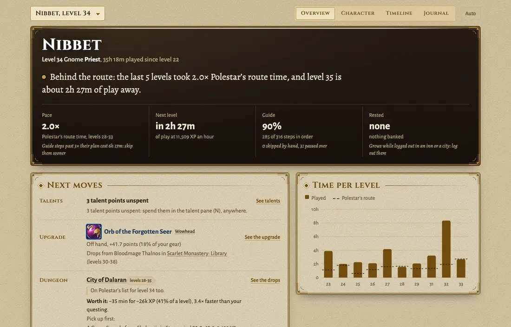
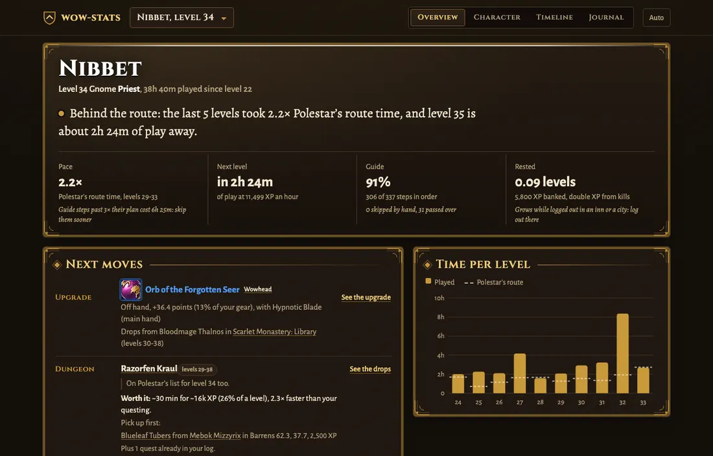

# wow-stats

<figure class="shot">

<figcaption>The Overview of Nibbet, a made-up priest. <a href="@BASE@demo/">Open his pages</a>.</figcaption>
</figure>

## Pick your path

<a class="path" href="../../docs/players/getting-started.md">
Play
<strong>A friend runs a server</strong>
They sent you a link. Add Polestar, run one command, play. About 15 minutes, no admin rights.
Join a friend's server
</a>
<a class="path" href="../../docs/ai/connect.md">
Connect your AI
<strong>Ask about your character</strong>
Claude, ChatGPT and a dozen other assistants can read your data and plan your next two hours.
Connect your AI
</a>
<a class="path" href="../../docs/self-host/demo.md">
Self-host
<strong>Run it yourself</strong>
One Docker Compose file on a small box at home, for you and your friends. Try it with made-up characters first.
Try it at home
</a>

## What's on your page

- **Your pace**: your time per level against [Polestar](https://github.com/fitzforge/polestar)'s route, and the hours of play to the next level. [Overview and next moves](../../docs/players/overview.md)
- **Your next upgrade**: the best item per slot, the points it adds and where it drops, auction house included. [Gear and upgrades](../../docs/players/gear.md)
- **The dungeon worth running**: XP against your questing pace, the quests to pick up first, the drops you'd wear. [Dungeons](../../docs/players/dungeons.md)
- **A plan for tonight**: 1 to 6 hours of guide steps, checkpoints and where to log out. [Plan your next hours](../../docs/players/plan.md)
- **Your history**: every level, one journal entry per evening, your look at each level in 3D. [Climb, timeline, journal](../../docs/players/history.md)

## What it doesn't do

- **Touch the game.** It reads the files WoW and your addons already save, after they save
  them. No addon of its own, no memory reading.
- **Send your data anywhere.** It goes from your computer to the server you (or a friend)
  run, and nowhere else. Friends see what you choose to share. [What's shared](../../docs/players/privacy.md)
- **Run an AI on the server.** Your own assistant does the thinking, in your own account.

How the pieces fit: [How it works](../../docs/explanation/how-it-works.md). Questions:
[Questions and answers](../../docs/faq.md).

Free software under the GPL-3.0. The route times and gear scoring come from
<a href="https://github.com/fitzforge/polestar">Polestar</a> and its contributors; other credits in
<a href="../../THIRD_PARTY.md">THIRD_PARTY.md</a>. World of Warcraft is a trademark of Blizzard
Entertainment; this project isn't affiliated with Blizzard.

