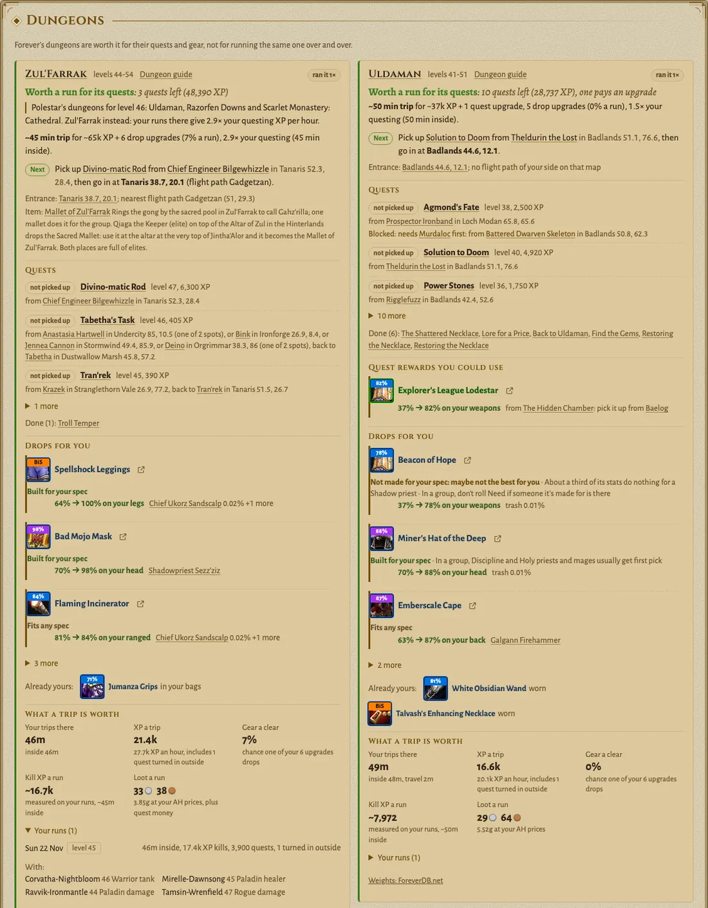

# wow-stats

## Pick your path

<a class="path" href="../../docs/players/getting-started.md">
Play
<strong>A friend runs a server</strong>
They sent you a link. Add Polestar, run one command, play. About 5 minutes, no admin rights.
Join a friend's server
</a>
<a class="path" href="../../docs/ai/connect.md">
Connect your AI
<strong>Ask about your character</strong>
Claude, ChatGPT or any MCP client reads your data and plans your next session. Nothing to install.
Connect your AI
</a>
<a class="path" href="../../docs/self-host/production.md">
Host it
<strong>Run it yourself</strong>
One Docker Compose file on a small box at home, for you and your friends. Try it with a made-up character in 10 minutes first.
The host guide
</a>

## What's on your page

Before you log in

<h3>What to do with the next hour</h3>

The Overview puts your pace against <a href="https://github.com/fitzforge/polestar">Polestar</a>'s route (2.0× is twice the route's time) and the hours of play to your next level. Under that, up to three next moves: the upgrade and who drops it, the dungeon worth a run with the quests to grab first, the talent points you forgot to spend.

<a href="../../docs/players/overview.md">Overview and next moves →</a>

Gear

<h3>Every slot, its next upgrade, and where it drops</h3>

The best item you can wear now and within 3 levels, what it does to the slot ("70% → 91% on your chest": its share of the best item for that slot, before and after), and where to get it: a boss, a quest, or the auction house at yesterday's price. If it's already in your bags, the page tells you to equip it. Scores use <a href="https://foreverdb.net">ForeverDB.net</a>'s weights, for levelling by default, PvP or PvE if you pick it.

<a href="../../docs/players/gear.md">Gear and upgrades →</a>

Dungeons

<h3>The dungeon worth running</h3>

Each dungeon around your level gets a card: the quests to pick up before you go in, the drops you'd actually wear, and the XP of a run against your own questing, with the time for the pickups and hand-ins counted in (<a href="../../docs/players/dungeons.md">how a trip is counted</a>).

<a href="../../docs/players/dungeons.md">Dungeons →</a>

Also on your page: **a plan for tonight**, 1 to 6 hours of guide steps with checkpoints and
where to log out ([Plan your next hours](../../docs/players/plan.md)), and **your history**:
every level, one journal entry per session, your look at each level
([Climb, timeline, journal](../../docs/players/history.md)).

What you need

### To play on a friend's server

- WoW Forever on Windows 10/11 or a Mac, logged in once.
- [Polestar](https://github.com/fitzforge/polestar) and Syndicator, from the CurseForge app.
- One command from your start page. No admin rights.

### To run your own

- Docker, and a box that stays on: 2 vCPU and 2 GiB of RAM for one player.
- About 10 minutes to [try it with made-up characters](../../docs/self-host/demo.md) first.

What it doesn't do

### Your data stays yours

- **No touching the game.** It reads the files WoW and your addons already save, after they
  save them. No addon of its own, no memory reading.
- **No sending your data elsewhere.** It goes from your computer to the server you (or a
  friend) run, and nowhere else unless that server's host turns on the analysis below. Friends
  see what you choose to share.
- **No model behind the numbers.** The page and the MCP tools work them out in code from your
  data; your own AI reads them and writes the reply, in your own account. A host can also have
  the server analyse your play with an AI provider they pick, once a character has {{analysis_hours}} hours of play since
  its last refresh (their setting). Off until they set it up; the app's Privacy page says
  whether it's on.

[What's shared →](../../docs/players/privacy.md)

How the pieces fit: [How it works](../../docs/explanation/how-it-works.md). Questions:
[Questions and answers](../../docs/faq.md). The words these pages use: [Glossary](../../docs/glossary.md).
Why a levelling log grew an MCP server and signed releases in six days:
[How this was built](../../docs/how-this-was-built.md).

Free software under the GPL-3.0. The route times come from
<a href="https://github.com/fitzforge/polestar">Polestar</a> and its contributors, the gear weights
and where gear comes from from <a href="https://foreverdb.net">ForeverDB.net</a>; other credits in
<a href="../../THIRD_PARTY.md">THIRD_PARTY.md</a>. World of Warcraft is a trademark of Blizzard
Entertainment; this project isn't affiliated with Blizzard.

